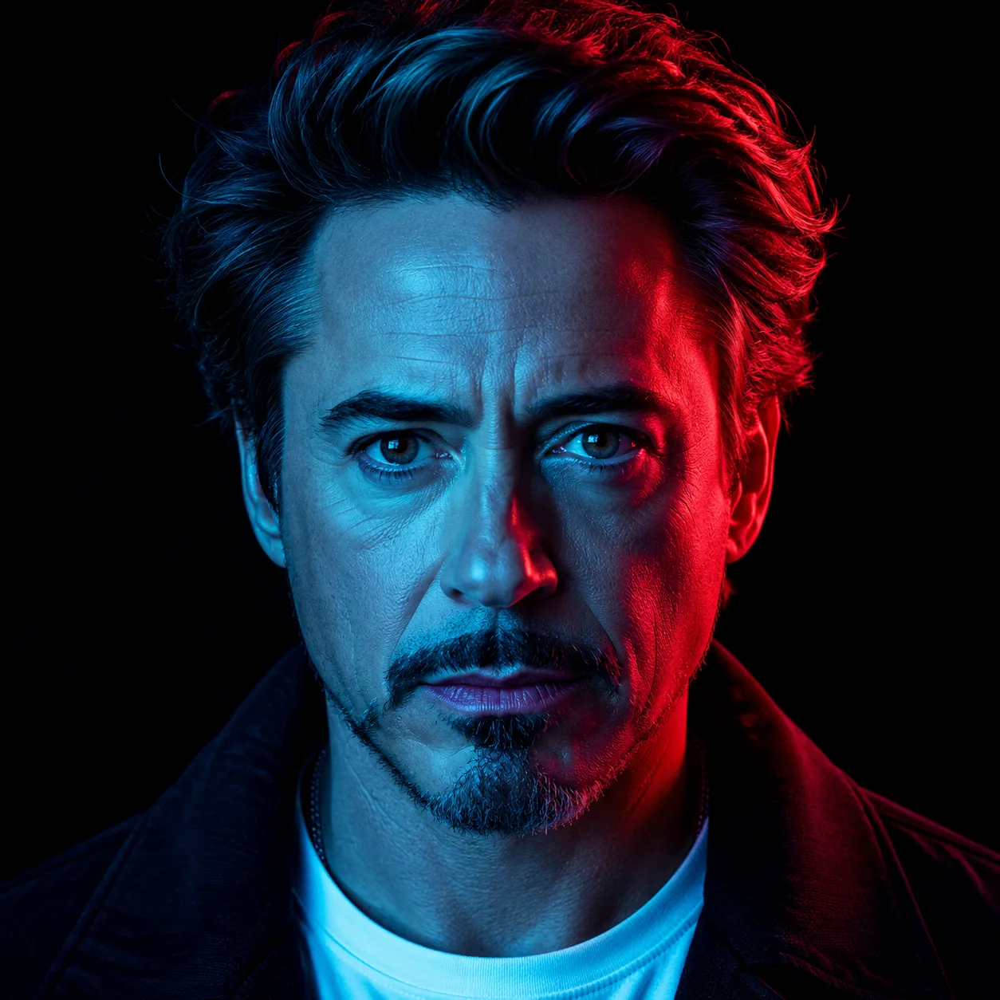

# Realistic, Portrait

[← Back to the collection](../../README.md) · Category: [Poster Design](../../gallery/poster-design.md) · Model: `Vinano Studio` · ID: `vn-01815`

<a href="https://vinano.ai?utm_source=github&utm_medium=readme&utm_campaign=awesome-image-video-prompts-updating&utm_content=prompt-page-image"></a>

<sub>Preview generated with <a href="https://vinano.ai?utm_source=github&utm_medium=readme&utm_campaign=awesome-image-video-prompts-updating&utm_content=prompt-page-caption">vinano.ai</a></sub>

## Prompt

```text
{
"image_type": "studio portrait",
"composition": {
"framing": "tight head-and-shoulders close-up",
"camera_angle": "eye-level",
"orientation": "vertical",
"symmetry": "near-perfect central symmetry",
"focus": "sharp focus on eyes and facial features",
"depth_of_field": "shallow, background fully blurred to black"
},
"subject": {
"description": "middle-aged male-presenting subject",
"pose": "frontal, facing camera directly",
"expression": "calm, confident, intense gaze",
"eye_direction": "looking straight into lens",
"facial_features": {
"facial_hair": "short salt-and-pepper stubble and trimmed goatee",
"skin_texture": "visible pores and fine lines, realistic skin detail",
"eyes": "light-colored eyes emphasized by catchlights"
},
"hair": {
"style": "medium-length, brushed back",
"texture": "natural, slightly tousled",
"color": "dark brown subtle gray highlights"
}
},
"wardrobe": {
"top": "white crew-neck t-shirt",
"outerwear": "dark jacket or coat soft texture",
"accessories": "thin chain necklace partially visible"
},
"lighting": {
"style": "cinematic, high-contrast neon lighting",
"key_light": {
"position": "front-left",
"color": "cool cyan/blue",
"effect": "dominant illumination across face and torso"
},
"rim_light": {
"position": "rear-right",
"color": "saturated red/magenta",
"effect": "strong edge highlight on hair and face contour"
},
"fill_light": "minimal to none",
"contrast_level": "high",
"mood": "dramatic, futuristic, intense"
},
"color_palette": {
"dominant_colors": ["cyan blue", "deep red", "black"],
"color_temperature": "mixed cool and warm neon tones",
"saturation": "high saturation on lighting, neutral clothing tones",
"color_grading": "stylized cyberpunk-inspired grading"
},
"background": {
"environment": "studio",
"details": "pure black background no visible texture or objects",
"separation": "strong subject-background separation rim lighting"
},
"technical_details": {
"camera_style": "professional studio photography",
"lens_effect": "slight compression typical of portrait lens",
"estimated_focal_length": "85mm equivalent",
"image_sharpness": "high",
"noise": "minimal",
"dynamic_range": "controlled highlights deep shadows"
},
"artistic_style": {
"genre": "cinematic portrait",
"influences": ["cyberpunk", "neo-noir", "editorial fashion"],
"visual_aesthetic": "bold, modern, high-impact",
"post_processing": {
"skin_retouching": "subtle, realistic",
"color_enhancement": "strong split-toning blue/red",
"clarity": "enhanced micro-contrast"
}
},
"overall_impression": {
"tone": "powerful and enigmatic",
"intended_use": "editorial, album cover, cinematic poster, AI style reference",
"style_recreation_keywords": ["cinematic neon portrait",
"blue and red split lighting",
"black background",
"intense direct gaze",
"cyberpunk color grading",
"high-contrast studio lighting"]
}
}

Keep edges clean and the overall composition balanced for a polished, gallery-ready result.
```

## Try it on vinano.ai

1. Copy the prompt above.
2. Open **[vinano.ai](https://vinano.ai?utm_source=github&utm_medium=readme&utm_campaign=awesome-image-video-prompts-updating&utm_content=prompt-page-try)**, paste it into the image generator and pick a model.
3. Swap any placeholders (brand, product, city, person…) for your own details, then generate.

More prompts like this: [Poster Design gallery](../../gallery/poster-design.md) · [all categories](../../README.md#contents)
