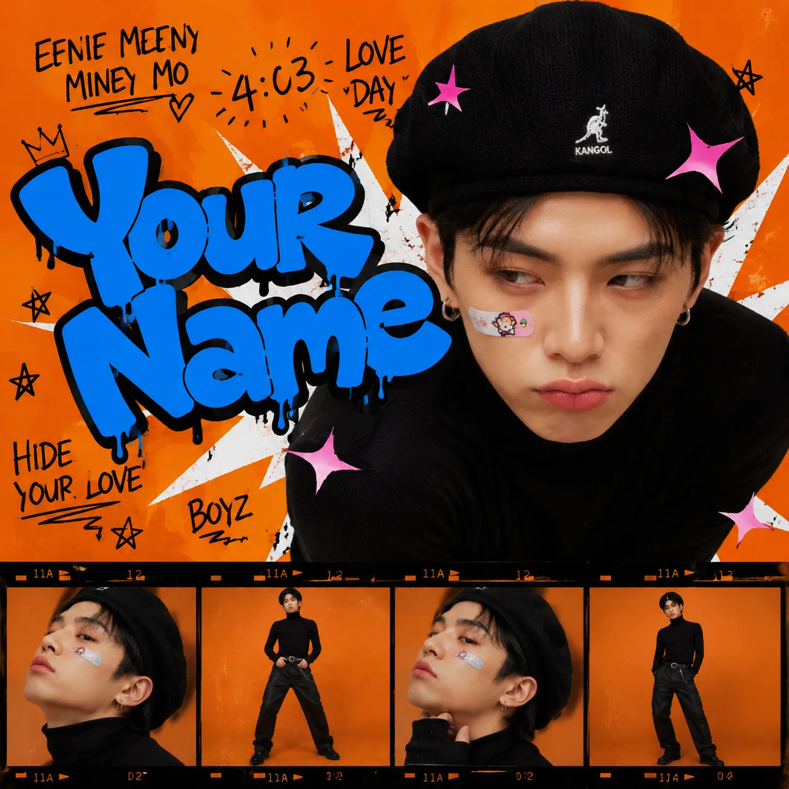

# Portrait, Poster

[← Back to the collection](../../README.md) · Category: [Poster Design](../../gallery/poster-design.md) · Model: `Vinano Studio` · ID: `vn-01826`

<a href="https://vinano.ai?utm_source=github&utm_medium=readme&utm_campaign=awesome-image-video-prompts-updating&utm_content=prompt-page-image"></a>

<sub>Preview generated with <a href="https://vinano.ai?utm_source=github&utm_medium=readme&utm_campaign=awesome-image-video-prompts-updating&utm_content=prompt-page-caption">vinano.ai</a></sub>

## Prompt

```text
Create a bold Y2K pop-street editorial collage featuring a young person as the central subject, combining playful graffiti typography, orange poster background, sticker-like graphic elements, and fashion magazine layout energy.

MAIN SUBJECT AND FRAMING:
Place the young person on the right side of the composition in a close-up to upper-body portrait. The face should be large and dominant, cropped from the chest upward, the subject slightly leaning forward into the frame. The composition should feel asymmetrical, graphic typography filling the left side and the subject anchoring the right side.

Do not control or describe the hairstyle.

OUTFIT DETAIL:
Style the subject in a minimal black streetwear outfit. They wear a black turtleneck or high-neck top a soft fitted silhouette, creating a clean dark shape against the bright orange background. Add a black beret or rounded cap a small embroidered logo detail on the front, giving the look a stylish retro street-fashion feeling.

Add a small colorful cheek sticker or decorative bandage on one cheek, cute tiny graphic details, making the styling feel playful and idol-like. Keep the outfit mostly black so the blue graffiti typography and orange background stand out strongly.

BEHAVIOUR AND BODY LANGUAGE:
The subject’s body language should feel calm, closed-off, and slightly moody. The shoulders are relaxed but slightly rounded forward, creating a soft guarded posture. The head tilts subtly downward and to the side, giving the portrait a cool detached attitude.

The subject does not need a big hand gesture in the main portrait; instead, the behaviour comes from the face angle, lowered posture, and intense sideways eye movement. The pose should feel like someone caught in a quiet bratty moment, not fully engaging the viewer.

FACIAL EXPRESSION:
The expression is pouty, serious, and mildly irritated in a fashionable way. The lips are softly pushed forward into a small pout, brows slightly tense, and the eyes look sideways a suspicious or unimpressed gaze. The mood should feel bratty, stylish, aloof, and quietly rebellious.

GRAPHIC BACKGROUND:
Use a saturated orange background a large white starburst shape behind the subject’s head and shoulders. The starburst should create strong comic-book energy and make the face pop.

Add hand-drawn black scribble text across the orange background, like messy diary writing or lyric notes. Include phrases such as:
“EENIE MEENY MINEY MO”
“4:03”
“LOVE DAY”
“HIDE YOUR LOVE”
“BOYZ”
The handwriting should look playful, imperfect, thin, and chaotic, but still visually controlled.

MAIN TYPOGRAPHY:
Place a large blue graffiti-style word “Your Name” across the left-center area. The letters should be chunky, rounded, irregular, and outlined in thick black, like a playful bubble graffiti tag. The typography should overlap slightly the subject’s face area without blocking the eyes.

Add pink star sparkle stickers around the face and cap area, giving a cute pop-idol accent.

BOTTOM FILMSTRIP:
At the bottom of the composition, add a horizontal filmstrip four rectangular photo panels. These panels show smaller full-body and close-up poses of the same young person wearing the same black outfit.

Panel pose ideas:
1. Side close-up portrait head tilted back slightly, cheek sticker visible, eyes looking away.

2. Full-body stance legs apart, hands near pockets or belt area, posture confident and relaxed.

3. Repeated close-up side portrait for rhythmic collage effect.

4. Repeated full-body stance, slightly different angle or crop.

The filmstrip should feel like a fashion contact sheet or idol editorial preview.

MOOD AND STYLE:
The overall mood should be playful, bratty, nostalgic, and street-fashion inspired. It should feel like a Y2K teen magazine layout mixed graffiti poster design, idol concept styling, and scrapbook-like pop graphics.

Emphasise material texture and natural light so the final frame feels tactile and premium.
```

## Try it on vinano.ai

1. Copy the prompt above.
2. Open **[vinano.ai](https://vinano.ai?utm_source=github&utm_medium=readme&utm_campaign=awesome-image-video-prompts-updating&utm_content=prompt-page-try)**, paste it into the image generator and pick a model.
3. Swap any placeholders (brand, product, city, person…) for your own details, then generate.

More prompts like this: [Poster Design gallery](../../gallery/poster-design.md) · [all categories](../../README.md#contents)
