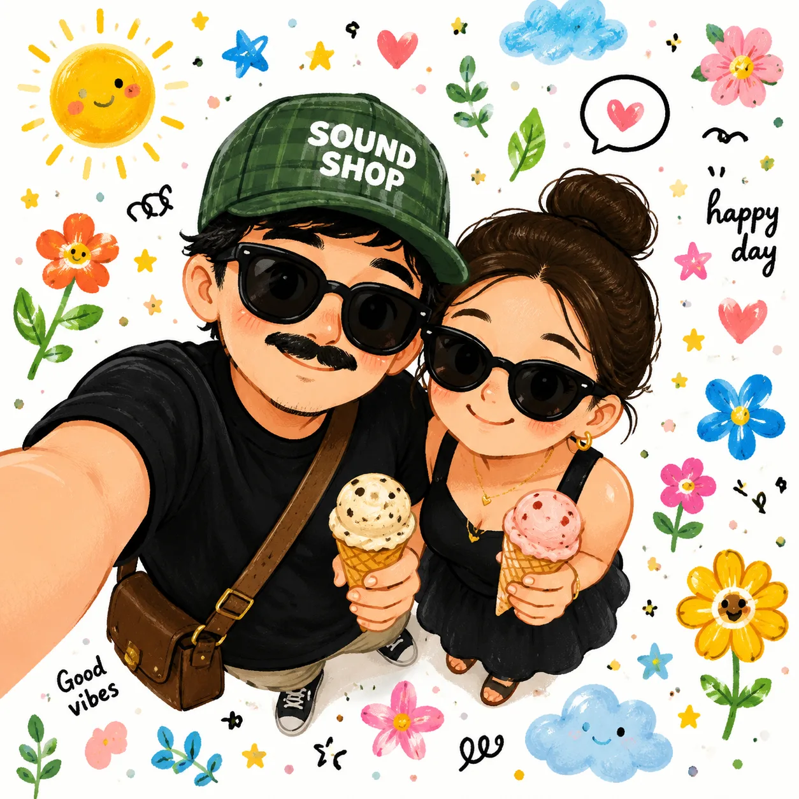

# Poster, Character

[← Back to the collection](../../README.md) · Category: [Poster Design](../../gallery/poster-design.md) · Model: `Vinano Studio` · ID: `vn-01830`

<a href="https://vinano.ai?utm_source=github&utm_medium=readme&utm_campaign=awesome-image-video-prompts-updating&utm_content=prompt-page-image"></a>

<sub>Preview generated with <a href="https://vinano.ai?utm_source=github&utm_medium=readme&utm_campaign=awesome-image-video-prompts-updating&utm_content=prompt-page-caption">vinano.ai</a></sub>

## Prompt

```text
Turn this real-life selfie into a playful hand-drawn cartoon illustration, cute doodle art style, top-down selfie perspective, stylish couple wearing black outfits and sunglasses, man mustache, green plaid cap bold white text, brown crossbody bag, woman hair bun, holding ice cream cones, cheerful and cozy summer vibe.

Bright white background filled colorful doodles: smiling sun, flowers, hearts, stars, leaves, squiggles, clouds, tiny dots, playful hand-drawn decorations surrounding the characters. Soft pastel palette vibrant accents, children's book illustration style, sticker art aesthetic, whimsical and charming.

Flat vector illustration, clean bold outlines, simplified facial features, rosy cheeks, expressive cartoon eyes, textured brush strokes, vibrant colors, high detail, cute lifestyle artwork, Instagram-friendly illustration, cozy relationship aesthetic, modern doodle poster, joyful mood.

Composition:
- Overhead selfie angle
- Couple centered
- Ice cream cones visible
- Green cap and black sunglasses preserved
- Decorative doodles evenly filling the background
- Clean white canvas

Style references:
cute doodle illustration, Scandinavian children's book art, whimsical sticker design, colorful hand-painted cartoon, playful digital illustration, kawaii aesthetic, modern lifestyle artwork, trending social media illustration.

Maintain consistent colour harmony and crisp focus across the whole frame.
```

## Try it on vinano.ai

1. Copy the prompt above.
2. Open **[vinano.ai](https://vinano.ai?utm_source=github&utm_medium=readme&utm_campaign=awesome-image-video-prompts-updating&utm_content=prompt-page-try)**, paste it into the image generator and pick a model.
3. Swap any placeholders (brand, product, city, person…) for your own details, then generate.

More prompts like this: [Poster Design gallery](../../gallery/poster-design.md) · [all categories](../../README.md#contents)
