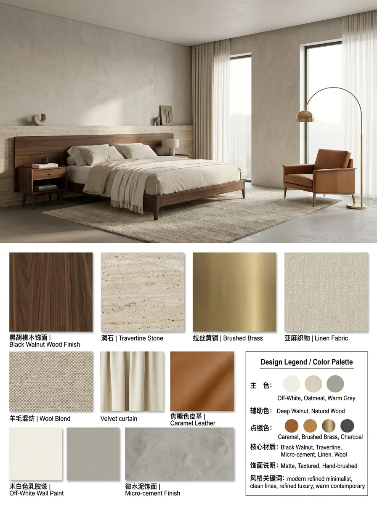

# Minimalist, Ai Art

[← Back to the collection](../../README.md) · Category: [Poster Design](../../gallery/poster-design.md) · Model: `Vinano Image Pro` · ID: `vn-01837`

<a href="https://vinano.ai?utm_source=github&utm_medium=readme&utm_campaign=awesome-image-video-prompts-updating&utm_content=prompt-page-image"></a>

<sub>Preview generated with <a href="https://vinano.ai?utm_source=github&utm_medium=readme&utm_campaign=awesome-image-video-prompts-updating&utm_content=prompt-page-caption">vinano.ai</a></sub>

## Prompt

```text
你是一名专业的室内设计 Mood Board 创作者。请基于用户提供的 [Space Type] 室内设计照片，生成一张 竖版 3:4 的高端室内设计情绪板。整体视觉参考专业室内设计提案图，呈现 [Style Keywords] 的审美特征，画面应具备 [Mood Keywords] 的空间氛围，并符合 [Branding Tone] 的高级设计表达。
场景类型（Space Type）：[Space Type]
画面布局要求
上半部分：呈现一张高分辨率、照片级真实感的 [Space Type] 室内设计效果图。

该效果图需要在空间结构、家具语言、材质关系、色彩搭配、光影氛围上与用户输入照片保持一致，同时提升为更完整、更精致、更具设计提案感的视觉呈现。

重点体现：[Key Furniture Elements]、[Material Keywords]、[Color Palette]、[Lighting Style]。
下半部分：展示与上方空间设计严格对应的材质与软装样本，包括：
材料样板
面料样本
色卡
饰面样本
与该空间相关的木材、石材、金属、玻璃、织物、皮革或涂料样本

所有样本必须与上方空间保持一致，并准确反映该设计方案中的核心材质与色彩逻辑。
右下角：设置一个 Design Legend / Color Palette 信息框，统一展示本方案的：
主色
辅助色
点缀色
核心材质
饰面说明
风格关键词
风格与输出要求
专业室内设计公司级别的 Mood Board 版式
极简、整洁、克制、有秩序的排版
明确的视觉层级与留白控制
材质、色彩、面料、饰面与上方空间完全匹配
标签清晰、现代、简洁，具有高级编辑设计感
整体气质需符合 [Style Keywords]
呈现 [Render Quality]
竖版 3:4 构图
4K Ultra HD
超高细节
写实渲染
直接用于图像生成
标签要求
每个材质或色彩样本配有清晰标签，标签内容围绕以下信息组织：

[Label Language] 的材质名称、颜色名称、饰面名称或织物类型。

标签风格应简洁、专业、排版规整，不喧宾夺主。
主题定义
[Space Type] Interior Design Mood Board

风格方向：[Style Name]

关键词：[Style Keywords], [Material Keywords], [Color Palette], [Mood Keywords]
负面约束
避免杂乱拼贴、避免廉价海报风、避免材质与空间不匹配、避免错误透视、避免低质字体、避免装饰元素过多、避免卡通感、避免过饱和色彩、避免信息层级混乱、避免伪随机材质堆砌。

空间类型：卧室
风格名称：现代中古

变量当成可替换字段：
[Space Type]：空间类型
例如：客厅、卧室、餐厅、厨房、书房、玄关、浴室、会客区、酒店大堂
[Style Name]：风格名称

例如：现代极简、意式极简、侘寂、奶油风、轻法式、现代中古、北欧自然、深色豪宅、日式原木、当代奢雅
[Style Keywords]：风格关键词

例如：modern refined minimalist, clean lines, refined luxury, warm contemporary
[Mood Keywords]：氛围关键词

例如：温暖宁静、克制高级、通透自然、沉稳静奢、明亮柔和
[Branding Tone]：品牌化视觉语气

例如：高端设计事务所提案感、国际家居品牌视觉、编辑型画册审美、奢华但克制
[Key Furniture Elements]：重点家具/造型元素

例如：低矮沙发、弧形单椅、岩板茶几、悬浮电视柜、落地灯、艺术摆件
[Material Keywords]：关键材质

例如：白蜡木、胡桃木、洞石、亚麻、羊毛、拉丝金属、微水泥、皮革、玻璃
[Color Palette]：配色方案

例如：米白、暖灰、燕麦色、焦糖棕、炭灰、鼠尾草绿、黑胡桃色
[Lighting Style]：光线风格

例如：自然漫射光、晨间柔光、傍晚暖光、均匀展厅光、低照度氛围光
[Label Language]：标签语言

例如：英文、中英双语、纯中文
[Render Quality]：渲染质量描述

例如：照片级真实感、high-end editorial rendering、luxury interior visualization

保持真实比例与空间层次，呈现专业、稳重的最终效果。
```

## Try it on vinano.ai

1. Copy the prompt above.
2. Open **[vinano.ai](https://vinano.ai?utm_source=github&utm_medium=readme&utm_campaign=awesome-image-video-prompts-updating&utm_content=prompt-page-try)**, paste it into the image generator and pick a model.
3. Swap any placeholders (brand, product, city, person…) for your own details, then generate.

More prompts like this: [Poster Design gallery](../../gallery/poster-design.md) · [all categories](../../README.md#contents)
