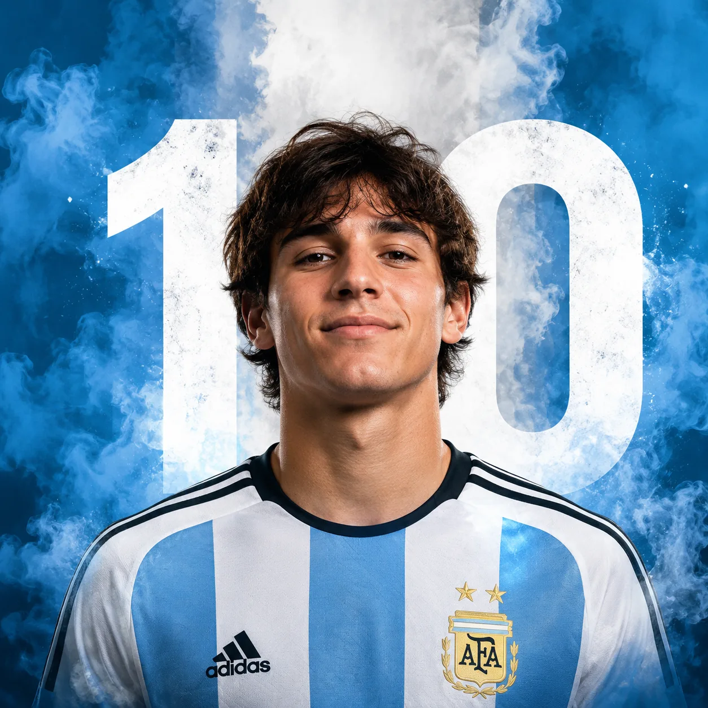

# Realistic, Portrait

[← Back to the collection](../../README.md) · Category: [Poster Design](../../gallery/poster-design.md) · Model: `Vinano Studio` · ID: `vn-01849`

<a href="https://vinano.ai?utm_source=github&utm_medium=readme&utm_campaign=awesome-image-video-prompts-updating&utm_content=prompt-page-image"></a>

<sub>Preview generated with <a href="https://vinano.ai?utm_source=github&utm_medium=readme&utm_campaign=awesome-image-video-prompts-updating&utm_content=prompt-page-caption">vinano.ai</a></sub>

## Prompt

```text
A mixed-media sports promotional poster featuring a realistic chest-up portrait of a young Argentine soccer player. He/She poses in a relaxed and confident manner a subtle smile, dark brown slightly messy hair falling naturally onto the forehead. He/She is wearing the Argentina national team jersey from the provided reference image, featuring the iconic sky-blue and white colors, the Adidas logo on the right chest and the Argentina Football Association crest on the left.

Soft studio lighting from the upper left creates gentle shadows and subtle highlights on the hair. Behind the player is a large bold white number “10,” partially overlapped by the subject.

The background features vertical smoke in the colors of the Argentine flag: sky blue, white, and sky blue.

The overall style is modern, clean, and dynamic, combining sharp details soft smoky effects, creating a powerful and professional sports-poster aesthetic.

Render with rich micro-detail while keeping the layout uncluttered and intentional.
```

## Try it on vinano.ai

1. Copy the prompt above.
2. Open **[vinano.ai](https://vinano.ai?utm_source=github&utm_medium=readme&utm_campaign=awesome-image-video-prompts-updating&utm_content=prompt-page-try)**, paste it into the image generator and pick a model.
3. Swap any placeholders (brand, product, city, person…) for your own details, then generate.

More prompts like this: [Poster Design gallery](../../gallery/poster-design.md) · [all categories](../../README.md#contents)
