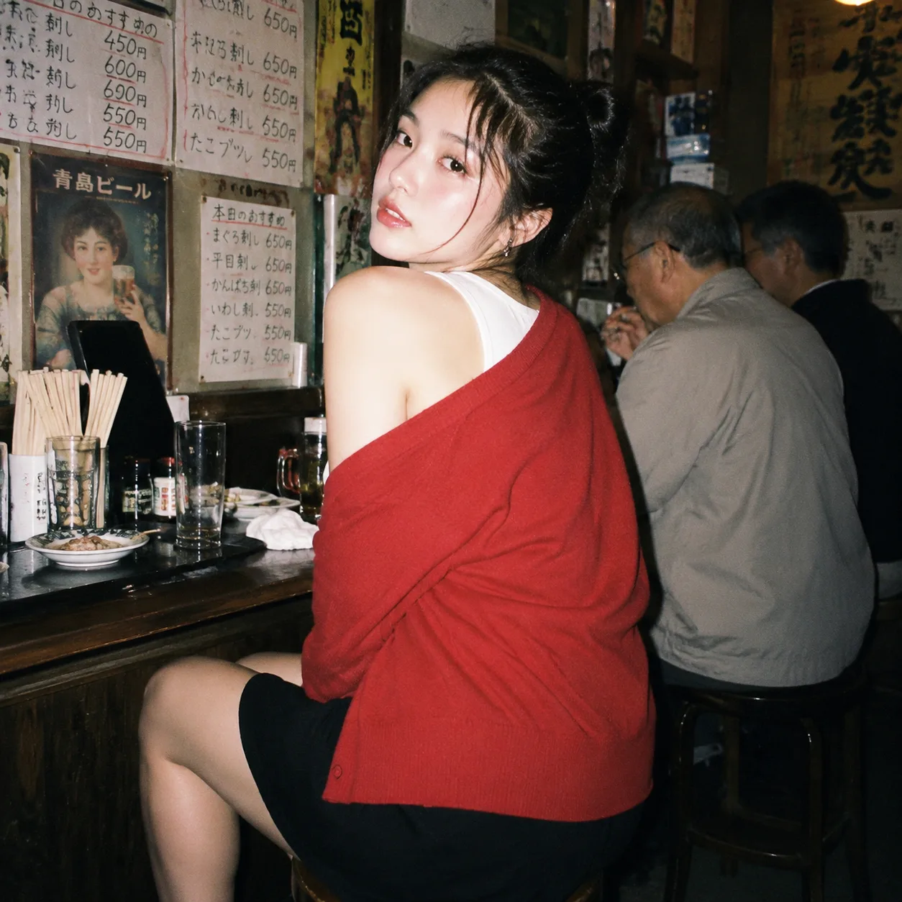

# Poster, Ai Art

[← Back to the collection](../../README.md) · Category: [Poster Design](../../gallery/poster-design.md) · Model: `Vinano Studio` · ID: `vn-01860`

<a href="https://vinano.ai?utm_source=github&utm_medium=readme&utm_campaign=awesome-image-video-prompts-updating&utm_content=prompt-page-image"></a>

<sub>Preview generated with <a href="https://vinano.ai?utm_source=github&utm_medium=readme&utm_campaign=awesome-image-video-prompts-updating&utm_content=prompt-page-caption">vinano.ai</a></sub>

## Prompt

```text
A 90s disposable-camera style flash snapshot taken inside a small, bustling Japanese izakaya decorated handwritten menus and retro posters. Direct flash creates grain, harsh shadows, and bright highlights. A young woman sits on a wooden bar stool, turning her upper body back toward the camera. She wears a soft red cardigan over a white tank top, paired a short black skirt. The red cardigan pops beautifully under the flash, complementing her blushed cheeks and glossy lips. Behind her, older patrons sit in the dim, noisy environment, contrasting her vivid, intimate glow. The image feels nostalgic, imperfect, and emotionally intimate. Aim for an editorial, design-driven look with deliberate negative space.
```

## Try it on vinano.ai

1. Copy the prompt above.
2. Open **[vinano.ai](https://vinano.ai?utm_source=github&utm_medium=readme&utm_campaign=awesome-image-video-prompts-updating&utm_content=prompt-page-try)**, paste it into the image generator and pick a model.
3. Swap any placeholders (brand, product, city, person…) for your own details, then generate.

More prompts like this: [Poster Design gallery](../../gallery/poster-design.md) · [all categories](../../README.md#contents)
