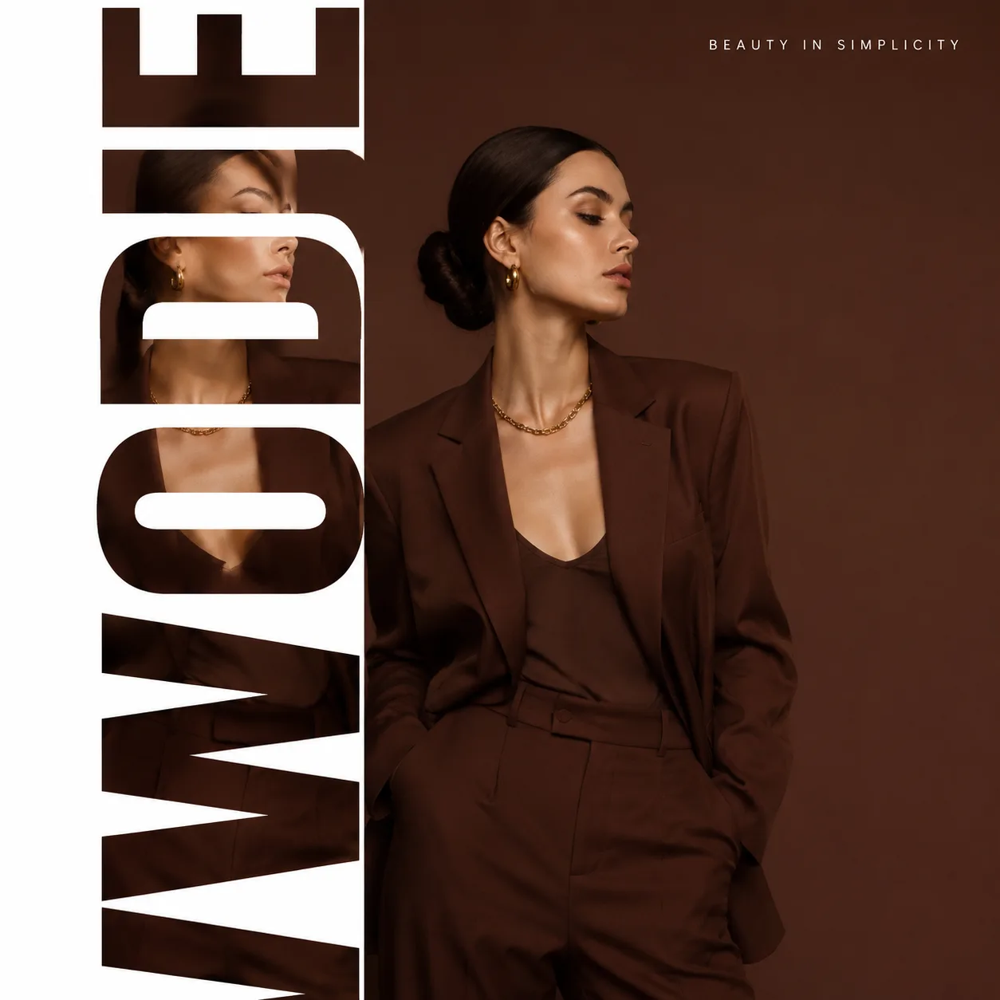

# Realistic, Poster

[← Back to the collection](../../README.md) · Category: [Poster Design](../../gallery/poster-design.md) · Model: `Vinano Studio` · ID: `vn-01872`

<a href="https://vinano.ai?utm_source=github&utm_medium=readme&utm_campaign=awesome-image-video-prompts-updating&utm_content=prompt-page-image"></a>

<sub>Preview generated with <a href="https://vinano.ai?utm_source=github&utm_medium=readme&utm_campaign=awesome-image-video-prompts-updating&utm_content=prompt-page-caption">vinano.ai</a></sub>

## Prompt

```text
Style & Composition: High-fashion editorial typography poster a strict 1:2 composition split. Layout & Ratio: The frame is divided so that the right two-thirds show the full subject and background, while the left one-third is reserved for the typography masking section.

Typography Masking: A massive, ultra-bold, vertical word "[WORD]" is placed on the left third. The text is strictly full-bleed, stretching perfectly and touching the absolute top and absolute bottom edges of the frame zero vertical padding, gaps, or margins. This typography acts as a stencil mask: the letters reveal the underlying character, while the space to the far left of the letters is a solid, clean white.

Subject Details & Positioning: An upper-body shot of [CHARACTER DESCRIPTION]. The model is positioned so that only her left-most side is visible through the letters, while the rest of her body is fully visible and contained on the right side against a solid [COLOR] background, ensuring no part of the subject is cropped by the right edge of the frame. Pose: [POSE DESCRIPTION], ensuring the silhouette remains within the center of the right two-thirds area.

Secondary Text: In the top right corner, add the text: "[TEXT]". Use a small, sophisticated, white "Helvetica Condensed" style font wide letter spacing (kerning) for a premium, refined minimalist look. Color Palette: A strict monochromatic [COLOR] theme, sharply contrasted by the crisp white negative space on the left. 8k resolution, true-to-life photorealistic textures, sharp studio lighting, high contrast, clean graphic design aesthetic.

Maintain consistent colour harmony and crisp focus across the whole frame.
```

## Try it on vinano.ai

1. Copy the prompt above.
2. Open **[vinano.ai](https://vinano.ai?utm_source=github&utm_medium=readme&utm_campaign=awesome-image-video-prompts-updating&utm_content=prompt-page-try)**, paste it into the image generator and pick a model.
3. Swap any placeholders (brand, product, city, person…) for your own details, then generate.

More prompts like this: [Poster Design gallery](../../gallery/poster-design.md) · [all categories](../../README.md#contents)
