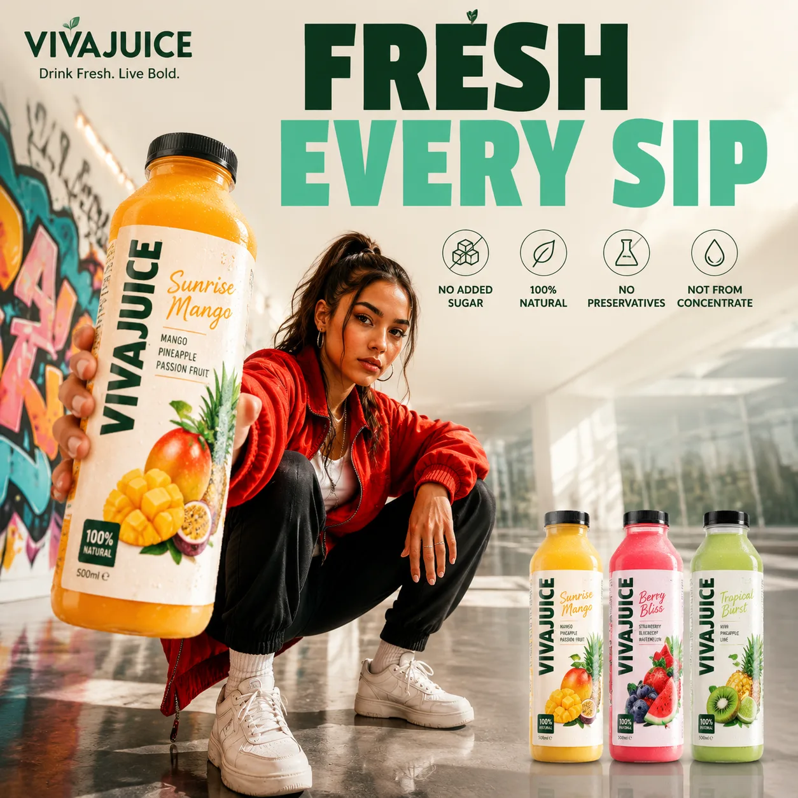

# Realistic, Poster

[← Back to the collection](../../README.md) · Category: [Poster Design](../../gallery/poster-design.md) · Model: `Vinano Studio` · ID: `vn-01873`

<a href="https://vinano.ai?utm_source=github&utm_medium=readme&utm_campaign=awesome-image-video-prompts-updating&utm_content=prompt-page-image"></a>

<sub>Preview generated with <a href="https://vinano.ai?utm_source=github&utm_medium=readme&utm_campaign=awesome-image-video-prompts-updating&utm_content=prompt-page-caption">vinano.ai</a></sub>

## Prompt

```text
Create a premium modern beverage advertisement poster in a vertical 3:4 format featuring a stylish young female model crouching confidently in a bright urban indoor hallway colorful graffiti wall art on one side and clean minimal architecture on the other, giving a trendy streetwear lifestyle vibe. The model wears casual fashionable clothes such as a red oversized jacket, white inner top, black joggers, and white sneakers, looking directly at the camera a cool confident expression. In the foreground, a giant realistic fruit juice bottle is held toward the camera in forced perspective, dominating the composition sharp focus and glossy reflections. The bottle should have a completely different fictional brand name such as “VIVAJUICE” in bold modern typography, attractive fruit illustrations on the label and flavor text like “Sunrise Mango” or “Tropical Burst.” At the top left, place the brand logo and a catchy tagline like “Drink Fresh. Live Bold.” Across the top center, add huge bold overlapping typography reading “PURE AS NATURE” or “FRESH EVERY SIP” in contrasting colors like dark green and mint. Below the headline, include 4 clean icon-based feature badges in a row text such as “NO ADDED SUGAR,” “100% NATURAL,” “NO PRESERVATIVES,” and “NOT FROM CONCENTRATE.” At the bottom right, display three smaller bottle variants in different flavors neatly arranged. Use soft natural lighting mixed commercial studio polish, realistic shadows, shallow depth of field, glossy floor reflections, and a premium energetic eCommerce campaign aesthetic inspired by modern Instagram and billboard ads. Keep edges clean and the overall composition balanced for a polished, gallery-ready result.
```

## Try it on vinano.ai

1. Copy the prompt above.
2. Open **[vinano.ai](https://vinano.ai?utm_source=github&utm_medium=readme&utm_campaign=awesome-image-video-prompts-updating&utm_content=prompt-page-try)**, paste it into the image generator and pick a model.
3. Swap any placeholders (brand, product, city, person…) for your own details, then generate.

More prompts like this: [Poster Design gallery](../../gallery/poster-design.md) · [all categories](../../README.md#contents)
