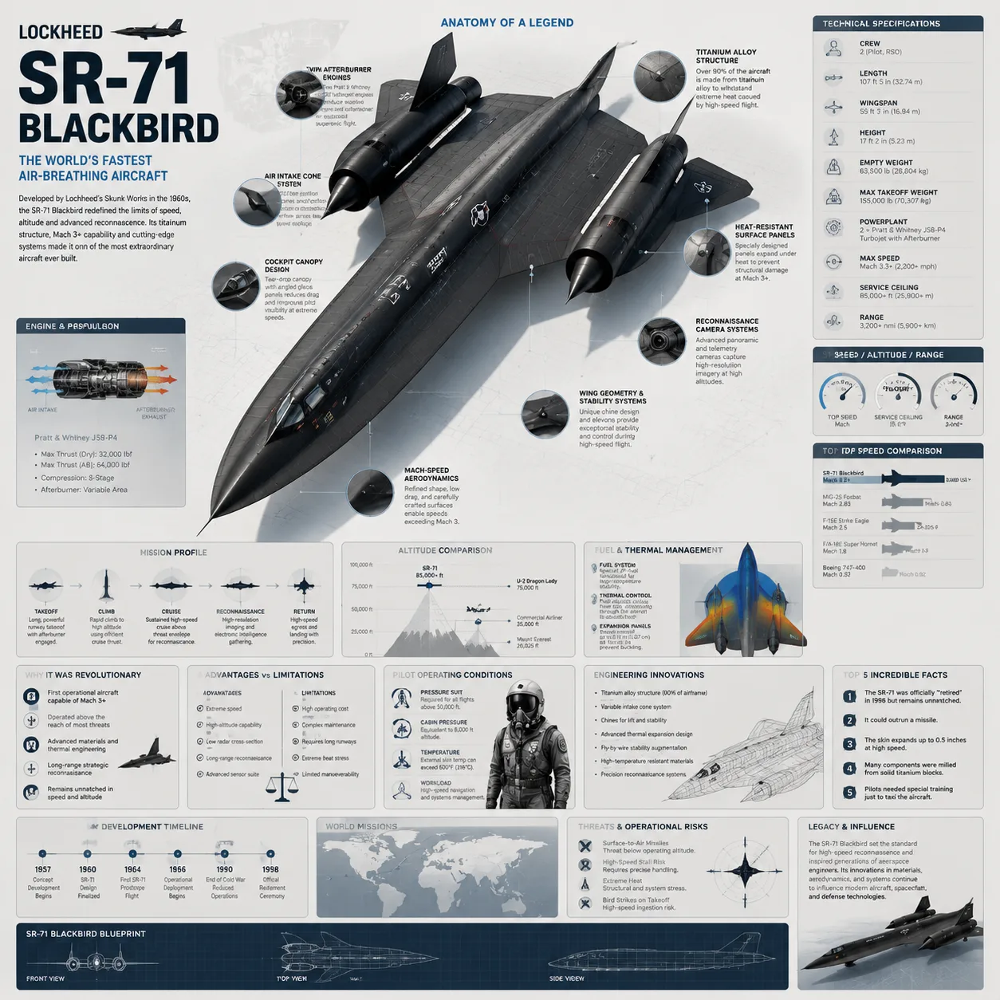

# Realistic, Poster

[← Back to the collection](../../README.md) · Category: [Poster Design](../../gallery/poster-design.md) · Model: `Vinano Studio` · ID: `vn-01883`

<a href="https://vinano.ai?utm_source=github&utm_medium=readme&utm_campaign=awesome-image-video-prompts-updating&utm_content=prompt-page-image"></a>

<sub>Preview generated with <a href="https://vinano.ai?utm_source=github&utm_medium=readme&utm_campaign=awesome-image-video-prompts-updating&utm_content=prompt-page-caption">vinano.ai</a></sub>

## Prompt

```text
Create a premium square “reference-style aviation infographic” centered around the legendary Lockheed SR-71 Blackbird, designed as a beautifully curated aerospace knowledge handbook page rather than a military poster.

The composition should feel like a modern visual encyclopedia mixed an elite aircraft field guide and high-end editorial infographic system.

Visual Direction:

• 1:1 square composition
• Soft light-toned aerospace background subtle blueprint textures
• Elegant muted palette charcoal black, titanium gray, deep navy, and soft steel blue
• Refined editorial typography hierarchy
• Rounded modular information cards clean spacing
• Gentle realistic shadows and premium UI-style dividers
• Minimal technical iconography
• Extremely detailed central aircraft render viewed in dramatic top-down three-quarter perspective
• Thin precision annotation lines pointing toward aircraft systems and structural features
• Clean, organized “knowledge-first” layout high information density but breathable spacing

Main Subject Presentation:

A stunning ultra-detailed SR-71 Blackbird illustration/render in the center realistic titanium body reflections, stealth-like silhouette, glowing cockpit glass, engine intake detailing, and aerodynamic surface paneling.

Surround the aircraft scientific callouts and magnified detail circles explaining:

• Twin afterburner engines
• Titanium alloy body structure
• Air intake cone system
• Cockpit canopy design
• Heat-resistant surface panels
• Reconnaissance camera systems
• Mach-speed aerodynamics
• Wing geometry and stability systems

Include modular infographic sections such as:

• Aircraft Overview
• Technical Specifications
• Speed / altitude / range statistics
• Engine and propulsion system
• Historical mission profile
• Flight performance charts
• Top speed comparison against other aircraft
• Fuel and thermal management system
• Why the aircraft was revolutionary
• Advantages vs limitations
• Pilot operating conditions
• Mission workflow diagram
• Engineering innovations
• Quick timeline of development
• Threats and operational risks
• “Top 5 Incredible Facts” section
• Legacy and influence on modern aerospace engineering

Add small premium visualization modules like:

• altitude comparison chart
• world mission map
• speed gauge graphics
• engine airflow diagram
• thermal heat visualization
• stealth/aerodynamic breakdown
• miniature side-profile blueprint views

Style Keywords:

“premium aerospace encyclopedia”
“editorial aircraft handbook”
“high-end aviation infographic”
“scientific aerospace poster”
“museum-quality aircraft reference page”
“modular aviation knowledge system”
“clean military technology editorial design”

Avoid:

• action movie poster aesthetics
• explosions or combat scenes
• aggressive propaganda styling
• excessive dark grunge
• generic tech poster layouts

The final result should resemble a professionally published aerospace reference-book page created for collectors, aviation enthusiasts, and educational visual archives.

Aim for an editorial, design-driven look with deliberate negative space.
```

## Try it on vinano.ai

1. Copy the prompt above.
2. Open **[vinano.ai](https://vinano.ai?utm_source=github&utm_medium=readme&utm_campaign=awesome-image-video-prompts-updating&utm_content=prompt-page-try)**, paste it into the image generator and pick a model.
3. Swap any placeholders (brand, product, city, person…) for your own details, then generate.

More prompts like this: [Poster Design gallery](../../gallery/poster-design.md) · [all categories](../../README.md#contents)
