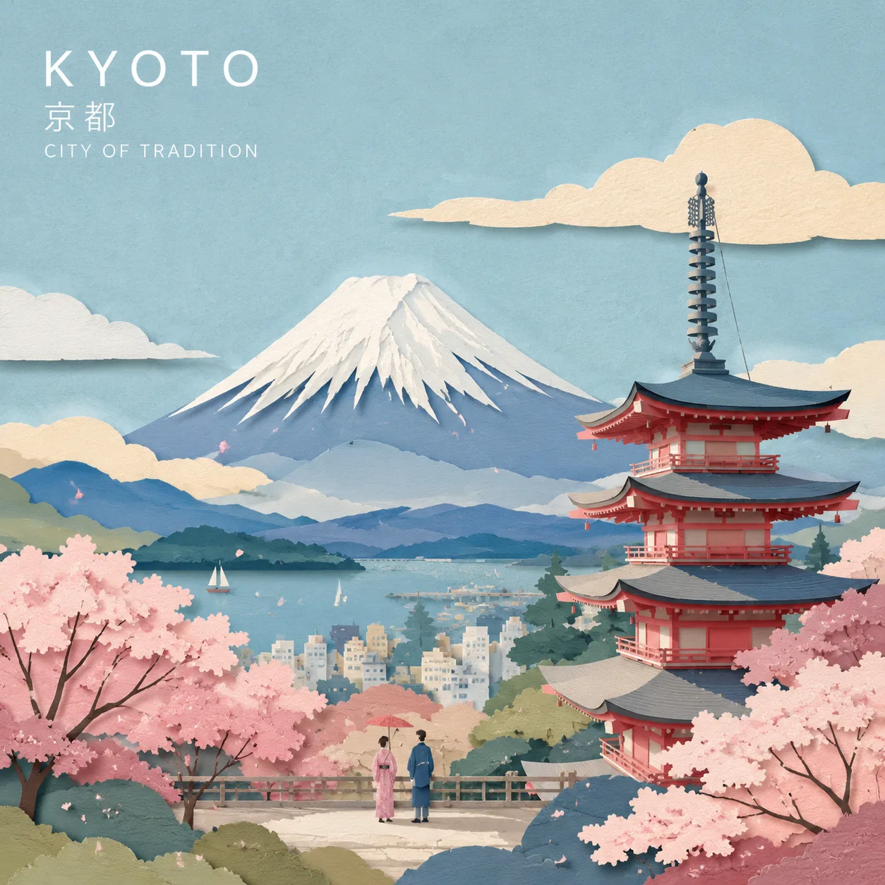

# Realistic, Landscape

[← Back to the collection](../../README.md) · Category: [Poster Design](../../gallery/poster-design.md) · Model: `Vinano Studio` · ID: `vn-01910`

<a href="https://vinano.ai?utm_source=github&utm_medium=readme&utm_campaign=awesome-image-video-prompts-updating&utm_content=prompt-page-image"></a>

<sub>Preview generated with <a href="https://vinano.ai?utm_source=github&utm_medium=readme&utm_campaign=awesome-image-video-prompts-updating&utm_content=prompt-page-caption">vinano.ai</a></sub>

## Prompt

```text
Create a refined wide landscape illustration of [City Subject], naturally featuring [Iconic Landmark] as the main recognizable visual anchor.

CORE STYLE:
Depict [Subject] as a calm, elegant, highly stylized scene in a toned-down pastel paper-collage poster style. The scene should feel minimal, clean, poetic, modern, cultured, leisurely, and softly cheerful rather than realistic.

COMPOSITION:
Use a spacious horizontal composition. Place [Main Subject] as the central focus, clearly recognizable through its iconic [Distinctive Features] rising above the layered scene. Surround it simplified [Contextual Elements]. Reinterpret in highly stylized illustrated forms clean geometric shapes, layered color planes, soft curves, crisp silhouettes, and paper-like cutout forms. Avoid photorealism.

VISUAL ELEMENTS:
Include minimal charming details: simplified forms, tiny expressive people for scale, small architectural/environmental accents, organic elements (trees, plants), calm open sky generous breathing space, clean horizontal layered divisions suggesting depth and atmosphere.

COLOR PALETTE (Toned-Down Pastels):
Soft sky blue, hazy blue-gray, pale cobalt, muted sage green, powder mint, warm cream, light beige, pale stone gray, dusty coral, soft peach, muted yellow, off-white, very small accents of navy or charcoal. [Add subject-specific accent colors as needed]

TACTILE QUALITY:
The image should feel tactile and handmade, like carefully arranged colored paper and gouache-painted poster board. Add subtle paper grain, matte printed texture, soft raised edges, delicate embossing, slight cut-paper shadows, gentle surface roughness. Keep surface refined and minimal, not messy.

VISUAL LANGUAGE:
Minimal paper collage, pastel travel poster, flat graphic shapes, subtle 3D paper relief, clean silhouettes, simplified architecture, soft matte texture, crisp color fields, gentle shadows, minimal linework, refined editorial illustration, modern [Cultural Context] poster mood. Wide landscape format, balanced negative space, strong graphic layering, clear focal area, simplified zones arranged harmoniously, airy composed and visually restful.

LIGHTING & MOOD:
Bright soft daylight, clean atmosphere, gentle shadows, warm relaxed tone, cultured and optimistic mood, quiet and sophisticated travel-poster feeling.

TYPOGRAPHY (Upper-left corner):
Main title '[City Subject Name]' in geometric uppercase sans-serif font wide letter-spacing, solid white color. Below: smaller native text '[Local Language Translation]' and English subtext '[Landmark Subtitle]', all in matching white, left-aligned, thin stroke weights airy spacious tracking.

AVOID:
Photorealism, realistic photography, over-detailed buildings, heavy outlines, messy brushwork, neon cyberpunk style, dark gloomy lighting, excessive gradients, crowded scenes, readable signage, logos, watermarks.

FINAL RESULT:
A polished minimal pastel paper-collage landscape illustration of [Subject], [Iconic Element] as the main recognizable visual anchor, featuring tactile paper texture, soft shadows, clean geometric color blocking, generous negative space, and a refined modern travel-illustration mood.

=====================================
VARIABLE REPLACEMENT GUIDE:
[City Subject] = Target city or subject
[Iconic Landmark] = Main recognizable landmark
[Distinctive Features] = Key identifying characteristics
[Contextual Elements] = Supporting environmental details
[Cultural Context] = Cultural/regional context

[Subject Specific Colors] = Custom accent colors (cherry blossoms: blush pink, lavender fields: soft lavender, etc.)

Aim for an editorial, design-driven look with deliberate negative space.
```

## Try it on vinano.ai

1. Copy the prompt above.
2. Open **[vinano.ai](https://vinano.ai?utm_source=github&utm_medium=readme&utm_campaign=awesome-image-video-prompts-updating&utm_content=prompt-page-try)**, paste it into the image generator and pick a model.
3. Swap any placeholders (brand, product, city, person…) for your own details, then generate.

More prompts like this: [Poster Design gallery](../../gallery/poster-design.md) · [all categories](../../README.md#contents)
