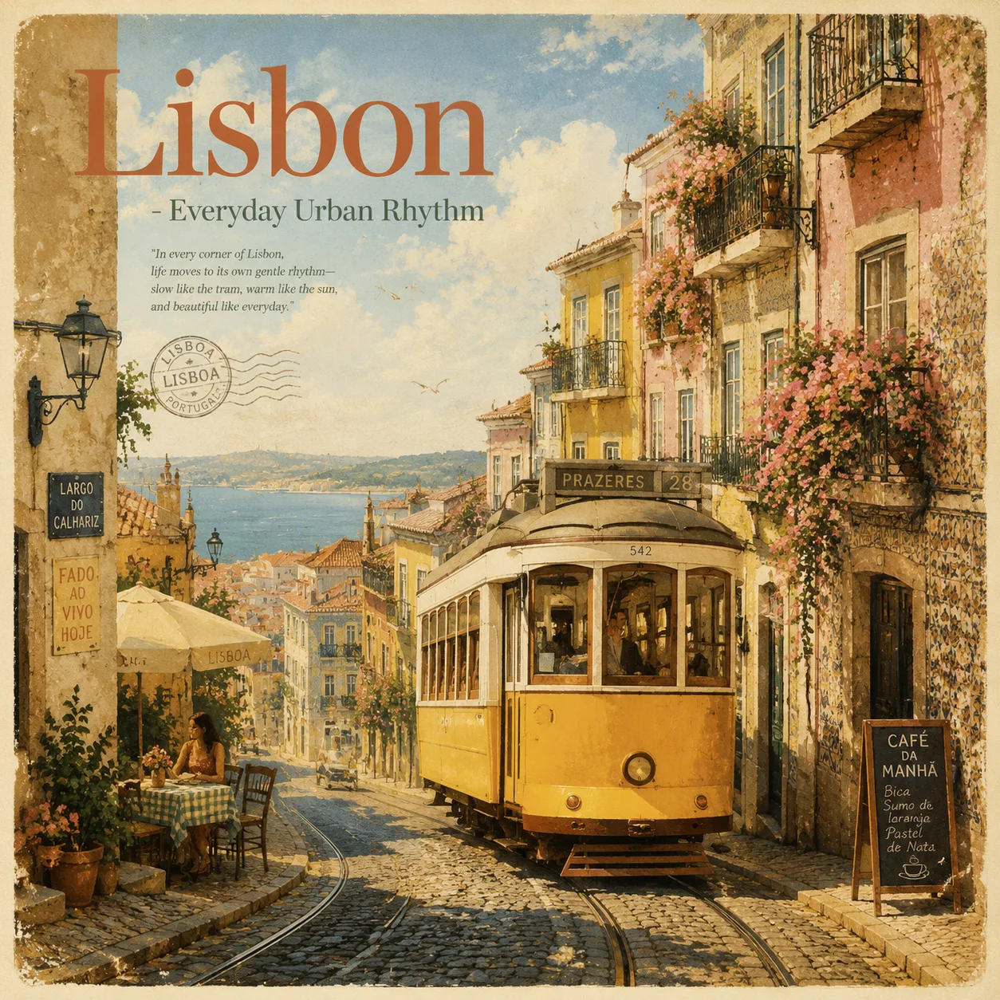

# Poster, Cinematic

[← Back to the collection](../../README.md) · Category: [Poster Design](../../gallery/poster-design.md) · Model: `Vinano Studio` · ID: `vn-01927`

<a href="https://vinano.ai?utm_source=github&utm_medium=readme&utm_campaign=awesome-image-video-prompts-updating&utm_content=prompt-page-image"></a>

<sub>Preview generated with <a href="https://vinano.ai?utm_source=github&utm_medium=readme&utm_campaign=awesome-image-video-prompts-updating&utm_content=prompt-page-caption">vinano.ai</a></sub>

## Prompt

```text
Dreamy vintage travel poster illustration of Lisbon, Portugal, featuring the iconic yellow tram moving through a steep cobblestone street, pastel buildings floral balconies, cozy café tables, soft Mediterranean sunlight, distant ocean view, warm nostalgic atmosphere, watercolor and gouache painting texture, elegant serif typography saying “Lisbon – Everyday Urban Rhythm”, European summer aesthetic, cinematic composition, highly detailed architecture, soft grain and paper texture, romantic travel journal vibe, vintage postcard style, ultra detailed, premium quality. Emphasise material texture and natural light so the final frame feels tactile and premium.
```

## Try it on vinano.ai

1. Copy the prompt above.
2. Open **[vinano.ai](https://vinano.ai?utm_source=github&utm_medium=readme&utm_campaign=awesome-image-video-prompts-updating&utm_content=prompt-page-try)**, paste it into the image generator and pick a model.
3. Swap any placeholders (brand, product, city, person…) for your own details, then generate.

More prompts like this: [Poster Design gallery](../../gallery/poster-design.md) · [all categories](../../README.md#contents)
