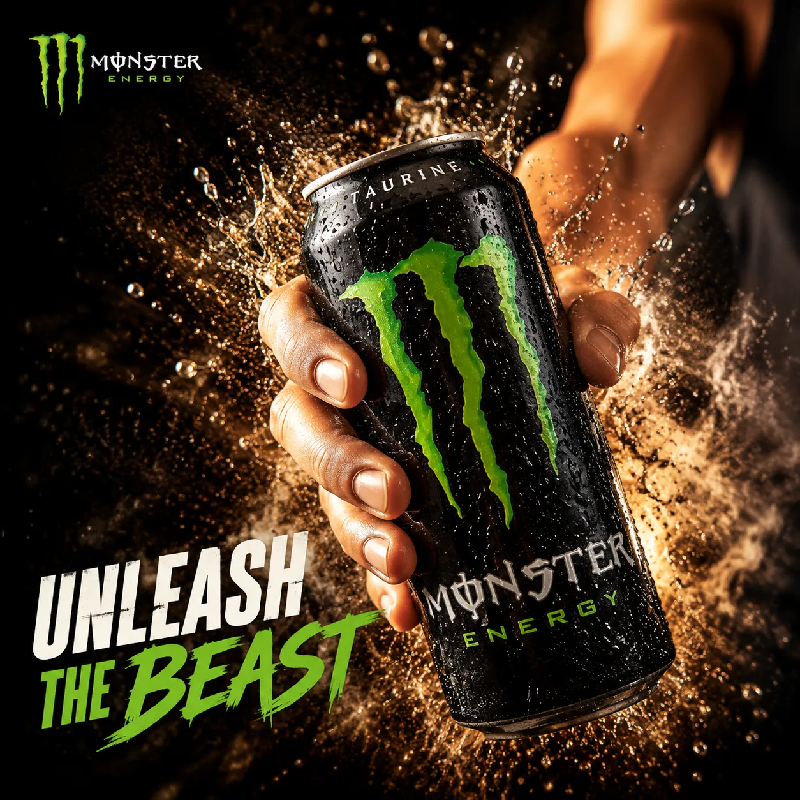

# Realistic, Poster

[← Back to the collection](../../README.md) · Category: [Poster Design](../../gallery/poster-design.md) · Model: `Vinano Studio` · ID: `vn-01935`

<a href="https://vinano.ai?utm_source=github&utm_medium=readme&utm_campaign=awesome-image-video-prompts-updating&utm_content=prompt-page-image"></a>

<sub>Preview generated with <a href="https://vinano.ai?utm_source=github&utm_medium=readme&utm_campaign=awesome-image-video-prompts-updating&utm_content=prompt-page-caption">vinano.ai</a></sub>

## Prompt

```text
Create a premium UGC-style advertising poster for [Product] by [Brand]. Use the product as the clear hero of the image and preserve the product shape, packaging, logo, label, colors, proportions, and readable text strong visual accuracy.

Design the image as a powerful commercial poster a bold editorial feel and a high-impact visual hook. The scene should feel like a real viral UGC moment elevated into a luxury campaign. Show a human hand naturally interacting the product in a dynamic action moment such as grabbing it, tossing it, spraying it, opening it, pouring it, unboxing it, or pushing it toward the camera. Capture the exact split second of action strong cinematic tension and scroll-stopping energy.

Add product-related action effects that enhance the visual hook, such as frozen splashes, flying particles, dust bursts, liquid trails, mist, shattered texture bursts, energetic motion blur, glow accents, or floating ingredients depending on the product category. The action should feel bold, intentional, premium, and visually irresistible.

Make the product the sharpest and most dominant subject in the frame. The composition should feel like a polished advertising poster, not just a casual photo. Use dramatic editorial lighting, clean rim light, realistic reflections, crisp focus, shallow depth of field, premium contrast, cinematic color grading, and a refined luxury commercial finish.

Include the brand logo clearly and tastefully as part of the poster design, either on the product packaging and/or as a clean design element in the composition. Also include one strong advertising slogan made of exactly 3 words:
"[Slogan]"

The slogan must feel bold, memorable, premium, and campaign-worthy. Place it in a visually powerful way, clean high-end typography and a layout that supports the product without overpowering it.

Composition: vertical poster, 4:5 or 9:16, dynamic close-up or medium-close framing, product large in the foreground, partial human presence, strong negative space, premium ad layout, viral commercial energy.

Mood: bold, premium, modern, playful, energetic, stylish, addictive, visually striking.

No fake branding, no distorted logo, no unreadable packaging, no messy anatomy, no cheap CGI, no cluttered layout, no weak composition, no duplicated product, no watermark.

Render with rich micro-detail while keeping the layout uncluttered and intentional.
```

## Try it on vinano.ai

1. Copy the prompt above.
2. Open **[vinano.ai](https://vinano.ai?utm_source=github&utm_medium=readme&utm_campaign=awesome-image-video-prompts-updating&utm_content=prompt-page-try)**, paste it into the image generator and pick a model.
3. Swap any placeholders (brand, product, city, person…) for your own details, then generate.

More prompts like this: [Poster Design gallery](../../gallery/poster-design.md) · [all categories](../../README.md#contents)
