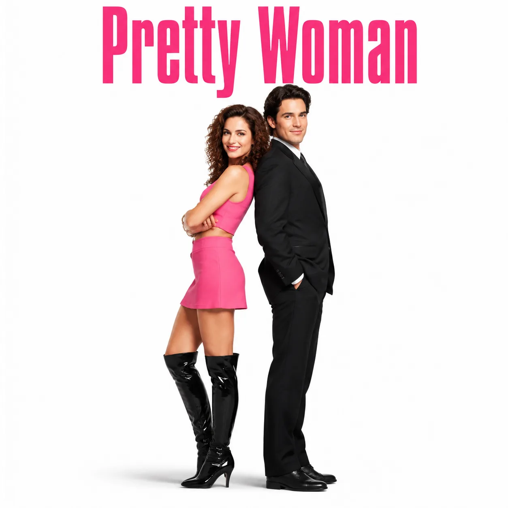

# Portrait, Poster

[← Back to the collection](../../README.md) · Category: [Poster Design](../../gallery/poster-design.md) · Model: `Vinano Studio` · ID: `vn-01952`

<a href="https://vinano.ai?utm_source=github&utm_medium=readme&utm_campaign=awesome-image-video-prompts-updating&utm_content=prompt-page-image"></a>

<sub>Preview generated with <a href="https://vinano.ai?utm_source=github&utm_medium=readme&utm_campaign=awesome-image-video-prompts-updating&utm_content=prompt-page-caption">vinano.ai</a></sub>

## Prompt

```text
{
 "generation_request": {
 "meta_data": { "tool": "", "task_type": "text_to_image_photoreal_romcom_poster", "version": "v1.0" },
 "references": {
 "reference_images": { "female_reference": "UPLOAD_FEMALE_REFERENCE_IMAGE (REQUIRED)", "male_reference": "UPLOAD_MALE_REFERENCE_IMAGE (REQUIRED)" },
 "reference_rules": { "preserve_identity_female": true, "preserve_identity_male": true, "identity_lock_strength_female": 0.995, "identity_lock_strength_male": 0.995, "face_similarity_priority": "MAX", "no_beautify_no_face_morph": true }
 },
 "output_settings": { "aspect_ratio": "9:16", "orientation": "portrait", "resolution": "ultra_high_res", "render_style": "photoreal_high_key_studio_poster", "sharpness": "high", "film_grain": "subtle" },
 "creative_prompt": {
 "scene_summary": "Playful iconic rom-com poster on pure white background. Couple stands back-to-back full body, confident smiles. Woman in bold pink mini dress and tall boots; man in classic black suit. Bright high-key studio lighting, crisp shadows, generous title space at top.",
 "typography": { "title_text_exact": "Pretty Woman", "placement": "top-center", "style": "bold tall sans-serif hot-pink accent" },
 "strict_rules": ["Exactly two people only", "No extra people", "No extra text elements"]
 },
 "negative_prompt": ["extra people", "extra text", "credits", "tagline", "watermark", "logo", "blurry faces", "plastic skin", "deformed hands", "extra fingers"]
 }
}

Render with rich micro-detail while keeping the layout uncluttered and intentional.
```

## Try it on vinano.ai

1. Copy the prompt above.
2. Open **[vinano.ai](https://vinano.ai?utm_source=github&utm_medium=readme&utm_campaign=awesome-image-video-prompts-updating&utm_content=prompt-page-try)**, paste it into the image generator and pick a model.
3. Swap any placeholders (brand, product, city, person…) for your own details, then generate.

More prompts like this: [Poster Design gallery](../../gallery/poster-design.md) · [all categories](../../README.md#contents)
