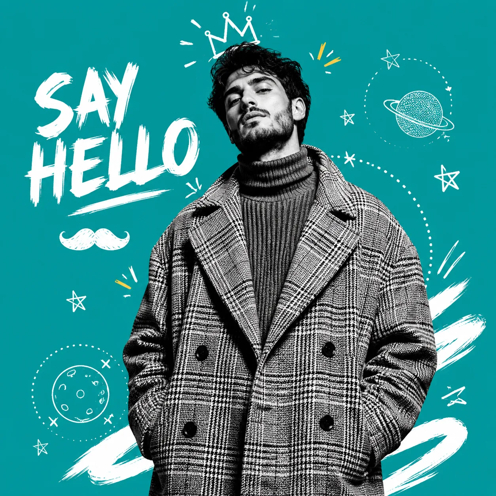

# Portrait, Poster

[← Back to the collection](../../README.md) · Category: [Poster Design](../../gallery/poster-design.md) · Model: `Vinano Studio` · ID: `vn-01956`

<a href="https://vinano.ai?utm_source=github&utm_medium=readme&utm_campaign=awesome-image-video-prompts-updating&utm_content=prompt-page-image"></a>

<sub>Preview generated with <a href="https://vinano.ai?utm_source=github&utm_medium=readme&utm_campaign=awesome-image-video-prompts-updating&utm_content=prompt-page-caption">vinano.ai</a></sub>

## Prompt

```text
Create a trendy 3:4 vertical fashion poster the uploaded portrait as reference. Convert the subject to high-contrast black-and-white duotone on a solid bright teal background. Keep stylish hair, beard, and a confident editorial pose. Dress him in an oversized double-breasted plaid wool overcoat over a ribbed turtleneck sweater, hands in pockets. Add playful white hand-drawn doodles (crown, stars, planets, dotted circles, motion lines, brush swooshes) around the figure. Include bold handwritten text “SAY HELLO” a small doodle mustache underneath. Modern streetwear-meets-collage fashion magazine aesthetic, crisp composition, centered mid-thigh crop. Maintain consistent colour harmony and crisp focus across the whole frame.
```

## Try it on vinano.ai

1. Copy the prompt above.
2. Open **[vinano.ai](https://vinano.ai?utm_source=github&utm_medium=readme&utm_campaign=awesome-image-video-prompts-updating&utm_content=prompt-page-try)**, paste it into the image generator and pick a model.
3. Swap any placeholders (brand, product, city, person…) for your own details, then generate.

More prompts like this: [Poster Design gallery](../../gallery/poster-design.md) · [all categories](../../README.md#contents)
