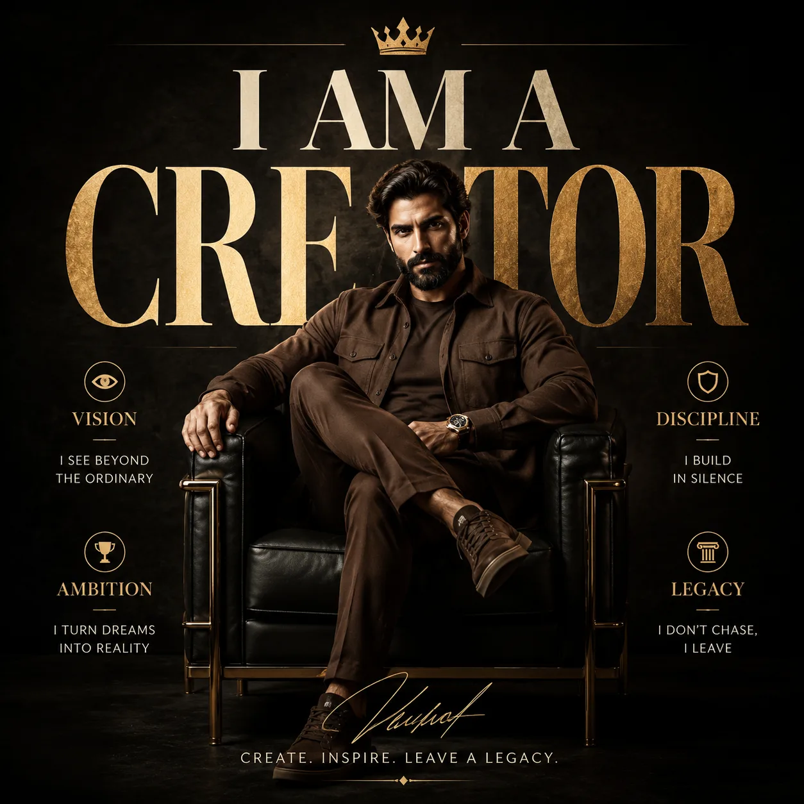

# Realistic, Poster

[← Back to the collection](../../README.md) · Category: [Poster Design](../../gallery/poster-design.md) · Model: `Vinano Studio` · ID: `vn-01963`

<a href="https://vinano.ai?utm_source=github&utm_medium=readme&utm_campaign=awesome-image-video-prompts-updating&utm_content=prompt-page-image"></a>

<sub>Preview generated with <a href="https://vinano.ai?utm_source=github&utm_medium=readme&utm_campaign=awesome-image-video-prompts-updating&utm_content=prompt-page-caption">vinano.ai</a></sub>

## Prompt

```text
Ultra-premium cinematic motivational poster, vertical 4:5 format, powerful charismatic man thick dark hair and a beard, sitting confidently in a luxurious black leather armchair gold metal frame, legs crossed, intense direct gaze at camera, wearing a monochromatic earth-tone outfit: brown overshirt, fitted trousers, premium designer sneakers, luxury wristwatch.

Dark black studio background subtle texture and dramatic shadows. Massive bold typography behind the subject filling most of the frame, reading "I AM A CREATOR" in giant elegant capital letters, cream and gold metallic colors. Small refined minimalist crown icon above the title. Premium branding aesthetic, entrepreneur mindset, success poster, luxury magazine cover style.

Around the subject, elegant motivational text elements:
"VISION – I SEE BEYOND THE ORDINARY"
"DISCIPLINE – I BUILD IN SILENCE"
"AMBITION – I TURN DREAMS INTO REALITY"
"LEGACY – I DON'T CHASE, I LEAVE"

Bottom section sophisticated gold signature and slogan:
"CREATE. INSPIRE. LEAVE A LEGACY."

Lighting: dramatic Rembrandt lighting, cinematic key light from upper left, subtle rim lighting, deep shadows, high contrast, warm highlights, professional studio photography.

Color palette: black, gold, bronze, beige, warm brown, luxury metallic accents.

Composition: centered subject, symmetrical layout, strong visual hierarchy, clean negative space, magazine-quality design, premium typography, ultra-sharp focus, highly detailed fabric textures, realistic skin tones, luxury advertising campaign, billionaire mindset aesthetic, award-winning poster design.

true-to-life photorealistic, 8K resolution, HDR, razor-sharp details, depth of field, professional color grading, masterpiece quality, high-end commercial photography, no blur, no distortion, no extra limbs, no watermark.

Aim for an editorial, design-driven look with deliberate negative space.
```

## Try it on vinano.ai

1. Copy the prompt above.
2. Open **[vinano.ai](https://vinano.ai?utm_source=github&utm_medium=readme&utm_campaign=awesome-image-video-prompts-updating&utm_content=prompt-page-try)**, paste it into the image generator and pick a model.
3. Swap any placeholders (brand, product, city, person…) for your own details, then generate.

More prompts like this: [Poster Design gallery](../../gallery/poster-design.md) · [all categories](../../README.md#contents)
