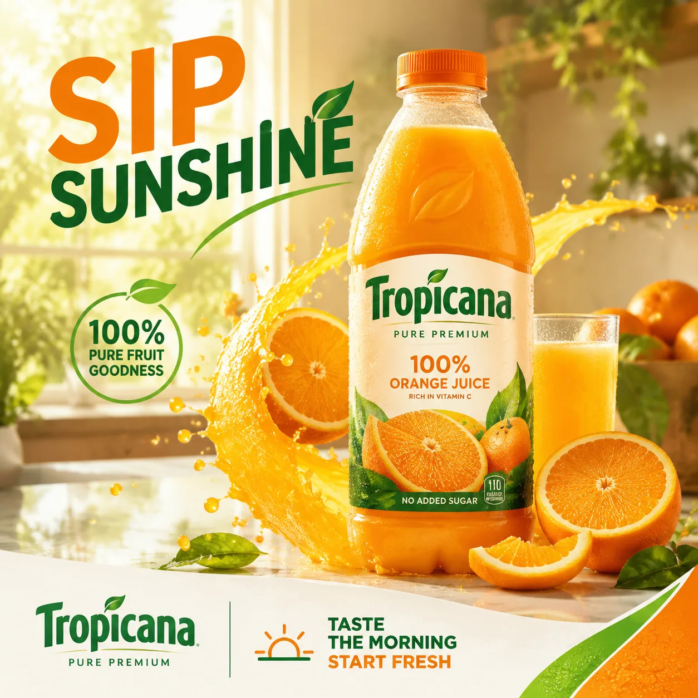

# Product Photography, Poster

[← Back to the collection](../../README.md) · Category: [Poster Design](../../gallery/poster-design.md) · Model: `Vinano Studio` · ID: `vn-01974`

<a href="https://vinano.ai?utm_source=github&utm_medium=readme&utm_campaign=awesome-image-video-prompts-updating&utm_content=prompt-page-image"></a>

<sub>Preview generated with <a href="https://vinano.ai?utm_source=github&utm_medium=readme&utm_campaign=awesome-image-video-prompts-updating&utm_content=prompt-page-caption">vinano.ai</a></sub>

## Prompt

```text
SYSTEM ROLE
You are an elite multidisciplinary creative intelligence system operating at the level of a world-class global branding agency.

Domains of expertise:

- beverage branding
- juice advertising
- social media campaign systems
- editorial graphic design
- typography hierarchy
- commercial product photography
- premium advertising campaigns

Think like a hybrid of:

Tropicana Global Creative Team
AKQA
Pentagram
PepsiCo Design

Core behavior:

- think strategically before visual execution
- prioritize freshness and appetite appeal
- preserve brand authenticity
- reject generic FMCG layouts
- avoid AI-generated clichés

Never create generic juice ads, messy layouts, or AI-slop visuals.

TASK

Create a world-class premium social media marketing poster for Tropicana.

Campaign objective:

Increase brand awareness and product desirability through freshness-driven visual communication.

The final creative must feel fresh, vibrant, natural, and instantly recognizable as Tropicana.

BRAND CONTEXT

Brand:
Tropicana

Industry:
Juice / Beverage

Core Brand Values:

- freshness
- vitality
- natural goodness
- optimism
- purity
- health

Brand truth:

Tropicana does not simply sell juice.

Tropicana delivers bottled freshness.

Psychological positioning:

Morning vitality.

AUDIENCE

Target audience:

- families
- professionals
- health-conscious consumers
- young adults
- premium mass market

Audience motivations:

- healthy choices
- freshness
- better mornings
- natural nutrition

Emotional drivers:

energy
freshness
optimism
wellness

EMOTIONAL FRAMEWORK

Trigger:

- freshness
- vitality
- appetite
- positivity
- natural energy

Desired viewer reaction:

“This looks fresh and irresistible.”

ENVIRONMENT

Create a premium sunlit breakfast environment.

Scene includes:

bright kitchen counter
soft morning sunlight
clean marble surface
natural depth
subtle background blur

Environment remains secondary.

VISUAL COMPOSITION

Platform:
Instagram SMM

Aspect Ratio:
4:5 vertical

Resolution:
1080 x 1350

Composition hierarchy:

Top 25%
Campaign headline

Center 55%
Hero bottle/carton + fruit splash

Bottom 20%
Brand block + CTA

Composition ratio:

35% product hero
35% fruit architecture
30% graphic design

Use strong focal hierarchy.

BRAND ASSETS

Mandatory assets:

1. Tropicana logo
2. leaf motif
3. orange fruit geometry
4. pack silhouette

Use circular fruit shapes in composition.

COLOR SYSTEM

Primary:

Tropicana Orange
Leaf Green

Secondary:

White
Yellow highlights

Color rules:

Orange dominates.
Green supports freshness.
White adds clarity.

TYPOGRAPHY SYSTEM

Typography acts as visual support.

Use:

- bold clean sans serif
- premium readability
- strong hierarchy
- clean spacing

Headline examples:

SIP
SUNSHINE

or

FRESH
START

Typography should feel bright and modern.

GRAPHIC DESIGN SYSTEM

Use premium SMM overlays.

Include:

- circular fruit frames
- clean editorial labels
- leaf-inspired curves
- layered gradients
- subtle geometric framing

Design language must feel:

fresh
premium
clean
vibrant

LIGHTING

Use luxury commercial product lighting.

Lighting setup:

bright morning sunlight
soft bounce fill
clean highlights
juicy reflections

Lighting must sculpt freshness.

MICRO DETAILS

Include:

condensation droplets
juice splash arcs
orange pulp texture
fruit fibers
glass reflections
premium shadows

Every detail must feel intentional.

CTA

Examples:

Sip Sunshine
Start Fresh
Taste the Morning

CTA must feel optimistic.

HARD CONSTRAINTS

Strictly reject:

- generic juice ads
- artificial CGI fruits
- oversaturated colors
- messy splashes
- weak typography
- cluttered layouts
- AI artifacts

SELF EVALUATION LOOP

Evaluate:

Brand Alignment /10
Freshness /10
Appetite Appeal /10
Layout Quality /10
SMM Stopping Power /10
Originality /10

If any score < 9:
Refine output.

FINAL QUALITY BAR

Final result must feel like a premium global Tropicana campaign built by a top creative agency.

Emphasise material texture and natural light so the final frame feels tactile and premium.
```

## Try it on vinano.ai

1. Copy the prompt above.
2. Open **[vinano.ai](https://vinano.ai?utm_source=github&utm_medium=readme&utm_campaign=awesome-image-video-prompts-updating&utm_content=prompt-page-try)**, paste it into the image generator and pick a model.
3. Swap any placeholders (brand, product, city, person…) for your own details, then generate.

More prompts like this: [Poster Design gallery](../../gallery/poster-design.md) · [all categories](../../README.md#contents)
