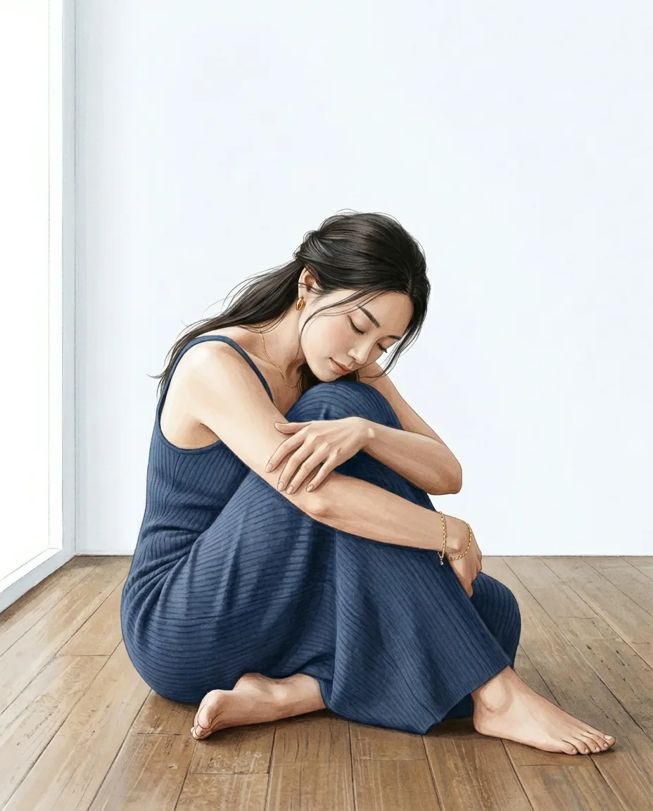

# Poster Design prompt #1985

[← Back to the collection](../../README.md) · Category: [Poster Design](../../gallery/poster-design.md) · Model: `Vinano Image Pro` · ID: `vn-01985`

<a href="https://vinano.ai?utm_source=github&utm_medium=readme&utm_campaign=awesome-image-video-prompts-updating&utm_content=prompt-page-image"></a>

<sub>Preview generated with <a href="https://vinano.ai?utm_source=github&utm_medium=readme&utm_campaign=awesome-image-video-prompts-updating&utm_content=prompt-page-caption">vinano.ai</a></sub>

## Prompt

```text
主体内容：一位坐在地面上轻轻抱膝的东方成年女性人物插画
主体气质：安静、清冷、柔和、细腻
画面用途：艺术海报
主色调：紫罗兰、深靛蓝、冷白
点缀色：金色
几何元素强度：无
几何元素类型：无
画幅比例：4:5
补充要求：人物为丰腴曲线，突出抱膝姿态下的胸腿重叠关系、腰腹收束感、大腿量感与肩颈线，服装为修身长裙或柔软针织裙，背景纯净留白，仅保留地面暗示

强调材质质感与自然光影，让画面更具高级真实感。
```

## Try it on vinano.ai

1. Copy the prompt above.
2. Open **[vinano.ai](https://vinano.ai?utm_source=github&utm_medium=readme&utm_campaign=awesome-image-video-prompts-updating&utm_content=prompt-page-try)**, paste it into the image generator and pick a model.
3. Swap any placeholders (brand, product, city, person…) for your own details, then generate.

More prompts like this: [Poster Design gallery](../../gallery/poster-design.md) · [all categories](../../README.md#contents)
