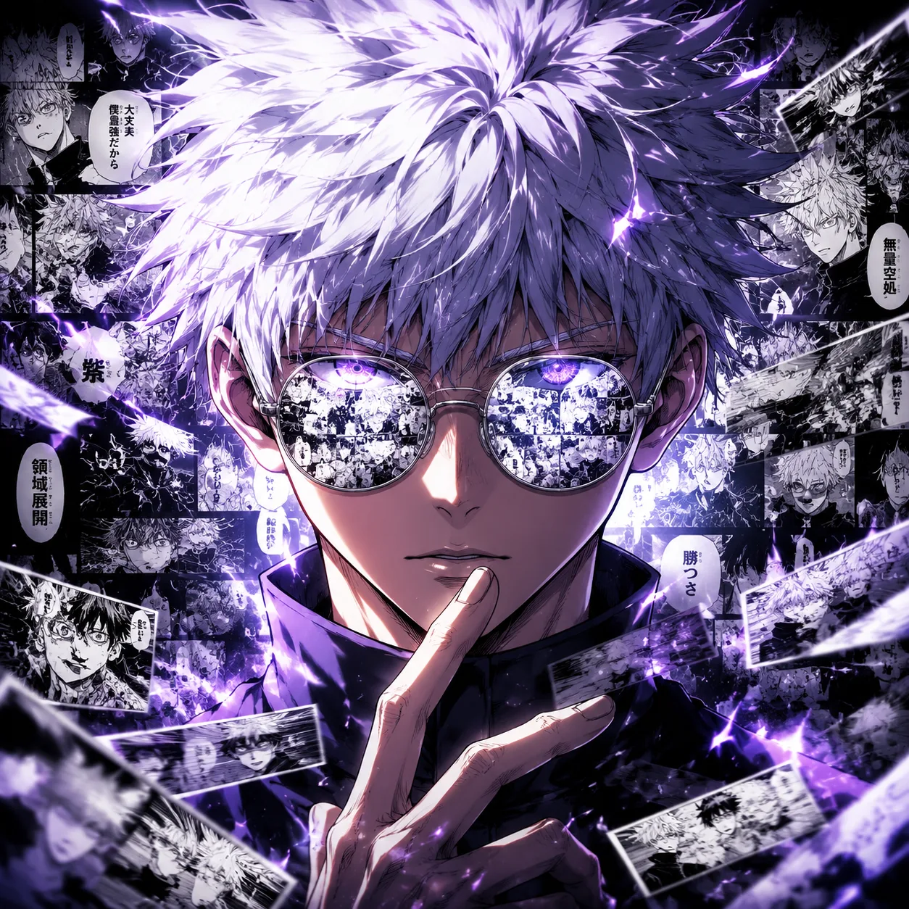

# Anime, Portrait

[← Back to the collection](../../README.md) · Category: [Poster Design](../../gallery/poster-design.md) · Model: `Vinano Studio` · ID: `vn-01987`

<a href="https://vinano.ai?utm_source=github&utm_medium=readme&utm_campaign=awesome-image-video-prompts-updating&utm_content=prompt-page-image"></a>

<sub>Preview generated with <a href="https://vinano.ai?utm_source=github&utm_medium=readme&utm_campaign=awesome-image-video-prompts-updating&utm_content=prompt-page-caption">vinano.ai</a></sub>

## Prompt

```text
Ultra detailed anime manga character poster of [CHARACTER NAME], dramatic front-facing upper body close-up, centered symmetrical composition, direct eye contact the viewer, overwhelming cinematic presence.

[CHARACTER HAIR DESCRIPTION], [EYE COLOR] eyes, wearing [ACCESSORY / GLASSES / MASK], a [EMOTION / EXPRESSION] facial expression. Dynamic anime lighting strong contrast and deep cel shading.

The reflective lenses contain countless black-and-white manga panels, iconic scenes, emotional memories, battles, and close-up expressions from the character’s world, creating a “memory reflection” effect.

The entire background is built from dense manga page collages, layered comic panels, speed lines, dialogue fragments, action frames, and emotional moments, forming a massive visual wall of memories and chaos.

Foreground filled floating manga strips moving at high speed across the scene, featuring cinematic motion blur, depth of field, and perspective distortion to create extreme depth and movement.

The atmosphere contains glowing [ENERGY COLOR] particles, spiritual energy fragments, sparks, smoke particles, and volumetric light effects, contrasting beautifully the character colors.

Modern premium anime commercial poster aesthetic, inspired by high-end manga covers, Japanese anime key visuals, cinematic anime trailers, and collector edition posters.

anime key visual, manga collage poster, cinematic anime lighting, reflective glasses, manga panels reflection, dynamic motion blur, ultra detailed anime illustration, layered composition, high contrast shading, cel shading, glowing particles, dramatic close-up portrait, symmetrical composition, manga montage background, Japanese comic aesthetic, premium anime poster, emotional action atmosphere, masterpiece anime illustration

Maintain consistent colour harmony and crisp focus across the whole frame.
```

## Try it on vinano.ai

1. Copy the prompt above.
2. Open **[vinano.ai](https://vinano.ai?utm_source=github&utm_medium=readme&utm_campaign=awesome-image-video-prompts-updating&utm_content=prompt-page-try)**, paste it into the image generator and pick a model.
3. Swap any placeholders (brand, product, city, person…) for your own details, then generate.

More prompts like this: [Poster Design gallery](../../gallery/poster-design.md) · [all categories](../../README.md#contents)
