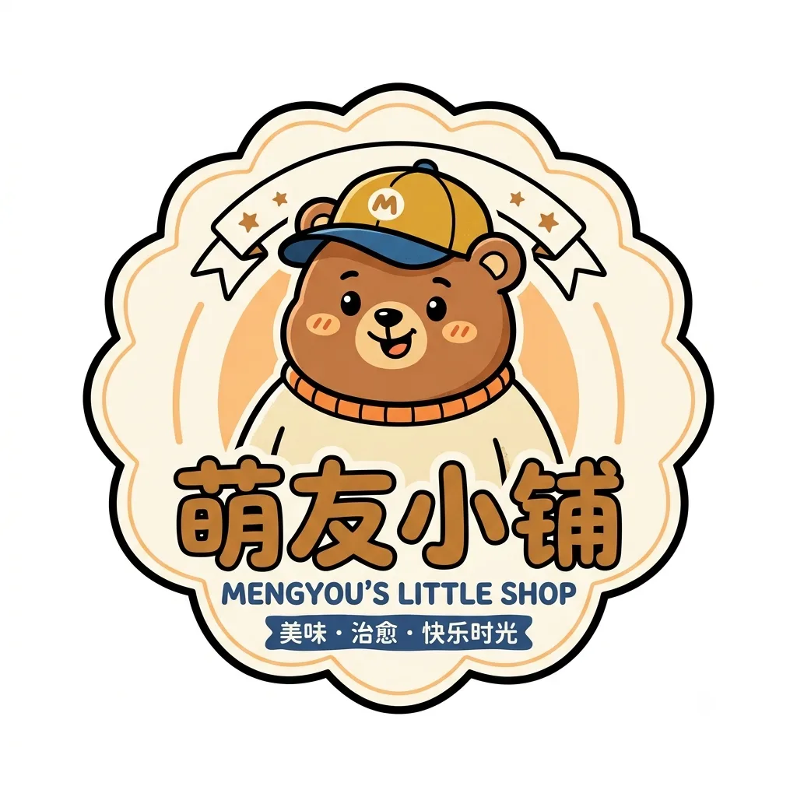

# 设计一张原创卡通吉祥物 Logo

[← Back to the collection](../../README.md) · Category: [Poster Design](../../gallery/poster-design.md) · Model: `Vinano Image Pro` · ID: `vn-01992`

<a href="https://vinano.ai?utm_source=github&utm_medium=readme&utm_campaign=awesome-image-video-prompts-updating&utm_content=prompt-page-image"></a>

<sub>Preview generated with <a href="https://vinano.ai?utm_source=github&utm_medium=readme&utm_campaign=awesome-image-video-prompts-updating&utm_content=prompt-page-caption">vinano.ai</a></sub>

## Prompt

```text
设计一张原创卡通吉祥物 Logo，整体为潮萌、轻复古、可商用的小店品牌视觉风格。画面采用纯白背景，Logo 单独居中展示，不要做成海报拼图。以「[品牌名]」为核心，围绕一个圆润可爱的[角色方向]展开，角色要有强记忆点，造型简洁、表情生动、轮廓清晰，带一点松弛感和趣味感。

整体风格参考：粗黑描边、扁平色块、高辨识度卡通形象、轻微手作感、贴纸感、小店 IP 感。配色控制在 2–4 种主色内，颜色要明快但不刺眼，可采用奶油色、橙黄、草绿、湖蓝、雾粉、焦糖棕等年轻化配色，不要脏灰，不要过度复杂，不要渐变金属感。

版式要求：图形主体在上，品牌字标在下或与图形自然结合；品牌主标题可以用中文、英文或中英结合；字体要圆润、厚实、有亲和力，可带一点手写感或趣味变形感；可加入一句简短副标题、小标语或[品类方向]说明，增强完整度，但文字不要过多。整体比例舒适，图形与文字关系紧凑，有品牌感，适合做门头、包装、贴纸、杯贴、社媒头像。

细节要求：Logo 要原创，不要照搬参考；不要太儿童化，也不要太幼稚；可爱中要带一点设计感 and 商业感；轮廓干净，识别度高，便于后续延展。输出为高清、干净、清晰的单个 Logo 成品图。

保持真实比例与空间层次，呈现专业、稳重的最终效果。
```

## Try it on vinano.ai

1. Copy the prompt above.
2. Open **[vinano.ai](https://vinano.ai?utm_source=github&utm_medium=readme&utm_campaign=awesome-image-video-prompts-updating&utm_content=prompt-page-try)**, paste it into the image generator and pick a model.
3. Swap any placeholders (brand, product, city, person…) for your own details, then generate.

More prompts like this: [Poster Design gallery](../../gallery/poster-design.md) · [all categories](../../README.md#contents)
