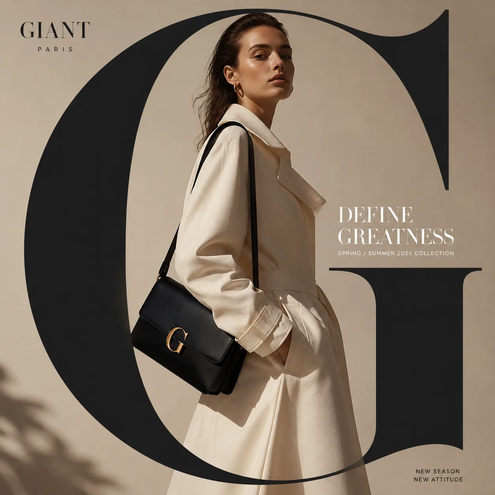

# Realistic, Poster

[← Back to the collection](../../README.md) · Category: [Poster Design](../../gallery/poster-design.md) · Model: `Vinano Studio` · ID: `vn-01997`

<a href="https://vinano.ai?utm_source=github&utm_medium=readme&utm_campaign=awesome-image-video-prompts-updating&utm_content=prompt-page-image"></a>

<sub>Preview generated with <a href="https://vinano.ai?utm_source=github&utm_medium=readme&utm_campaign=awesome-image-video-prompts-updating&utm_content=prompt-page-caption">vinano.ai</a></sub>

## Prompt

```text
Create a high-end luxury fashion campaign mockup strong typography, realistic fashion photography and premium brand presence.

Theme: [Luxury Fashion / Magazine Cover / Event Poster / Seasonal Lookbook / Product Campaign]
Direction: [Giant Initial Campaign / Pop Fashion Magazine Cover / Luxury Noir Event Poster / Urban Seasonal Lookbook]
Brand / event name: [Name]
Main title: [Short Headline]
Subtitle: [Short Subtitle]
Product / focus: [Bag / Outfit / Model / Event / Collection]
Model / subject: [Model Description]
Color palette: [Cream-Black / Black-Yellow-White / Black-Silver / Camel-Grey-Brown]
Mood: [Quiet Luxury / Bold Fashion / Noir Elegance / Urban Winter / Modern Editorial]
Aspect ratio: [9:16]

The poster should feel like a premium fashion campaign, luxury ad, magazine cover, event visual or lookbook mockup.

Use oversized serif typography, realistic fashion photography, refined lighting, strong negative space, clear brand hierarchy, product or event mood, and a strong relationship between the model, product and type.

Choose one direction:

1. Giant initial campaign
 Use one huge brand initial as the main structure. Let the model and product overlap the letter. Keep it clean, minimal, luxurious and campaign-like.

2. Pop fashion magazine cover
 Use a bold fashion model pose, strong color accent, oversized magazine-style masthead and dynamic editorial typography.

3. Luxury noir event poster
 Use a dark luxury setting, elegant eveningwear, oversized letterforms as spatial structures, silver / black tones, and refined event information.

4. Urban seasonal lookbook
 Use an autumn / winter city outfit, muted tones, architectural background, one large spatial letter or word, and minimal premium lookbook typography.

Keep the result high-end, realistic, editorial and brand-driven.

Avoid cheap e-commerce style, cluttered template design, random stickers, weak typography, too much text, messy layout, fake plastic skin, distorted body, deformed hands, product distortion, bad text rendering and real copyrighted brand logos.

Generate one finished poster only.

Aim for an editorial, design-driven look with deliberate negative space.
```

## Try it on vinano.ai

1. Copy the prompt above.
2. Open **[vinano.ai](https://vinano.ai?utm_source=github&utm_medium=readme&utm_campaign=awesome-image-video-prompts-updating&utm_content=prompt-page-try)**, paste it into the image generator and pick a model.
3. Swap any placeholders (brand, product, city, person…) for your own details, then generate.

More prompts like this: [Poster Design gallery](../../gallery/poster-design.md) · [all categories](../../README.md#contents)
