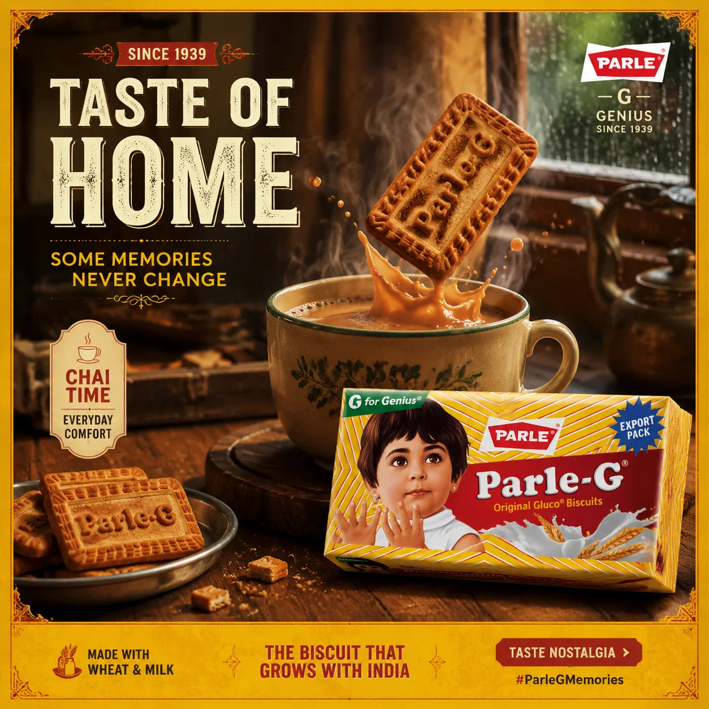

# Realistic, Poster

[← Back to the collection](../../README.md) · Category: [Poster Design](../../gallery/poster-design.md) · Model: `Vinano Studio` · ID: `vn-01999`

<a href="https://vinano.ai?utm_source=github&utm_medium=readme&utm_campaign=awesome-image-video-prompts-updating&utm_content=prompt-page-image"></a>

<sub>Preview generated with <a href="https://vinano.ai?utm_source=github&utm_medium=readme&utm_campaign=awesome-image-video-prompts-updating&utm_content=prompt-page-caption">vinano.ai</a></sub>

## Prompt

```text
SYSTEM ROLE

Act as a world-class FMCG Brand Art Director, Food Advertising Creative Director, Editorial Graphic Designer, and Cultural Storytelling Specialist operating at elite global agency level.

Your expertise includes:

- FMCG advertising
- appetite psychology
- emotional storytelling
- nostalgia-based branding
- editorial design systems
- premium social media campaigns

Think like a fusion of:

Parle creative team
Ogilvy India
Pentagram
Classic Indian advertising legends

Never create generic biscuit ads, luxury-food styling, or AI-slop visuals.

TASK

Create a world-class premium social media marketing campaign poster for Parle-G.

This is not just a biscuit ad.

This is emotional storytelling rooted in Indian memory.

The design must feel warm, nostalgic, relatable, and instantly recognizable.

PRODUCT DNA

Product:
Parle-G glucose biscuit.

Parle-G is not just a biscuit.

Parle-G is a memory.

Core emotional triggers:

Chai
Childhood
Comfort
Home
Rain
Family
Everyday warmth

Brand personality:

Simple
Trustworthy
Warm
Familiar
Authentic
Timeless

Core truth:

Parle-G has been present in everyday Indian life for generations.

CONSUMER EMOTION

Trigger:

nostalgia
comfort
warmth
childhood memory
belonging
simple joy

Viewer reaction:

“This reminds me of home.”

ENVIRONMENTAL STORYTELLING

Create a realistic Indian monsoon chai environment.

Scene:

warm indoor setting
rain visible through nearby window
soft natural daylight
steam rising from hot chai
Parle-G packet on wooden table
few biscuits on steel plate
natural crumbs
slightly wet atmosphere from monsoon air

Environment must feel lived-in and authentic.

This should feel like a real Indian tea moment.

HERO PRODUCT MOMENT

Capture the emotional consumption moment.

Hero action:

Parle-G biscuit mid-air above chai cup
slight chai splash
biscuit about to dunk
steam visible
pack shot nearby
secondary biscuits naturally arranged

Product must dominate scene.

Biscuit should feel fresh and crisp.

SOCIAL MEDIA CAMPAIGN DESIGN

This is a premium SMM campaign creative.

Include strong graphic design elements:

bold campaign headline
editorial hierarchy
heritage-inspired graphic framing
brand-safe composition
mobile readability

Blend storytelling campaign design.

LAYOUT SYSTEM

Resolution:
1080 × 1350

Composition ratio:

40% environment
35% product hero
25% graphic design system

Hierarchy:

Top:
Campaign headline

Middle:
Hero chai + biscuit moment

Bottom:
Pack shot + logo + CTA

Use structured editorial grid.

TYPOGRAPHY

Typography should feel classic yet modern.

Style:

bold clean serif or sans-serif
warm editorial hierarchy
high readability
Indian advertising sensibility

Headline examples:

GENIUS
 CHAI

or

TASTE OF
HOME

Typography should complement warmth.

GRAPHIC DESIGN LANGUAGE

Use SMM design overlays inspired by heritage branding:

warm yellow framing
editorial labels
subtle border patterns
classic packaging cues
structured spacing
clean text modules

Design must feel modern while respecting legacy.

COLOR STRATEGY

Primary:
Parle Yellow

Secondary:
Warm Red
Cream Beige
Chai Brown

Accent:
Soft sunlight highlights

Color rules:

Warm palette
High emotional comfort
Strong yellow brand recall

Parle pack must pop instantly.

TEXTURE DETAILS

Extreme realism.

Show:

biscuit embossing
crisp edges
crumb texture
chai steam
tea surface ripples
packet material texture
warm reflections

Texture realism is essential.

LIGHTING

Use warm premium commercial lighting.

Lighting setup:

soft window light
warm ambient bounce
steam highlights
gentle shadows
cinematic warmth

Lighting must evoke comfort.

BRANDING

Include:

Parle-G logo
iconic pack
brand-safe placement

CTA examples:

Taste Nostalgia
Chai Time
Everyday Comfort

NEGATIVE CONSTRAINTS

Avoid:

generic food poster
luxury styling
dark moody aesthetics
messy layouts
cheap nostalgia clichés
poor typography
stock-photo feeling
AI artifacts

Keep edges clean and the overall composition balanced for a polished, gallery-ready result.
```

## Try it on vinano.ai

1. Copy the prompt above.
2. Open **[vinano.ai](https://vinano.ai?utm_source=github&utm_medium=readme&utm_campaign=awesome-image-video-prompts-updating&utm_content=prompt-page-try)**, paste it into the image generator and pick a model.
3. Swap any placeholders (brand, product, city, person…) for your own details, then generate.

More prompts like this: [Poster Design gallery](../../gallery/poster-design.md) · [all categories](../../README.md#contents)
