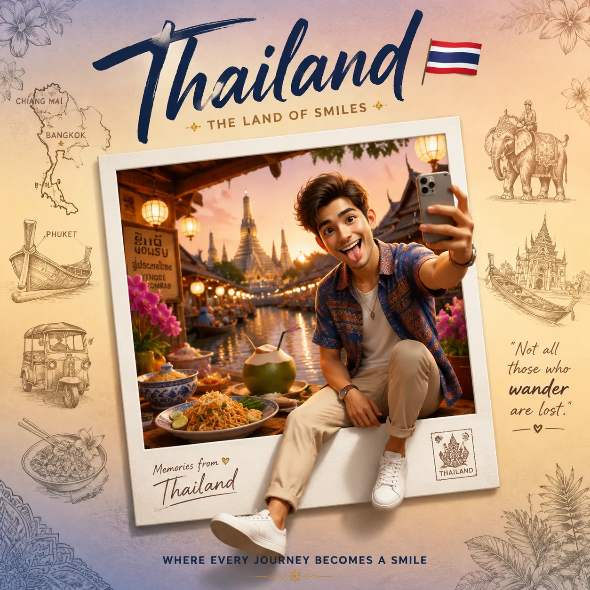

# Poster, Character

[← Back to the collection](../../README.md) · Category: [Poster Design](../../gallery/poster-design.md) · Model: `Vinano Studio` · ID: `vn-02003`

<a href="https://vinano.ai?utm_source=github&utm_medium=readme&utm_campaign=awesome-image-video-prompts-updating&utm_content=prompt-page-image"></a>

<sub>Preview generated with <a href="https://vinano.ai?utm_source=github&utm_medium=readme&utm_campaign=awesome-image-video-prompts-updating&utm_content=prompt-page-caption">vinano.ai</a></sub>

## Prompt

```text
Create a premium collectible travel poster, Theme: [Place Name] The man from the attached country-style photo takes a funny selfie his smartphone, sitting on the bottom edge of a large Polaroid photo frame, one leg hanging outside the frame, creating a playful 3D popping effect. Inside the Polaroid photo frame: A cozy room / travel scene inspired by place. Authentic elements of culture, architecture, food, nature, crafts and local lifestyle Warm, inviting lighting Rich narrative details Character dressed in modern fashion inspired by the color and identity of the country Happy facial expression, large expressive eyes, carefully styled hair, very attractive design Camera angle, similar to selfies on social networks For Beyond the Polaroid: Premium soft gradient background Thai-inspired colors, elegant monochrome hand-drawn drawings and icons, attractions related to traveling around the country, flora and fauna, cultural symbols, local food, transport, maps and decorative motifs crisp composition lots of negative space No clutter Typography: Large and stylishly handwritten name of the country at the top A small national flag next to the name A short slogan of the country at the bottom An inspiring handwritten quote Polaroid Art style on the picture frame: premium-quality 3D illustration Collectible poster design Very cute character design Soft filmic, cinematic lighting Detailed textures Aesthetic tourist souvenir Bright but tasteful colors First-class illustrations for social networks Depth of field Professional composition 4K quality Vertical poster format (4:5) Important: The character must reflect the spirit of the country through the environment, fashion, colors, hobbies and cultural elements, not through stereotypes. The country should be instantly recognizable through visual storytelling. Set the aspect ratio to 3:4 Render with rich micro-detail while keeping the layout uncluttered and intentional.
```

## Try it on vinano.ai

1. Copy the prompt above.
2. Open **[vinano.ai](https://vinano.ai?utm_source=github&utm_medium=readme&utm_campaign=awesome-image-video-prompts-updating&utm_content=prompt-page-try)**, paste it into the image generator and pick a model.
3. Swap any placeholders (brand, product, city, person…) for your own details, then generate.

More prompts like this: [Poster Design gallery](../../gallery/poster-design.md) · [all categories](../../README.md#contents)
