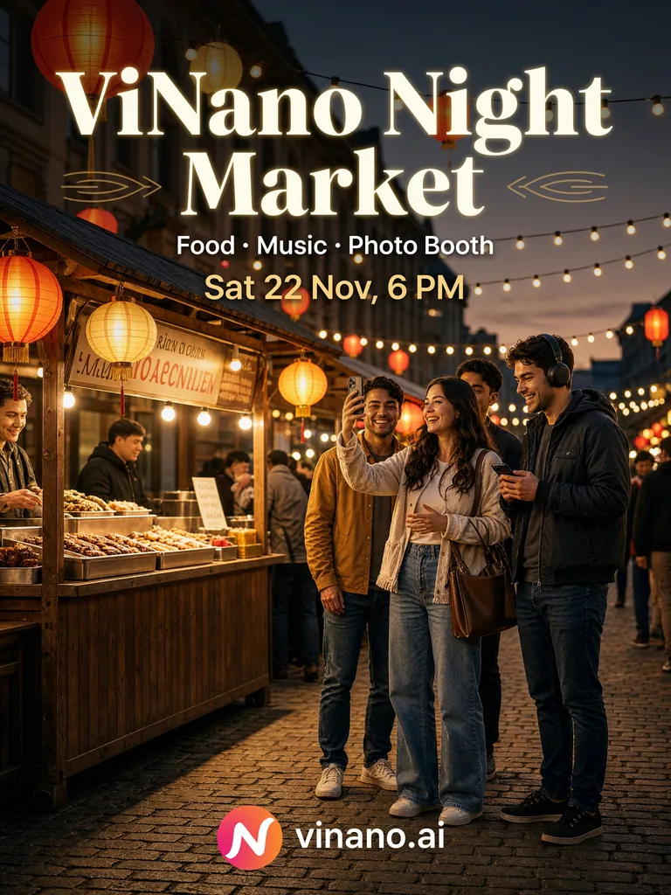

# Vertical event poster for a night market

[← Back to the collection](../../README.md) · Category: [Poster Design](../../gallery/poster-design.md) · Model: `MiniMax H3 Image` · ID: `vn-02111`

<a href="https://vinano.ai?utm_source=github&utm_medium=readme&utm_campaign=awesome-image-video-prompts-updating&utm_content=prompt-page-image"></a>

<sub>Preview generated with <a href="https://vinano.ai?utm_source=github&utm_medium=readme&utm_campaign=awesome-image-video-prompts-updating&utm_content=prompt-page-caption">vinano.ai</a> · added 2026-11-18</sub>

## Prompt

```text
Vertical event poster for a night market. Large bold headline at the top: "ViNano Night Market". Below it a smaller line: "Food · Music · Photo Booth" and the date "Sat 22 Nov, 6 PM". The scene shows glowing paper lanterns over food stalls, string lights and people with phones taking photos. Bottom right corner has a round logo: a pink-to-orange gradient circle with a white flowing letter N, next to the text "vinano.ai". Crisp print-ready typography, rich warm colors.
```

## Try it on vinano.ai

1. Copy the prompt above.
2. Open **[vinano.ai](https://vinano.ai?utm_source=github&utm_medium=readme&utm_campaign=awesome-image-video-prompts-updating&utm_content=prompt-page-try)**, paste it into the image generator and pick a model.
3. Swap any placeholders (brand, product, city, person…) for your own details, then generate.

More prompts like this: [Poster Design gallery](../../gallery/poster-design.md) · [all categories](../../README.md#contents)
