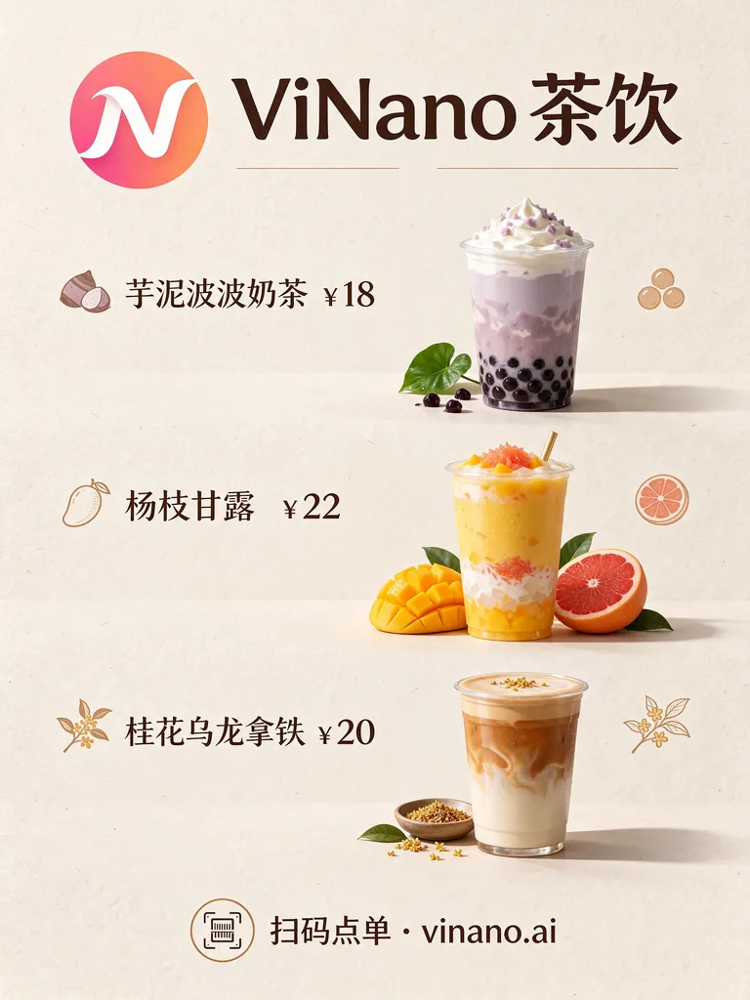

# 一张奶茶店的竖版菜单海报

[← Back to the collection](../../README.md) · Category: [Poster Design](../../gallery/poster-design.md) · Model: `Seedream 5.5` · ID: `vn-02112`

<a href="https://vinano.ai?utm_source=github&utm_medium=readme&utm_campaign=awesome-image-video-prompts-updating&utm_content=prompt-page-image"></a>

<sub>Preview generated with <a href="https://vinano.ai?utm_source=github&utm_medium=readme&utm_campaign=awesome-image-video-prompts-updating&utm_content=prompt-page-caption">vinano.ai</a> · added 2026-11-18</sub>

## Prompt

```text
一张奶茶店的竖版菜单海报，奶油色背景，顶部大标题“ViNano 茶饮”，标题左边是一个圆形 logo：粉色到橙色渐变的圆，里面是白色流线型字母 N。下面分三行列出饮品和价格：“芋泥波波奶茶 ¥18”“杨枝甘露 ¥22”“桂花乌龙拿铁 ¥20”，每款旁边配一张写实的饮品小图。底部一行小字“扫码点单 · vinano.ai”。排版整洁，中文清晰可读，印刷质感。
```

## Try it on vinano.ai

1. Copy the prompt above.
2. Open **[vinano.ai](https://vinano.ai?utm_source=github&utm_medium=readme&utm_campaign=awesome-image-video-prompts-updating&utm_content=prompt-page-try)**, paste it into the image generator and pick a model.
3. Swap any placeholders (brand, product, city, person…) for your own details, then generate.

More prompts like this: [Poster Design gallery](../../gallery/poster-design.md) · [all categories](../../README.md#contents)
