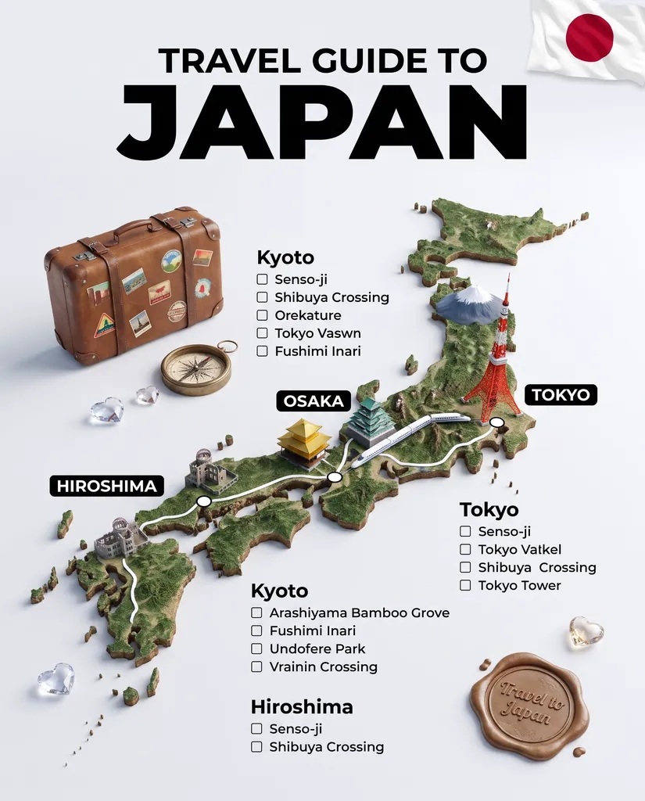

# 3D travel guide poster for Japan

[← Back to the collection](../../README.md) · Category: [Poster Design](../../gallery/poster-design.md) · Model: `Nano Banana Pro` · ID: `vn-02113`

<a href="https://vinano.ai?utm_source=github&utm_medium=readme&utm_campaign=awesome-image-video-prompts-updating&utm_content=prompt-page-image"></a>

<sub>Preview generated with <a href="https://vinano.ai?utm_source=github&utm_medium=readme&utm_campaign=awesome-image-video-prompts-updating&utm_content=prompt-page-caption">vinano.ai</a> · added 2026-11-18</sub>

## Prompt

```text
A hyper-realistic 3D travel guide infographic poster for Japan. The country shape is rendered as a raised, textured terrain map floating on a clean light gray surface. Iconic landmarks are placed as miniature 3D sculpted models at their correct geographic locations across the map — each one highly detailed and photorealistic. Roads or railway lines connect key cities as white paths across the terrain. Around the map, floating 3D decorative props related to travel are scattered: a vintage leather suitcase with travel stickers, a compass rose, crystal heart charms, and a postage stamp seal reading “Travel to Japan.” The national flag of Japan is shown as a small realistic folded flag in the upper right corner. Each major city has a bold black label on the map, and beside the map, each city has a neat checklist of its top attractions in clean sans-serif typography. A large bold title at the top reads: “TRAVEL GUIDE TO JAPAN” in black uppercase typography with the word JAPAN in heavy bold. The overall aesthetic is premium editorial travel content — soft studio lighting, photorealistic 3D render, white/light gray background, clean layout.
```

## Try it on vinano.ai

1. Copy the prompt above.
2. Open **[vinano.ai](https://vinano.ai?utm_source=github&utm_medium=readme&utm_campaign=awesome-image-video-prompts-updating&utm_content=prompt-page-try)**, paste it into the image generator and pick a model.
3. Swap any placeholders (brand, product, city, person…) for your own details, then generate.

More prompts like this: [Poster Design gallery](../../gallery/poster-design.md) · [all categories](../../README.md#contents)
