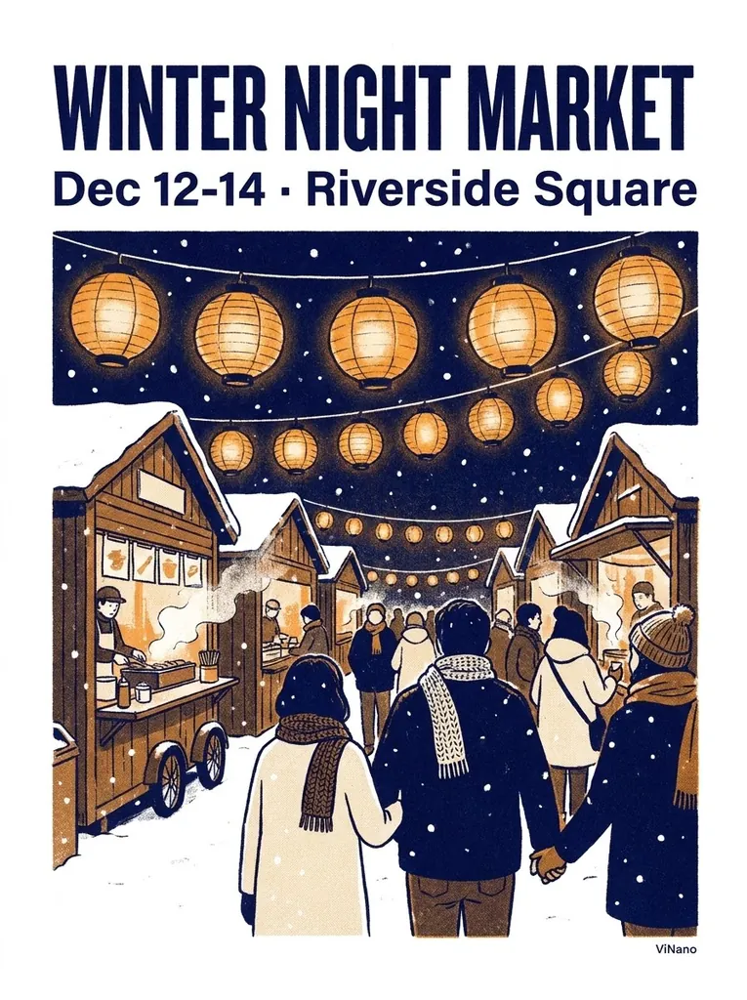

# Winter Night Market Poster

[← Back to the collection](../../README.md) · Category: [Poster Design](../../gallery/poster-design.md) · Model: `Nano Banana Pro` · ID: `vn-02140`

<a href="https://vinano.ai?utm_source=github&utm_medium=readme&utm_campaign=awesome-image-video-prompts-updating&utm_content=prompt-page-image"></a>

<sub>Preview generated with <a href="https://vinano.ai?utm_source=github&utm_medium=readme&utm_campaign=awesome-image-video-prompts-updating&utm_content=prompt-page-caption">vinano.ai</a> · added 2026-11-19</sub>

## Prompt

```text
A vertical event poster for a winter night market: rows of glowing paper lanterns over snowy wooden stalls, steam rising from food carts, a small crowd in knitted scarves seen from behind. Bold condensed headline at the top reading "WINTER NIGHT MARKET", smaller line below "Dec 12-14 · Riverside Square", and a tiny "ViNano" credit in the bottom corner. Risograph print texture, limited palette of deep navy, warm amber and off-white, generous margins, clean grid typography.
```

## Try it on vinano.ai

1. Copy the prompt above.
2. Open **[vinano.ai](https://vinano.ai?utm_source=github&utm_medium=readme&utm_campaign=awesome-image-video-prompts-updating&utm_content=prompt-page-try)**, paste it into the image generator and pick a model.
3. Swap any placeholders (brand, product, city, person…) for your own details, then generate.

More prompts like this: [Poster Design gallery](../../gallery/poster-design.md) · [all categories](../../README.md#contents)
