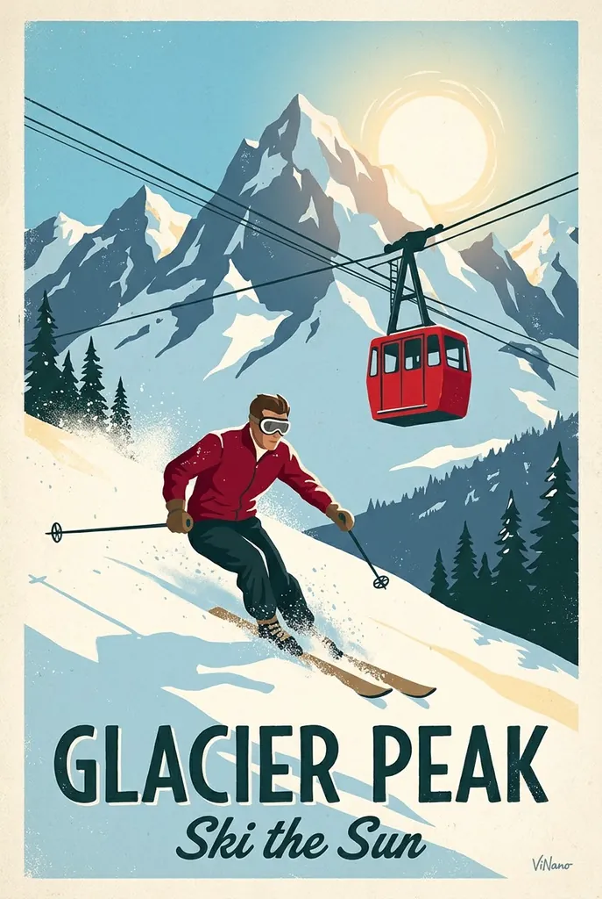

# Retro Ski Resort Travel Poster

[← Back to the collection](../../README.md) · Category: [Poster Design](../../gallery/poster-design.md) · Model: `Nano Banana 2.1` · ID: `vn-02147`

<a href="https://vinano.ai?utm_source=github&utm_medium=readme&utm_campaign=awesome-image-video-prompts-updating&utm_content=prompt-page-image"></a>

<sub>Preview generated with <a href="https://vinano.ai?utm_source=github&utm_medium=readme&utm_campaign=awesome-image-video-prompts-updating&utm_content=prompt-page-caption">vinano.ai</a> · added 2026-11-19</sub>

## Prompt

```text
A vintage-style travel poster for a fictional alpine ski town called "Glacier Peak": a skier carving down a sunlit slope with jagged mountains and a red cable car behind, flat screen-printed shapes, bold 1950s lettering at the bottom reading "GLACIER PEAK" with "Ski the Sun" underneath. Limited palette of sky blue, snow white, cherry red and pine green, subtle paper grain, small "ViNano" signature in the corner.
```

## Try it on vinano.ai

1. Copy the prompt above.
2. Open **[vinano.ai](https://vinano.ai?utm_source=github&utm_medium=readme&utm_campaign=awesome-image-video-prompts-updating&utm_content=prompt-page-try)**, paste it into the image generator and pick a model.
3. Swap any placeholders (brand, product, city, person…) for your own details, then generate.

More prompts like this: [Poster Design gallery](../../gallery/poster-design.md) · [all categories](../../README.md#contents)
