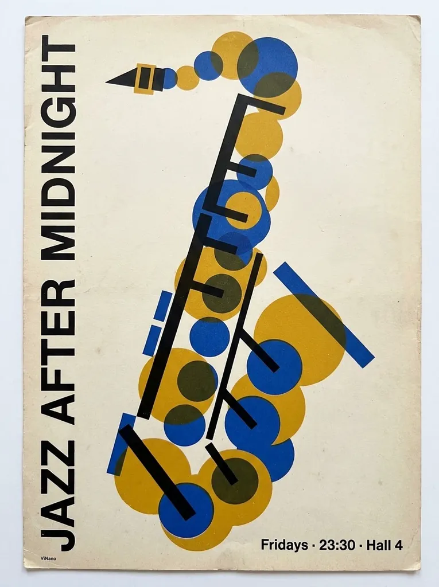

# Swiss-Style Jazz Night Poster

[← Back to the collection](../../README.md) · Category: [Poster Design](../../gallery/poster-design.md) · Model: `Nano Banana Pro` · ID: `vn-02151`

<a href="https://vinano.ai?utm_source=github&utm_medium=readme&utm_campaign=awesome-image-video-prompts-updating&utm_content=prompt-page-image"></a>

<sub>Preview generated with <a href="https://vinano.ai?utm_source=github&utm_medium=readme&utm_campaign=awesome-image-video-prompts-updating&utm_content=prompt-page-caption">vinano.ai</a> · added 2026-11-23</sub>

## Prompt

```text
A Swiss International Style poster for a late-night jazz series: a huge abstract saxophone silhouette built from overlapping circles and diagonal bars, strict modular grid, flush-left Helvetica-like type. Headline "JAZZ AFTER MIDNIGHT" set vertically along the left edge, small lines of event details "Fridays · 23:30 · Hall 4" at the bottom right, and a tiny "ViNano" credit. Palette of mustard yellow, cobalt blue and black on warm off-white paper, slight offset-print misregistration.
```

## Try it on vinano.ai

1. Copy the prompt above.
2. Open **[vinano.ai](https://vinano.ai?utm_source=github&utm_medium=readme&utm_campaign=awesome-image-video-prompts-updating&utm_content=prompt-page-try)**, paste it into the image generator and pick a model.
3. Swap any placeholders (brand, product, city, person…) for your own details, then generate.

More prompts like this: [Poster Design gallery](../../gallery/poster-design.md) · [all categories](../../README.md#contents)
