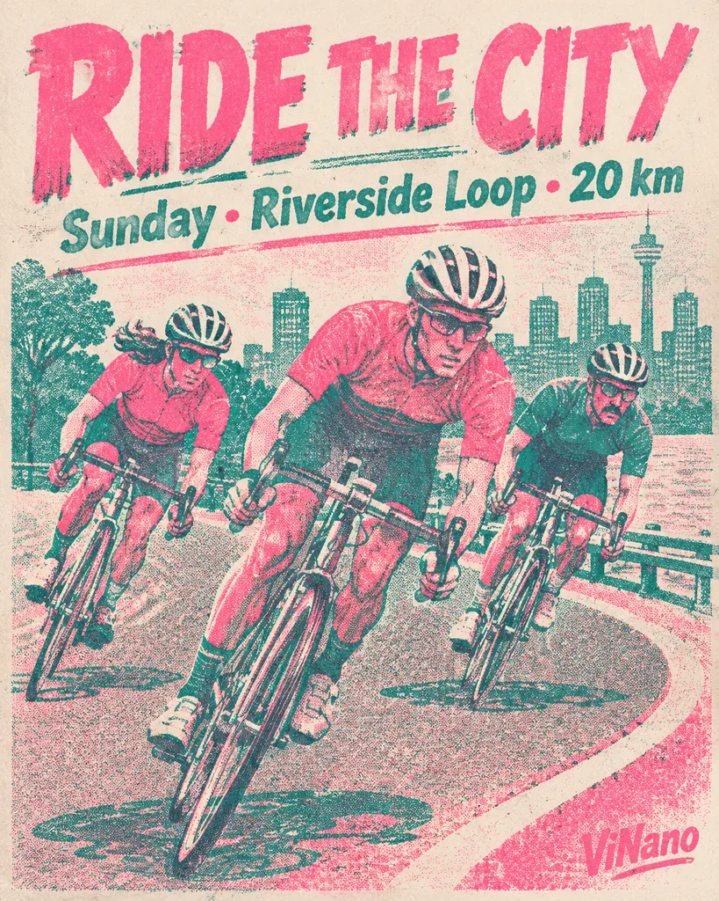

# Risograph Bike Festival Poster

[← Back to the collection](../../README.md) · Category: [Poster Design](../../gallery/poster-design.md) · Model: `GPT Image 2.6 Flare` · ID: `vn-02163`

<a href="https://vinano.ai?utm_source=github&utm_medium=readme&utm_campaign=awesome-image-video-prompts-updating&utm_content=prompt-page-image"></a>

<sub>Preview generated with <a href="https://vinano.ai?utm_source=github&utm_medium=readme&utm_campaign=awesome-image-video-prompts-updating&utm_content=prompt-page-caption">vinano.ai</a> · added 2026-11-24</sub>

## Prompt

```text
A two-color risograph poster for a community cycling day: a bold illustration of three riders on vintage road bikes leaning into a curve, drawn with chunky shapes and halftone grain. Big hand-cut lettering "RIDE THE CITY" across the top, smaller lines "Sunday · Riverside Loop · 20 km" below, and a small "ViNano" mark in the corner. Fluorescent pink and teal inks overlapping on off-white paper, visible misregistration and ink texture.
```

## Try it on vinano.ai

1. Copy the prompt above.
2. Open **[vinano.ai](https://vinano.ai?utm_source=github&utm_medium=readme&utm_campaign=awesome-image-video-prompts-updating&utm_content=prompt-page-try)**, paste it into the image generator and pick a model.
3. Swap any placeholders (brand, product, city, person…) for your own details, then generate.

More prompts like this: [Poster Design gallery](../../gallery/poster-design.md) · [all categories](../../README.md#contents)
