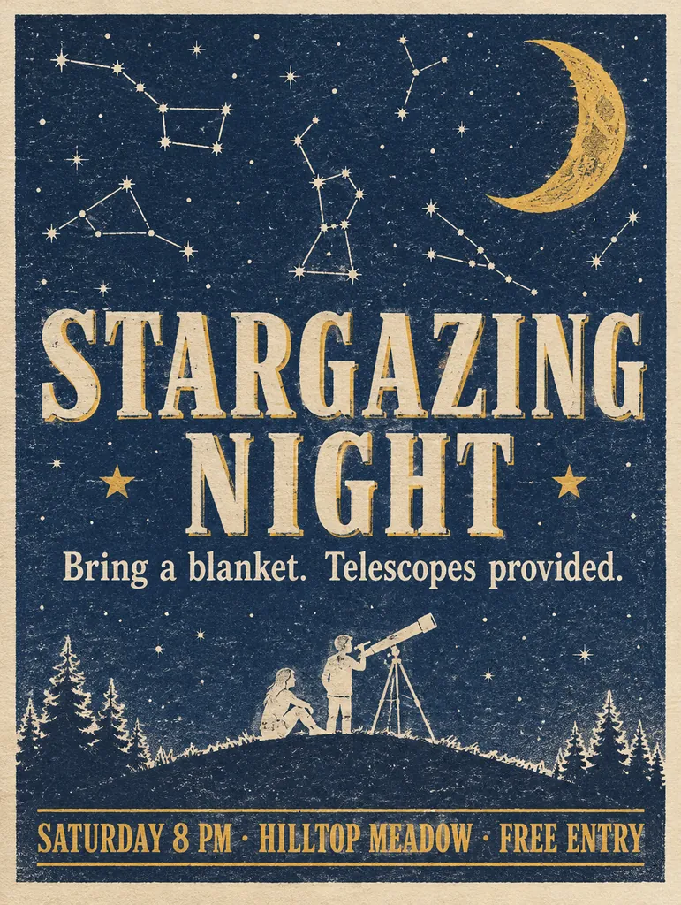

# Letterpress Stargazing Night Poster

[← Back to the collection](../../README.md) · Category: [Poster Design](../../gallery/poster-design.md) · Model: `GPT Image 2.6 Flare` · ID: `vn-02173`

<a href="https://vinano.ai?utm_source=github&utm_medium=readme&utm_campaign=awesome-image-video-prompts-updating&utm_content=prompt-page-image"></a>

<sub>Preview generated with <a href="https://vinano.ai?utm_source=github&utm_medium=readme&utm_campaign=awesome-image-video-prompts-updating&utm_content=prompt-page-caption">vinano.ai</a> · added 2026-11-25</sub>

## Prompt

```text
A letterpress-style event poster for a community astronomy evening. A deep navy night sky fills the sheet, dotted with hand-drawn constellations connected by fine cream lines, a large crescent moon in the upper right, and a small silhouette of a hill with a telescope and two people at the bottom. Headline in bold condensed serif capitals: "STARGAZING NIGHT". Subline: "Bring a blanket. Telescopes provided." Footer line: "Saturday 8 PM · Hilltop Meadow · Free entry". Limited palette of navy, cream and one warm gold ink, visible paper texture and slight ink misregistration, generous margins, balanced vintage layout, all lettering spelled correctly.
```

## Try it on vinano.ai

1. Copy the prompt above.
2. Open **[vinano.ai](https://vinano.ai?utm_source=github&utm_medium=readme&utm_campaign=awesome-image-video-prompts-updating&utm_content=prompt-page-try)**, paste it into the image generator and pick a model.
3. Swap any placeholders (brand, product, city, person…) for your own details, then generate.

More prompts like this: [Poster Design gallery](../../gallery/poster-design.md) · [all categories](../../README.md#contents)
