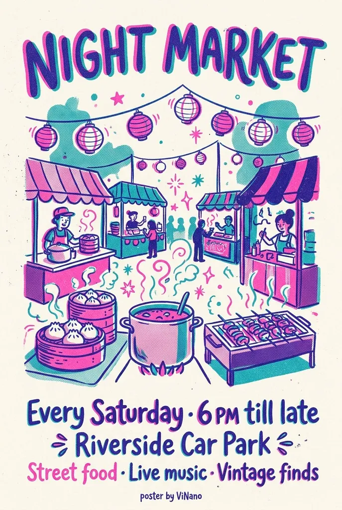

# Risograph Night Market Poster

[← Back to the collection](../../README.md) · Category: [Poster Design](../../gallery/poster-design.md) · Model: `Nano Banana 2.1` · ID: `vn-02193`

<a href="https://vinano.ai?utm_source=github&utm_medium=readme&utm_campaign=awesome-image-video-prompts-updating&utm_content=prompt-page-image"></a>

<sub>Preview generated with <a href="https://vinano.ai?utm_source=github&utm_medium=readme&utm_campaign=awesome-image-video-prompts-updating&utm_content=prompt-page-caption">vinano.ai</a> · added 2026-11-27</sub>

## Prompt

```text
A retro risograph-style poster for a neighborhood night market. Two-color print look in fluorescent pink and teal with visible grain and slight misregistration. Center: a playful illustration of food stalls under strings of round paper lanterns, steam rising from dumpling baskets and skewers on a grill. Big bubbly headline at the top: "NIGHT MARKET". Below: "Every Saturday · 6 PM till late", "Riverside Car Park", "Street food · Live music · Vintage finds". Small footer: "poster by ViNano". Off-white paper background, bold flat shapes, joyful energetic composition, crisp readable lettering.
```

## Try it on vinano.ai

1. Copy the prompt above.
2. Open **[vinano.ai](https://vinano.ai?utm_source=github&utm_medium=readme&utm_campaign=awesome-image-video-prompts-updating&utm_content=prompt-page-try)**, paste it into the image generator and pick a model.
3. Swap any placeholders (brand, product, city, person…) for your own details, then generate.

More prompts like this: [Poster Design gallery](../../gallery/poster-design.md) · [all categories](../../README.md#contents)
