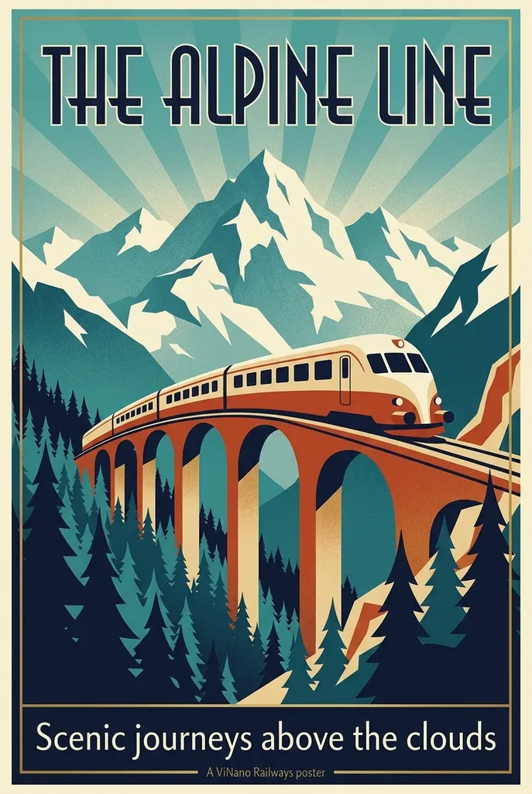

# Art Deco Alpine Railway Travel Poster

[← Back to the collection](../../README.md) · Category: [Poster Design](../../gallery/poster-design.md) · Model: `Nano Banana 2.1` · ID: `vn-02205`

<a href="https://vinano.ai?utm_source=github&utm_medium=readme&utm_campaign=awesome-image-video-prompts-updating&utm_content=prompt-page-image"></a>

<sub>Preview generated with <a href="https://vinano.ai?utm_source=github&utm_medium=readme&utm_campaign=awesome-image-video-prompts-updating&utm_content=prompt-page-caption">vinano.ai</a> · added 2026-11-28</sub>

## Prompt

```text
A vintage Art Deco travel poster for a fictional mountain railway. A streamlined cream-and-red train curves across a tall stone viaduct in front of jagged snowy peaks, with stylized pine forests below and sun rays fanning out across a teal sky. Bold geometric shapes, flat colors with subtle lithograph texture, limited palette of teal, cream, burnt orange and deep navy. Large condensed headline at the top: "THE ALPINE LINE". Bottom band: "Scenic journeys above the clouds" and a small line "A ViNano Railways poster". Elegant 1930s lettering, thin gold border.
```

## Try it on vinano.ai

1. Copy the prompt above.
2. Open **[vinano.ai](https://vinano.ai?utm_source=github&utm_medium=readme&utm_campaign=awesome-image-video-prompts-updating&utm_content=prompt-page-try)**, paste it into the image generator and pick a model.
3. Swap any placeholders (brand, product, city, person…) for your own details, then generate.

More prompts like this: [Poster Design gallery](../../gallery/poster-design.md) · [all categories](../../README.md#contents)
