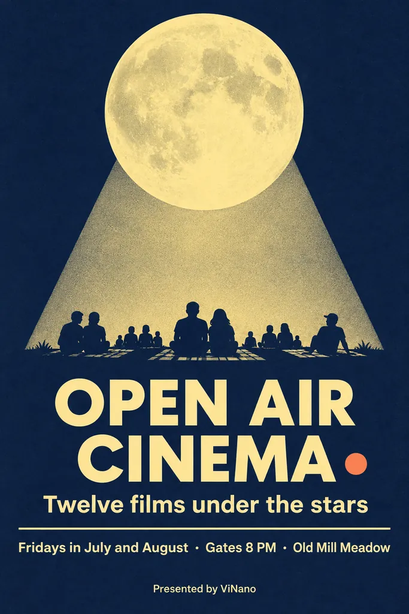

# Open Air Cinema Moon Poster

[← Back to the collection](../../README.md) · Category: [Poster Design](../../gallery/poster-design.md) · Model: `GPT Image 2.6 Flare` · ID: `vn-02206`

<a href="https://vinano.ai?utm_source=github&utm_medium=readme&utm_campaign=awesome-image-video-prompts-updating&utm_content=prompt-page-image"></a>

<sub>Preview generated with <a href="https://vinano.ai?utm_source=github&utm_medium=readme&utm_campaign=awesome-image-video-prompts-updating&utm_content=prompt-page-caption">vinano.ai</a> · added 2026-11-28</sub>

## Prompt

```text
A minimal typographic poster for an outdoor summer film series. Deep midnight-blue background with a huge pale-yellow full moon in the upper half; the moon doubles as a projector beam that widens down onto a tiny silhouette of an audience sitting on picnic blankets. Clean grotesque type: headline "OPEN AIR CINEMA", subline "Twelve films under the stars", details "Fridays in July and August · Gates 8 PM · Old Mill Meadow", and a small credit "Presented by ViNano". Generous negative space, two-color palette with a single coral accent dot, subtle paper grain.
```

## Try it on vinano.ai

1. Copy the prompt above.
2. Open **[vinano.ai](https://vinano.ai?utm_source=github&utm_medium=readme&utm_campaign=awesome-image-video-prompts-updating&utm_content=prompt-page-try)**, paste it into the image generator and pick a model.
3. Swap any placeholders (brand, product, city, person…) for your own details, then generate.

More prompts like this: [Poster Design gallery](../../gallery/poster-design.md) · [all categories](../../README.md#contents)
