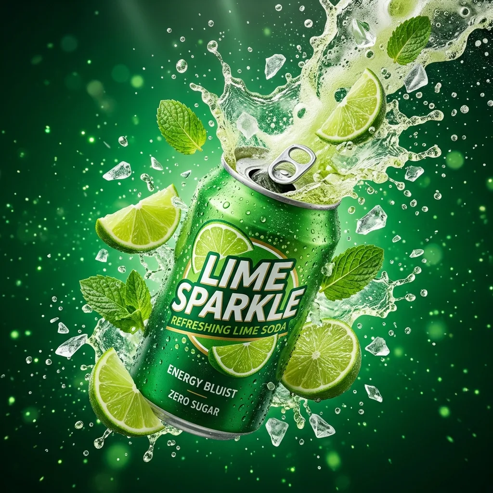

# Commercial product shot of a refreshing lime soda can

[← Back to the collection](../../README.md) · Category: [Product & Brand](../../gallery/product-brand.md) · Model: `Vinano Image Pro` · ID: `vn-00050`

<a href="https://vinano.ai?utm_source=github&utm_medium=readme&utm_campaign=awesome-image-video-prompts-updating&utm_content=prompt-page-image"></a>

<sub>Preview generated with <a href="https://vinano.ai?utm_source=github&utm_medium=readme&utm_campaign=awesome-image-video-prompts-updating&utm_content=prompt-page-caption">vinano.ai</a></sub>

## Prompt

```text
A hyper-realistic commercial product shot of a refreshing lime soda can exploding energy in mid-air. A vibrant green aluminum can covered in condensation, surrounded by sliced limes, mint leaves, and shards of ice, a dramatic water splash bursting from the top. Lime wedges collide the can, frozen in motion, droplets suspended in the air. Deep emerald green gradient background glowing particles, cinematic studio lighting, high contrast highlights, ultra-sharp focus on the can, macro-level texture detail. Dynamic action composition, refreshing summer mood, premium beverage advertising style, true-to-life photorealistic, 8k resolution. Aim for an editorial, design-driven look with deliberate negative space.
```

## Try it on vinano.ai

1. Copy the prompt above.
2. Open **[vinano.ai](https://vinano.ai?utm_source=github&utm_medium=readme&utm_campaign=awesome-image-video-prompts-updating&utm_content=prompt-page-try)**, paste it into the image generator and pick a model.
3. Swap any placeholders (brand, product, city, person…) for your own details, then generate.

More prompts like this: [Product & Brand gallery](../../gallery/product-brand.md) · [all categories](../../README.md#contents)
