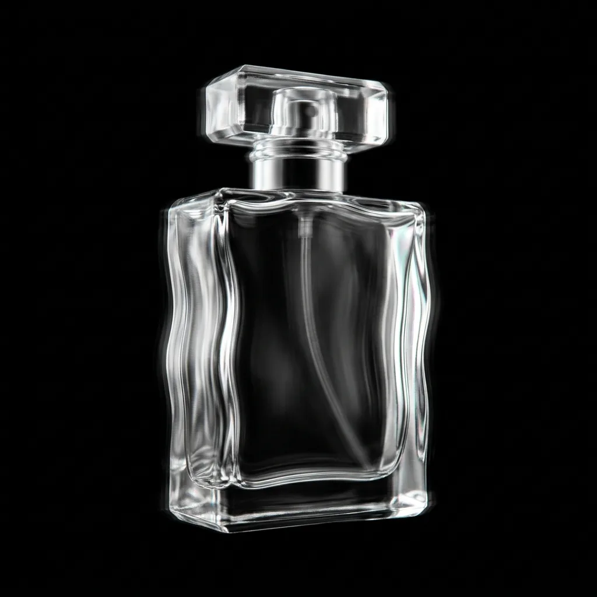

# Project name

[← Back to the collection](../../README.md) · Category: [Product & Brand](../../gallery/product-brand.md) · Model: `Vinano Image Pro` · ID: `vn-00095`

<a href="https://vinano.ai?utm_source=github&utm_medium=readme&utm_campaign=awesome-image-video-prompts-updating&utm_content=prompt-page-image"></a>

<sub>Preview generated with <a href="https://vinano.ai?utm_source=github&utm_medium=readme&utm_campaign=awesome-image-video-prompts-updating&utm_content=prompt-page-caption">vinano.ai</a></sub>

## Prompt

```text
{
"project_name": "Distorted_Luxury_Motion",

"USER_CUSTOMIZATION": {
"product_description": "PRODUCT HERE"
},
"settings": {
"style": "Avant-garde luxury product photography, abstract distortion, dreamlike etherealism, monochromatic subtle color accents.",
"aspect_ratio": "4:5",
"camera_angle": "Camera positioned low, looking up at the product which stands perfectly vertical and upright"
},
"prompt_construction": {
"MAIN_SUBJECT": {
"subject": "{{USER_CUSTOMIZATION.product_description}}",
"presentation": "The product stands perfectly vertical and upright, completely isolated. It is the sole object in the frame. The product is rendered surreal, fluid distortion effects along its edges, appearing semi-solid as if vibrating or viewed through heat haze. The core form remains recognizable. No additional materials, fabrics, liquids, or extensions are added to the product."
},
"VISUAL_EFFECTS": {
"distortion": "Heavy 'scanline' or 'refraction' distortion effects applied only to the product itself. The edges and contours are wavy, rippled, and stretched, similar to looking through heat haze or warped glass. The distortion warps the product's silhouette.",
"blur_and_smudge": "Motion blur and gaussian blur soften details, creating a 'smudged' painterly look. Light appears to drag and streak across the product's form only.",
"ghosting": "Subtle vibratory ghosting on the product's edges only, reinforcing the feeling of movement.",
"color_treatment": "Predominantly monochromatic silver, black, and grey tones. Subtle iridescent color notes (cyan, magenta) appear only within the distortion effects and highlights on the product's edges."
},
"LIGHTING_AND_COLOR": {
"background": "MANDATORY: Pure solid black background, hex code #000000, RGB (0,0,0). The entire background must be uniformly black no gradients, no grey tones, no white, no other colors. Absolute flat black darkness zero variation.",
"background_restrictions": "The background has zero atmospheric effects: no glow, no light rays, no light beams, no light streaks, no halos, no fog, no mist, no haze, no gradients, no vignettes, no ambient light bleeding. The black remains pure, flat, and completely untouched by any lighting effects.",
"product_lighting": "Strict high-contrast chiaroscuro lighting on the product only. Bright, blown-out highlights on the rim and ridges create sharp contrast against deep shadows. These highlights have subtle, clean iridescent quality (cyan, magenta, silver) contained within the product's edges only. Light does not escape or radiate beyond the product's boundaries.",
"light_source": "Single key light source illuminating only the product. The light ends at the product's edges and does not extend into the background. No fill light, no background lights, no secondary light sources, no light spill into the void, no rays, no beams, no streaks."
},
"COMPOSITION": {
"perspective": "Camera positioned below eye level, angled slightly upward. The product stands perfectly vertical - perpendicular to the ground plane - in the center of frame.",
"positioning": "The product is suspended and floating in the void. It has no base, no ground surface beneath it, no support structure. It exists isolated in empty space.",
"framing": "The product is completely within the frame all edges visible. It must never be cropped or cut off by the canvas edges. No frames or borders around the image.",
"isolation": "Only the product exists in frame. No contextual environment, no surfaces, no additional objects, no props, no added materials."
},
"NEGATIVE_CONSTRAINTS": ["white background",
"grey background",
"colored background",
"gradient background",
"light background",
"any background color other than pure black #000000",
"light rays",
"light beams",
"light streaks shooting across background",
"diagonal light streaks",
"radial light beams",
"volumetric light rays",
"god rays",
"sunbeams",
"light shafts",
"studio light streaks",
"tilted product",
"laying down",
"horizontal orientation",
"diagonal angle",
"dutch angle",
"product rotation",
"ground surface",
"floor",
"base",
"platform",
"pedestal",
"reflections on ground",
"pooling liquid",
"melting onto surface",
"fabric draping",
"cloth extensions",
"liquid extensions",
"additional materials attached to product",
"background glow",
"atmospheric haze in background",
"light halos in void",
"background lighting effects",
"chromatic aberration in background",
"light spill into black areas",
"ambient background illumination",
"background vignette",
"background gradient",
"background fog",
"background mist",
"extra light sources",
"fill light",
"rim light on background",
"multiple products",
"double exposure",
"added glass objects",
"water droplets",
"other objects",
"props",
"contextual environment",
"frames",
"borders",
"product cut off by edges",
"cropped product",
"extreme low angle",
"extreme perspective distortion",
"sharp focus",
"perfect clarity",
"static image",
"flat lighting",
"warm color palette",
"saturated colors",
"vibrant colors",
"complex background",
"realistic rendering",
"eye-level view",
"high angle view",
"straight horizon lines",
"clean edges",
"no distortion",
"matte finish",
"natural daylight",
"softbox lighting",
"bokeh",
"film grain",
"commercial catalog look",
"studio setup visible",
"photography equipment visible"],
}
}

Emphasise material texture and natural light so the final frame feels tactile and premium.
```

## Try it on vinano.ai

1. Copy the prompt above.
2. Open **[vinano.ai](https://vinano.ai?utm_source=github&utm_medium=readme&utm_campaign=awesome-image-video-prompts-updating&utm_content=prompt-page-try)**, paste it into the image generator and pick a model.
3. Swap any placeholders (brand, product, city, person…) for your own details, then generate.

More prompts like this: [Product & Brand gallery](../../gallery/product-brand.md) · [all categories](../../README.md#contents)
