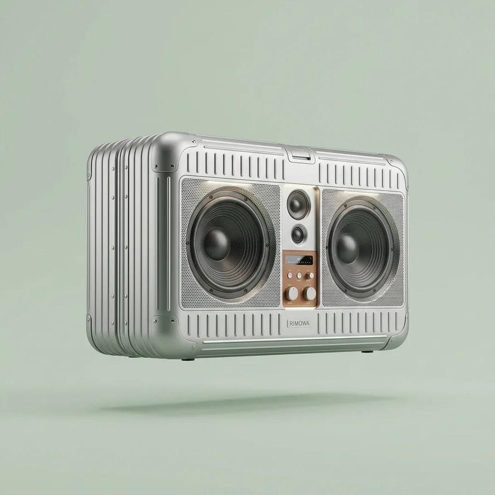

# BRAND NAME design language, object reimagined as an unexpected

[← Back to the collection](../../README.md) · Category: [Product & Brand](../../gallery/product-brand.md) · Model: `Vinano Image Pro` · ID: `vn-00113`

<a href="https://vinano.ai?utm_source=github&utm_medium=readme&utm_campaign=awesome-image-video-prompts-updating&utm_content=prompt-page-image"></a>

<sub>Preview generated with <a href="https://vinano.ai?utm_source=github&utm_medium=readme&utm_campaign=awesome-image-video-prompts-updating&utm_content=prompt-page-caption">vinano.ai</a></sub>

## Prompt

```text
[BRAND NAME] design language, object reimagined as an unexpected flagship product of the brand for the next decade. Crafted from signature materials and textures. Distinctive aesthetics, iconic form factor, embodiment of brand philosophy, high-end industrial design.

COMPOSITION & STAGING:

The object is floating suspended in mid-air within the studio space (anti-gravity effect). It is positioned strictly dead center in the frame.

Negative Space: There is a wide, generous margin of empty space (air) surrounding the object on all sides.
Framing: The object is fully contained within the image boundaries absolutely no cropping.

PHOTOGRAPHY:

Professional product photography, soft volumetric lighting, clean light pastel background, ultra-detailed.

Preserve realistic proportions and depth for a confident, professional finish.
```

## Try it on vinano.ai

1. Copy the prompt above.
2. Open **[vinano.ai](https://vinano.ai?utm_source=github&utm_medium=readme&utm_campaign=awesome-image-video-prompts-updating&utm_content=prompt-page-try)**, paste it into the image generator and pick a model.
3. Swap any placeholders (brand, product, city, person…) for your own details, then generate.

More prompts like this: [Product & Brand gallery](../../gallery/product-brand.md) · [all categories](../../README.md#contents)
