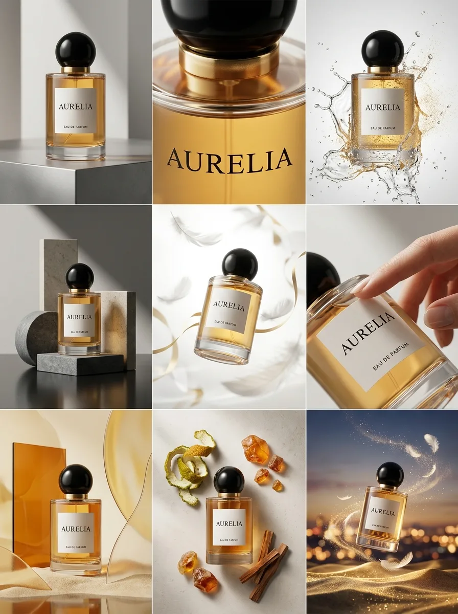

# 为高端商业营销活动创建3×3网格

[← Back to the collection](../../README.md) · Category: [Product & Brand](../../gallery/product-brand.md) · Model: `Vinano Image Pro` · ID: `vn-00144`

<a href="https://vinano.ai?utm_source=github&utm_medium=readme&utm_campaign=awesome-image-video-prompts-updating&utm_content=prompt-page-image"></a>

<sub>Preview generated with <a href="https://vinano.ai?utm_source=github&utm_medium=readme&utm_campaign=awesome-image-video-prompts-updating&utm_content=prompt-page-caption">vinano.ai</a></sub>

## Prompt

```text
为高端商业营销活动创建3×3网格，3:4纵横比，以上传产品为中心主体。

每帧呈现独特视觉概念，同时保持九张图像中产品的完美一致性。

网格概念（每格一个）：

1. 标志性英雄静物画，构图大胆

2. 极端微距细节，突显材质与纹理

3. 动感液体或粒子与产品互动

4. 极简雕塑排列，抽象形态

5. 浮动元素，暗示轻盈与创新

6. 感官特写，强调触感与真实感

7. 色彩驱动概念场景，灵感源自产品调色板

8. 成分或组件抽象化（非字面意思，象征性）

9. 超现实优雅融合，结合写实与想象

视觉规则：
产品形状、比例、标签、字体、色彩、品牌必须100%准确

无扭曲、变形或重新设计

产品与背景清晰分离

灯光与风格：
柔和可控的摄影棚灯光

细微高光，真实阴影

高动态范围，超锐焦点

编辑奢侈广告美学

高端感官营销外观

总体感觉：
现代、精致、视觉连贯

高端商业活动

适用于品牌网站、社交网格及数字广告牌

超现实、电影感、精致、志在高远

在保证细节的同时保持版式克制、留白得当。
```

## Try it on vinano.ai

1. Copy the prompt above.
2. Open **[vinano.ai](https://vinano.ai?utm_source=github&utm_medium=readme&utm_campaign=awesome-image-video-prompts-updating&utm_content=prompt-page-try)**, paste it into the image generator and pick a model.
3. Swap any placeholders (brand, product, city, person…) for your own details, then generate.

More prompts like this: [Product & Brand gallery](../../gallery/product-brand.md) · [all categories](../../README.md#contents)
