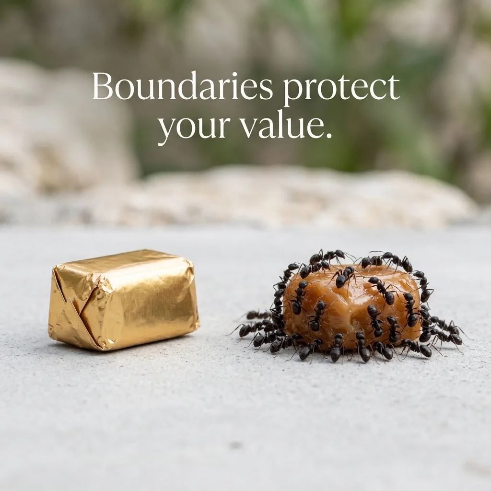

# Quiet outdoor setting a clean surface under soft natural

[← Back to the collection](../../README.md) · Category: [Product & Brand](../../gallery/product-brand.md) · Model: `Vinano Image Pro` · ID: `vn-00156`

<a href="https://vinano.ai?utm_source=github&utm_medium=readme&utm_campaign=awesome-image-video-prompts-updating&utm_content=prompt-page-image"></a>

<sub>Preview generated with <a href="https://vinano.ai?utm_source=github&utm_medium=readme&utm_campaign=awesome-image-video-prompts-updating&utm_content=prompt-page-caption">vinano.ai</a></sub>

## Prompt

```text
{
 "style": "cinematic, symbolic, minimal, realistic",
 "aspect_ratio": "9:16",
 "scenes": [{
 "scene_number": 1,
 "description": "A quiet outdoor setting a clean surface under soft natural light. Two identical toffees are placed side by side.",
 "camera": "slow zoom-in",
 "mood": "calm, neutral"
 },
 {
 "scene_number": 2,
 "description": "One toffee is neatly wrapped in shiny paper. The other toffee is unwrapped, fully exposed.",
 "camera": "static close-up",
 "mood": "contrast, anticipation"
 },
 {
 "scene_number": 3,
 "description": "Ants begin to appear and slowly crawl toward the unwrapped toffee, completely ignoring the wrapped one.",
 "camera": "macro shot, slow motion",
 "mood": "uneasy, revealing"
 },
 {
 "scene_number": 4,
 "description": "More ants gather around the unwrapped toffee, covering it, while the wrapped toffee remains untouched and protected.",
 "camera": "top-down shot",
 "mood": "warning, realization"
 },
 {
 "scene_number": 5,
 "description": "Text fades in on screen as the ants swarm the unwrapped toffee.",
 "text_overlay": "When you are too open, you can be used.",
 "camera": "gentle fade",
 "mood": "reflective"
 },
 {
 "scene_number": 6,
 "description": "Final frame focuses on the wrapped toffee standing alone, clean and intact.",
 "text_overlay": "Boundaries protect your value.",
 "camera": "slow zoom-out",
 "mood": "empowering, calm"
 }],
 "audio": {
 "background_music": "soft ambient piano",
 "sound_effects": "subtle nature ambience"
 }
}

Render with rich micro-detail while keeping the layout uncluttered and intentional.
```

## Try it on vinano.ai

1. Copy the prompt above.
2. Open **[vinano.ai](https://vinano.ai?utm_source=github&utm_medium=readme&utm_campaign=awesome-image-video-prompts-updating&utm_content=prompt-page-try)**, paste it into the image generator and pick a model.
3. Swap any placeholders (brand, product, city, person…) for your own details, then generate.

More prompts like this: [Product & Brand gallery](../../gallery/product-brand.md) · [all categories](../../README.md#contents)
