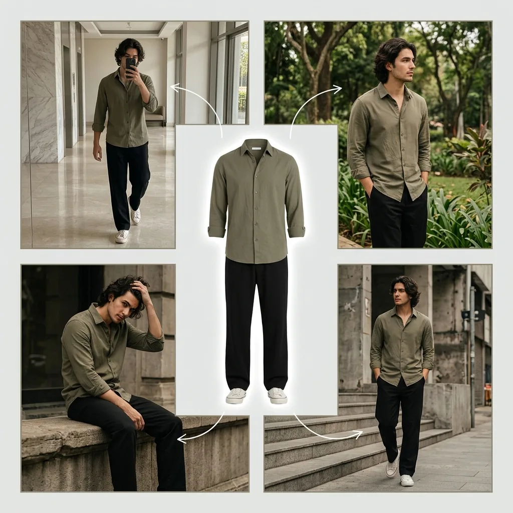

# Stylish young man medium-length wavy dark hair

[← Back to the collection](../../README.md) · Category: [Product & Brand](../../gallery/product-brand.md) · Model: `Vinano Image Pro` · ID: `vn-00170`

<a href="https://vinano.ai?utm_source=github&utm_medium=readme&utm_campaign=awesome-image-video-prompts-updating&utm_content=prompt-page-image"></a>

<sub>Preview generated with <a href="https://vinano.ai?utm_source=github&utm_medium=readme&utm_campaign=awesome-image-video-prompts-updating&utm_content=prompt-page-caption">vinano.ai</a></sub>

## Prompt

```text
A stylish young man medium-length wavy dark hair and a clean face, wearing a muted olive green button-up shirt sleeves slightly rolled up, paired loose fit black straight pants and white sneakers. The outfit looks minimal, modern, and aesthetic.
Create a fashion collage layout 5 sections:
Center: a clean cutout of the outfit (olive shirt + black pants) placed vertically, slightly floating, a soft white outline glow around it.
Around the center: four different lifestyle shots of the same man wearing the outfit.
Top left: indoor mirror selfie in a modern lobby marble walls and shiny floor, holding phone covering face, relaxed walking pose.
Top right: outdoor greenery setting plants and trees, walking pose hands in pockets, looking sideways.
Bottom left: sitting pose on a bench or ledge, slightly leaning forward, one hand in hair, moody lighting.
Bottom right: urban street or stairs background concrete textures, walking casually hands in pockets.
Add minimal white curved arrows pointing from each lifestyle image toward the center outfit.
Lighting: soft natural light, slightly warm tone, cinematic shadows, Instagram aesthetic.
Color palette: neutral tones, olive green, black, white, soft greys.
Style: clean, minimal, high-end fashion lookbook, Pinterest / Instagram aesthetic.
Camera: 35mm lens, shallow depth of field, sharp subject focus.
Quality: ultra realistic, high resolution, 4K, detailed fabric texture.

Keep edges clean and the overall composition balanced for a polished, gallery-ready result.
```

## Try it on vinano.ai

1. Copy the prompt above.
2. Open **[vinano.ai](https://vinano.ai?utm_source=github&utm_medium=readme&utm_campaign=awesome-image-video-prompts-updating&utm_content=prompt-page-try)**, paste it into the image generator and pick a model.
3. Swap any placeholders (brand, product, city, person…) for your own details, then generate.

More prompts like this: [Product & Brand gallery](../../gallery/product-brand.md) · [all categories](../../README.md#contents)
