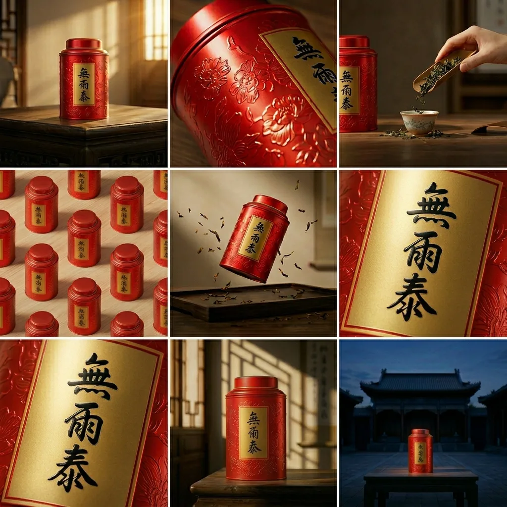

# Clean 3×3 storyboard grid nine equal-sized panels

[← Back to the collection](../../README.md) · Category: [Product & Brand](../../gallery/product-brand.md) · Model: `Vinano Image Pro` · ID: `vn-00171`

<a href="https://vinano.ai?utm_source=github&utm_medium=readme&utm_campaign=awesome-image-video-prompts-updating&utm_content=prompt-page-image"></a>

<sub>Preview generated with <a href="https://vinano.ai?utm_source=github&utm_medium=readme&utm_campaign=awesome-image-video-prompts-updating&utm_content=prompt-page-caption">vinano.ai</a></sub>

## Prompt

```text
A clean 3×3 storyboard grid nine equal-sized panels and an overall 4:5 aspect ratio.
Use the reference image as the base product reference. Keep the same product, packaging design, branding, materials, colors, proportions and overall identity across all nine panels exactly as the reference. The product must remain clearly recognizable in every frame. The label, logo and proportions must stay exactly the same.
This storyboard is a high-end designer mockup presentation for a branding portfolio. The focus is on form, composition, materiality and visual rhythm rather than realism or lifestyle narrative. The overall look should feel curated, editorial and design-driven.
FRAME 1 (The Icon): Center-composed hero shot of the red tea tin on an antique dark walnut table, bathed in warm, golden afternoon sun.
FRAME 2 (The Tactile): Extreme close-up on the glossy red metal surface showing the embossed gold floral texture catching the light.
FRAME 3 (The Environment): The canister placed on a wooden shelf in a blurred traditional Chinese study calligraphy brushes in the background.
FRAME 4 (The Interaction): An elegant hand pouring dry tea leaves near the base of the tin, emphasizing the ritual.
FRAME 5 (The Matrix): An isometric grid of multiple red tins arranged on a wooden surface, creating a pattern of red and gold.
FRAME 6 (The Gravity): The red canister floating gently above a wooden tray, surrounded by drifting dried tea leaves.
FRAME 7 (The Signature): Macro detail focusing strictly on the black Chinese calligraphy "Wu Yu Tai" against the gold background.
FRAME 8 (The Statement): Artistic high-contrast shot shadows of window lattice (geometric patterns) cast across the red tin.
FRAME 9 (The Horizon): Wide cinematic shot of the tin placed on a low table in a grand, dimly lit traditional courtyard at dusk.
CAMERA & STYLE:
ultra-detailed, high-fidelity studio imagery a real camera look. Different camera angles and framings across frames. Controlled depth of field, precise lighting, accurate materials and reflections. Lighting logic, color palette, mood and visual language must remain consistent across all nine panels as one cohesive series.
OUTPUT:
A clean 3×3 grid no borders, no text, no captions and no watermarks.

Render with rich micro-detail while keeping the layout uncluttered and intentional.
```

## Try it on vinano.ai

1. Copy the prompt above.
2. Open **[vinano.ai](https://vinano.ai?utm_source=github&utm_medium=readme&utm_campaign=awesome-image-video-prompts-updating&utm_content=prompt-page-try)**, paste it into the image generator and pick a model.
3. Swap any placeholders (brand, product, city, person…) for your own details, then generate.

More prompts like this: [Product & Brand gallery](../../gallery/product-brand.md) · [all categories](../../README.md#contents)
