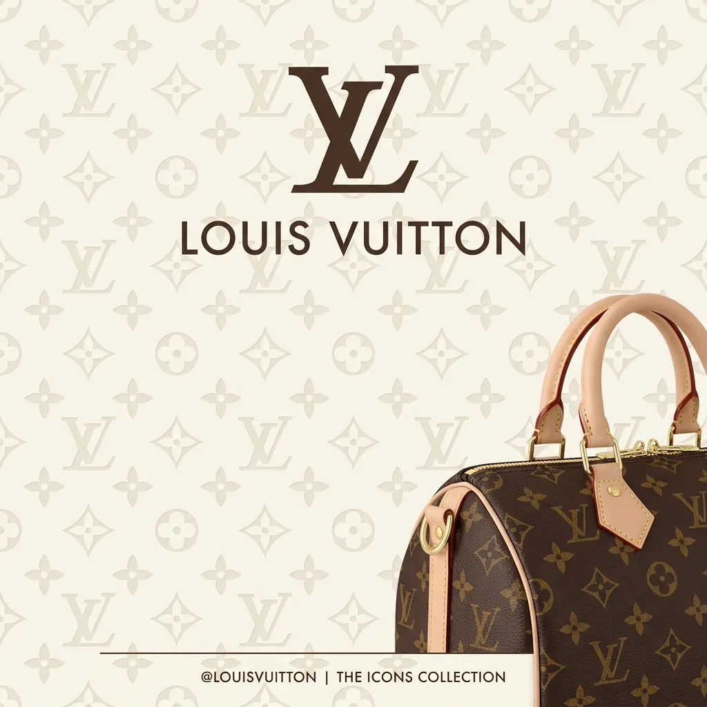

# BRAND NAME + PRODUCT Act as a Senior Luxury

[← Back to the collection](../../README.md) · Category: [Product & Brand](../../gallery/product-brand.md) · Model: `Vinano Image Pro` · ID: `vn-00183`

<a href="https://vinano.ai?utm_source=github&utm_medium=readme&utm_campaign=awesome-image-video-prompts-updating&utm_content=prompt-page-image"></a>

<sub>Preview generated with <a href="https://vinano.ai?utm_source=github&utm_medium=readme&utm_campaign=awesome-image-video-prompts-updating&utm_content=prompt-page-caption">vinano.ai</a></sub>

## Prompt

```text
[BRAND NAME] + [PRODUCT]

Act as a Senior Luxury Fashion Art Director and Studio Photographer specializing in high-end product key visuals for flagship campaigns, e-commerce editorials, and mobile-first brand content.

PHASE 1: FORMAT & CANVAS
Vertical format, 9:16 aspect ratio. Canvas background: a single flat field of warm off-white — not pure white, not grey. Target tone: soft ivory cream (#F4EFE6 equivalent), uniform and completely shadowless
 across the entire background plane.
Autonomously determine [BRAND NAME]'s signature background tone — if the brand has a recognized house color for its packaging, tissue paper, or lookbook backgrounds, shift the canvas toward that specific off-white or neutral. The result must feel like an official brand document, not a generic studio.

PHASE 2: BACKGROUND PATTERN (WATERMARK LAYER)

Autonomously identify [BRAND NAME]'s iconic surface pattern, monogram, or archival motif — examples: a house monogram, toile print, geometric logo repeat, heritage emblem, or signature textile pattern.
Render this pattern across the entire background canvas as a ghost watermark: same tone as the background but a slight value shift (approximately 8–12% darker
or lighter than the base). The pattern must be large in scale — individual motifs spanning 15–25% of canvas width. Opacity: 10–18% maximum. No hard edges. The pattern should feel embossed or tone-on-tone woven, not printed. It must recede behind all other elements.

PHASE 3: LOGO PLACEMENT

Autonomously reproduce [BRAND NAME]'s official logo complete fidelity — correct letterforms, proportions, secondary marks (emblems, crowns, stars, monogram icons).
Place the logo centered horizontally in the upper third of the frame (top 30% of canvas). Scale: the logo should span approximately 40–50% of canvas width — prominent but not overwhelming.
Logo rendering: flat 2D, no extrusion, no chrome. Color: autonomously apply [BRAND NAME]'s official logo colorway — the exact brand-standard color(s) used on official packaging and website. If the brand uses a two-tone logo (icon + wordmark in different colors), preserve that hierarchy precisely.
Directly below the main logo mark, place the full [BRAND NAME] wordmark in spaced capital letters — clean, geometric sans-serif, tracking: +200 to +300,
same brand color, optical size approximately 60% of logo height. No decorative elements between logo and wordmark.

PHASE 4: PRODUCT PLACEMENT

Render [PRODUCT] as a true-to-life photorealistic studio object maximum material fidelity:
— Leather: visible grain, pore structure, stitching thread texture, realistic edge paint.
— Hardware: gold or silver metal micro-reflections, not flat.
— Canvas/fabric: woven fiber detail, not smooth CG.
— All brand-specific surface patterns on the product must be accurate and legible.
Placement: the product enters the frame from the bottom-right corner at a natural 25–35 degree angle, as if casually placed or mid-motion. The product is cropped — only 60–75% of the object is visible
within the frame. The crop should feel intentional and editorial, not accidental. The product occupies the lower 55–65% of the canvas.
The product must feel physically present in the space — not floating. Cast an extremely soft, barely visible contact shadow (opacity 8–12%) on the canvas beneath the nearest edge. No hard drop shadows.

PHASE 5: LIGHTING

Lighting: simulated large north-facing studio window light. Soft, directional, shadowless on the background. Color temperature: 5500–6000K (neutral daylight, slightly cool).
Key light: large softbox equivalent from upper-left, filling the entire product surface evenly
minimal contrast ratio (1.2:1 to 1.5:1 max).
Fill light: large bounce from right side, eliminating all harsh shadows. No rim light. No dramatic contrast. The lighting philosophy is: "the product sells itself — light only reveals, never performs."
Global Illumination enabled for subtle inter-reflections between product surfaces. No specular hotspots on leather — only on metal hardware.

PHASE 6: TYPOGRAPHY & FINISHING

Bottom of frame: a thin horizontal rule line (1px, brand color, 80% canvas width, centered). Below the rule: a single line of micro-copy — a social handle, collection name, or campaign label — in the same clean sans-serif, lowercase or small-caps, minimal tracking. Autonomously generate a contextually appropriate label for [BRAND NAME].

TECH SPECS

Render engine: true-to-life photorealistic CGI, Keyshot / Octane product visualization aesthetic. Resolution: 9:16, ultra-high detail.
Depth of Field: f/16 equivalent — everything in sharp focus. Zero bokeh. Tack-sharp edges on all product details.Tone mapping: clean, true-to-life. No filmic crush. No vignette. No grain. Color grade: neutral, faithful to real product color. Slight warmth in the ivory background only. No AI-plastic normals on leather or fabric. Microscopic surface imperfection maps required. No reflections on background. No environmental reflections — studio only. Mood reference: Louis Vuitton / Bottega Veneta / Celine official e-commerce and campaign photography standard. Clean enough to be used as a press image.

Maintain consistent colour harmony and crisp focus across the whole frame.
```

## Try it on vinano.ai

1. Copy the prompt above.
2. Open **[vinano.ai](https://vinano.ai?utm_source=github&utm_medium=readme&utm_campaign=awesome-image-video-prompts-updating&utm_content=prompt-page-try)**, paste it into the image generator and pick a model.
3. Swap any placeholders (brand, product, city, person…) for your own details, then generate.

More prompts like this: [Product & Brand gallery](../../gallery/product-brand.md) · [all categories](../../README.md#contents)
