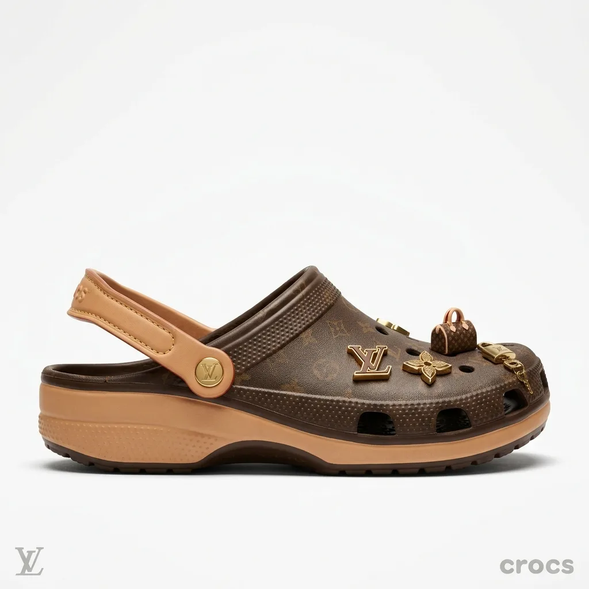

# Louis Vuitton

[← Back to the collection](../../README.md) · Category: [Product & Brand](../../gallery/product-brand.md) · Model: `Vinano Image Pro` · ID: `vn-00195`

<a href="https://vinano.ai?utm_source=github&utm_medium=readme&utm_campaign=awesome-image-video-prompts-updating&utm_content=prompt-page-image"></a>

<sub>Preview generated with <a href="https://vinano.ai?utm_source=github&utm_medium=readme&utm_campaign=awesome-image-video-prompts-updating&utm_content=prompt-page-caption">vinano.ai</a></sub>

## Prompt

```text
[Louis Vuitton]. Act as a World-Class Footwear Designer and Product Photographer creating a high-end "Crocs Collaboration" campaign image.

1. THE SUBJECT (CUSTOMIZED CROCS CLOG):

Generate a true-to-life photorealistic, high-end customized Crocs Classic Clog inspired by the visual identity of [BRAND NAME].

View: The shoe is positioned in a Strict Side Profile View (facing right), exactly like a product profile shot. It must look grounded and substantial.

Color Blocking: Apply [BRAND NAME]'s official color palette intelligently:

Body: The main foam upper is the brand's Primary Color.

Sole/Strap: Use the Secondary/Accent colors for the thick rubber sole unit and the heel strap to create contrast.

Custom Jibbitz (Charms): The shoe is decorated 3-4 premium-quality 3D Jibbitz charms plugged into the ventilation holes. These charms must be iconic symbols or products associated [BRAND NAME] (e.g., if "Starbucks" -> a tiny frappuccino cup and logo; if "Nike" -> a 3D swoosh).

2. THE BACKGROUND ():

The background is a Pure White Studio Space (#FFFFFF).

3. LIGHTING & MATERIALITY (EDITORIAL QUALITY):

Lighting: Ultra-realistic High-Key Studio Lighting. Use a large softbox from the top-left to create smooth, glossy highlights on the rubber curves of the Crocs. The lighting is bright, neutral, and expensive.

Texture: The material must look like real Croslite foam resin—matte subtle specular highlights on the edges. The Jibbitz charms should look like hard glossy plastic or rubber.

Shadows: A sharp, realistic contact shadow under the shoe to ground it on the white floor.

4. BRANDING & LAYOUT (UI ELEMENTS):

Bottom Left Corner: Place a small, discrete, Monochrome Light Grey Logo of [BRAND NAME].

Bottom Right Corner: Place a small, discrete, Monochrome Light Grey "Crocs" Logo.

TECH SPECS:

Macro product photography, Phase One camera, 100mm lens, razor-sharp focus, 8k resolution, uncompressed, commercial look.

Maintain consistent colour harmony and crisp focus across the whole frame.
```

## Try it on vinano.ai

1. Copy the prompt above.
2. Open **[vinano.ai](https://vinano.ai?utm_source=github&utm_medium=readme&utm_campaign=awesome-image-video-prompts-updating&utm_content=prompt-page-try)**, paste it into the image generator and pick a model.
3. Swap any placeholders (brand, product, city, person…) for your own details, then generate.

More prompts like this: [Product & Brand gallery](../../gallery/product-brand.md) · [all categories](../../README.md#contents)
