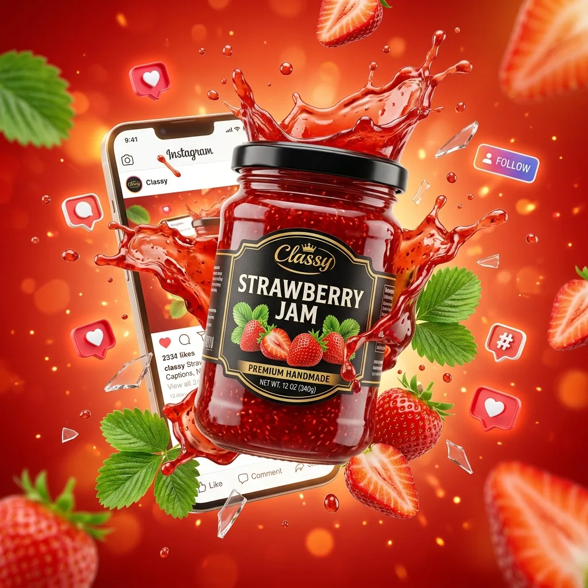

# Commercial food product advertising scene featuring a glass jar

[← Back to the collection](../../README.md) · Category: [Product & Brand](../../gallery/product-brand.md) · Model: `Vinano Image Pro` · ID: `vn-00230`

<a href="https://vinano.ai?utm_source=github&utm_medium=readme&utm_campaign=awesome-image-video-prompts-updating&utm_content=prompt-page-image"></a>

<sub>Preview generated with <a href="https://vinano.ai?utm_source=github&utm_medium=readme&utm_campaign=awesome-image-video-prompts-updating&utm_content=prompt-page-caption">vinano.ai</a></sub>

## Prompt

```text
Ultra-realistic commercial food product advertising scene featuring a glass jar labeled "Classy Strawberry Jam" floating dynamically in mid-air. The jar is filled glossy vibrant red strawberry jam and has a black lid a premium black label showing fresh strawberries and the Classy brand logo clearly visible. Surrounding the jar are splashes of thick strawberry jam bursting outward in dramatic fluid motion, droplets and shards of transparent glass frozen mid-air. Fresh whole strawberries, sliced strawberries, and green strawberry leaves float around the product to emphasize freshness. Behind the jar is a large smartphone screen displaying a social media post layout, suggesting an Instagram-style interface, symbolizing viral promotion. Floating around the composition are social media icons such as hearts, likes, comment bubbles, and hashtag symbols to represent online engagement. The background is a vibrant red-orange gradient glowing highlights that enhance the energetic advertising feel. Cinematic studio lighting highlights the glossy texture of the jam, reflective glass jar, and dynamic splashes. High-end commercial advertising style, macro product photography, ultra-detailed textures, shallow depth of field, true-to-life photorealistic, 8K resolution. Aim for an editorial, design-driven look with deliberate negative space.
```

## Try it on vinano.ai

1. Copy the prompt above.
2. Open **[vinano.ai](https://vinano.ai?utm_source=github&utm_medium=readme&utm_campaign=awesome-image-video-prompts-updating&utm_content=prompt-page-try)**, paste it into the image generator and pick a model.
3. Swap any placeholders (brand, product, city, person…) for your own details, then generate.

More prompts like this: [Product & Brand gallery](../../gallery/product-brand.md) · [all categories](../../README.md#contents)
