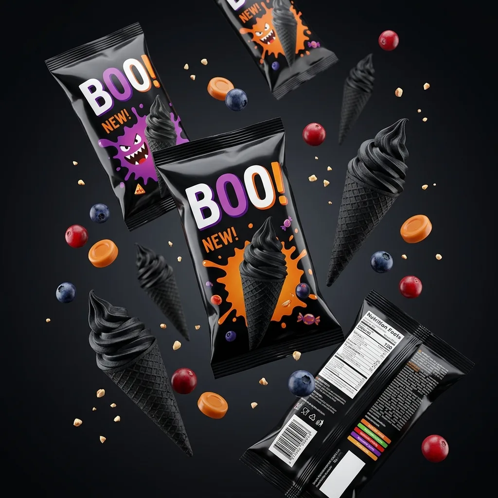

# Studio product photography

[← Back to the collection](../../README.md) · Category: [Product & Brand](../../gallery/product-brand.md) · Model: `Vinano Image Pro` · ID: `vn-00233`

<a href="https://vinano.ai?utm_source=github&utm_medium=readme&utm_campaign=awesome-image-video-prompts-updating&utm_content=prompt-page-image"></a>

<sub>Preview generated with <a href="https://vinano.ai?utm_source=github&utm_medium=readme&utm_campaign=awesome-image-video-prompts-updating&utm_content=prompt-page-caption">vinano.ai</a></sub>

## Prompt

```text
{
 "image_type": "commercial product advertisement",
 "resolution_target": "8K",
 "aspect_ratio": "3:4",
 "orientation": "vertical",

 "scene": {
 "environment": "studio product photography",
 "background": {
 "color": "dark charcoal to black gradient",
 "texture": "smooth matte",
 "lighting_falloff": "soft radial gradient toward center"
 }
 },

 "composition": {
 "style": "floating product arrangement",
 "depth": "multi-layer depth foreground, midground, background objects",
 "camera_angle": "slightly top-down perspective",
 "camera_distance": "medium close-up",
 "focus": "sharp focus on central package, slightly softer on background elements",
 "visual_flow": "diagonal downward flow from top-left to bottom-right"
 },

 "primary_objects": [{
 "object_type": "snack_package",
 "brand_text": "BOO!",
 "position": "upper center",
 "orientation": "tilted slightly upward left-to-right",
 "packaging_color": "black glossy plastic",
 "text_details": {
 "main_text": "BOO!",
 "font_style": "bold sans-serif",
 "text_colors": ["white", "purple", "orange"],
 "secondary_text": "NEW!",
 "language": "Cyrillic"
 },
 "graphics": ["cartoon monster face triangular teeth",
 "paint splash graphic in purple",
 "ice cream cone illustration black swirl"]
 },

 {
 "object_type": "snack_package",
 "brand_text": "BOO!",
 "position": "center",
 "orientation": "slightly angled",
 "packaging_color": "black glossy plastic",
 "text_details": {
 "main_text": "BOO!",
 "secondary_text": "NEW!",
 "accent_color": "orange"
 },
 "graphics": ["orange paint splash",
 "black ice cream cone graphic",
 "small candy illustrations"]
 },

 {
 "object_type": "snack_package",
 "brand_text": "BOO!",
 "position": "bottom",
 "orientation": "back side facing camera",
 "packaging_color": "black glossy plastic",
 "visible_elements": ["nutrition text block",
 "barcode",
 "multicolor ingredient indicator bars"]
 }],

 "secondary_objects": [{
 "object_type": "ice_cream_cone",
 "color": "black",
 "texture": "waffle cone pattern",
 "ice_cream": "black soft swirl",
 "positions": ["right side near center",
 "bottom left",
 "background scattered"]
 },

 {
 "object_type": "berries",
 "colors": ["red", "dark blue"],
 "shape": "small spherical",
 "positions": "floating around packages"
 },

 {
 "object_type": "caramel_candy",
 "shape": "round flat candy discs",
 "color": "orange caramel",
 "positions": "floating mid-scene"
 },

 {
 "object_type": "nut_fragments",
 "color": "light beige",
 "size": "small crumb particles",
 "distribution": "scattered floating around scene"
 }],

 "lighting": {
 "type": "studio lighting",
 "key_light": "soft directional light from upper left",
 "fill_light": "soft ambient fill",
 "rim_light": "subtle edge highlight on packaging",
 "reflections": "visible glossy reflections on plastic packaging",
 "shadows": "soft shadows beneath floating objects"
 },

 "materials": {
 "packaging": "glossy plastic",
 "cone": "matte waffle texture",
 "berries": "smooth slightly reflective skin",
 "candies": "semi-gloss caramel surface"
 },

 "color_palette": {
 "dominant": ["black", "dark gray"],
 "accent": ["orange", "purple", "red", "blue"],
 "highlight": ["white"]
 },

 "motion_effect": {
 "style": "frozen motion",
 "objects": "packages, cones, candies appear suspended mid-air",
 "particle_effect": "small crumbs floating"
 },

 "render_quality": {
 "detail_level": "ultra high detail",
 "sharpness": "crisp edges",
 "noise": "none",
 "texture_detail": "high fidelity",
 "realism": "true-to-life photorealistic commercial product render"
 }
}

Maintain consistent colour harmony and crisp focus across the whole frame.
```

## Try it on vinano.ai

1. Copy the prompt above.
2. Open **[vinano.ai](https://vinano.ai?utm_source=github&utm_medium=readme&utm_campaign=awesome-image-video-prompts-updating&utm_content=prompt-page-try)**, paste it into the image generator and pick a model.
3. Swap any placeholders (brand, product, city, person…) for your own details, then generate.

More prompts like this: [Product & Brand gallery](../../gallery/product-brand.md) · [all categories](../../README.md#contents)
