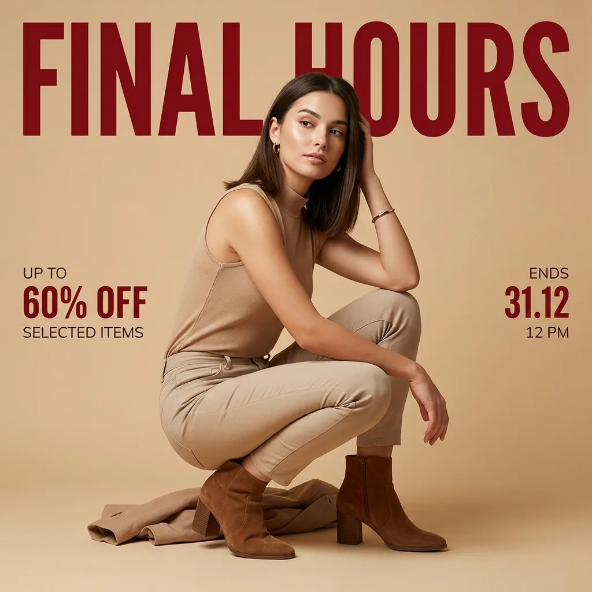

# Fashion advertisement poster, refined minimalist editorial style

[← Back to the collection](../../README.md) · Category: [Product & Brand](../../gallery/product-brand.md) · Model: `Vinano Image Pro` · ID: `vn-00245`

<a href="https://vinano.ai?utm_source=github&utm_medium=readme&utm_campaign=awesome-image-video-prompts-updating&utm_content=prompt-page-image"></a>

<sub>Preview generated with <a href="https://vinano.ai?utm_source=github&utm_medium=readme&utm_campaign=awesome-image-video-prompts-updating&utm_content=prompt-page-caption">vinano.ai</a></sub>

## Prompt

```text
Ultra-realistic fashion advertisement poster, refined minimalist editorial style.
Background: solid warm beige studio backdrop soft gradient lighting, smooth clean texture.
Main subject: a stylish young woman in a low squat pose, body slightly turned sideways, one arm resting on knee, other hand touching back of head. Expression calm, confident, slightly looking sideways (not directly at camera).
Outfit (keep EXACT):
Sleeveless beige/tan high-neck top
Slim beige pants
Brown suede ankle boots block heels
Light brown jacket placed casually near her feet
Minimal accessories: small hoop earrings, thin bracelet
Hair: straight, shoulder-length, natural dark brown, side-parted
Makeup: soft natural tones, clean skin, subtle glow
⚠️ Face: [REPLACE FACE PROVIDED IMAGE / KEEP FACE GENERIC IF NOT PROVIDED]
(ensure seamless blending, same lighting, same skin tone, hyper-realistic)
Typography & Layout (EXACT SAME STYLE)
Top: Large bold condensed sans-serif text in dark red: FINAL HOURS (very large, stretched across width, behind subject partially)
Left side: Small text: UP TO
60% OFF
SELECTED ITEMS
Right side: ENDS
31.12
12 PM
Bottom: ⚠️ NO WEBSITE TEXT (REMOVE COMPLETELY)
Lighting & Style
Soft studio lighting, warm tone
Subtle shadows under subject
Clean editorial magazine look
Slight depth but mostly flat poster style
Matte finish, no gloss
Perfect alignment, balanced spacing

Render with rich micro-detail while keeping the layout uncluttered and intentional.
```

## Try it on vinano.ai

1. Copy the prompt above.
2. Open **[vinano.ai](https://vinano.ai?utm_source=github&utm_medium=readme&utm_campaign=awesome-image-video-prompts-updating&utm_content=prompt-page-try)**, paste it into the image generator and pick a model.
3. Swap any placeholders (brand, product, city, person…) for your own details, then generate.

More prompts like this: [Product & Brand gallery](../../gallery/product-brand.md) · [all categories](../../README.md#contents)
