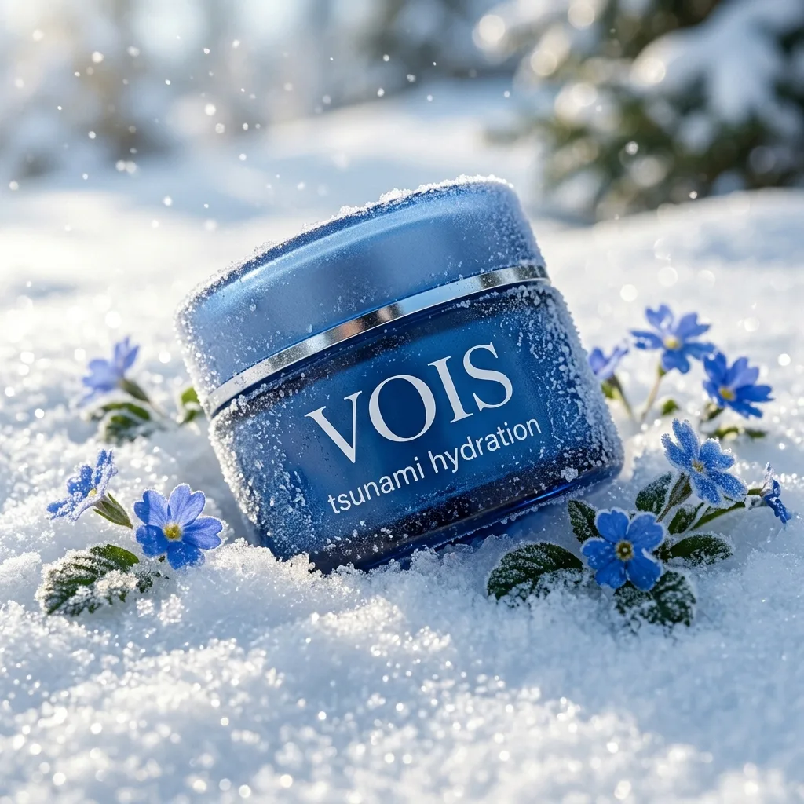

# Product & Brand prompt #261

[← Back to the collection](../../README.md) · Category: [Product & Brand](../../gallery/product-brand.md) · Model: `Vinano Image Pro` · ID: `vn-00261`

<a href="https://vinano.ai?utm_source=github&utm_medium=readme&utm_campaign=awesome-image-video-prompts-updating&utm_content=prompt-page-image"></a>

<sub>Preview generated with <a href="https://vinano.ai?utm_source=github&utm_medium=readme&utm_campaign=awesome-image-video-prompts-updating&utm_content=prompt-page-caption">vinano.ai</a></sub>

## Prompt

```text
{
 "type": "true-to-life photorealistic skincare product photography",
 "product": {
 "name": "VOIS – tsunami hydration",
 "container": "blue cosmetic cream jar",
 "position": "diagonally placed and partially embedded in fresh white snow",
 "details": "light hoarfrost and frozen condensation crystals on the jar surface"
 },
 "scene": {
 "environment": "soft powdery snow sparkling ice crystals",
 "elements": "small blue primrose flowers green leaves scattered around, some partially buried",
 "background": "clean minimal snowy bokeh cold airy atmosphere"
 },
 "lighting": "bright winter side sunlight creating crisp highlights and soft natural shadows",
 "camera": {
 "lens": "85mm macro",
 "aperture": "f/2.8",
 "iso": 100,
 "depth_of_field": "shallow"
 },
 "style": "premium commercial skincare advertisement, cinematic macro composition",
 "quality": "ultra-detailed, true-to-life photorealistic, 8K",
 "constraints": ["no people", "no text overlays", "minimal background"]
}

Keep edges clean and the overall composition balanced for a polished, gallery-ready result.
```

## Try it on vinano.ai

1. Copy the prompt above.
2. Open **[vinano.ai](https://vinano.ai?utm_source=github&utm_medium=readme&utm_campaign=awesome-image-video-prompts-updating&utm_content=prompt-page-try)**, paste it into the image generator and pick a model.
3. Swap any placeholders (brand, product, city, person…) for your own details, then generate.

More prompts like this: [Product & Brand gallery](../../gallery/product-brand.md) · [all categories](../../README.md#contents)
