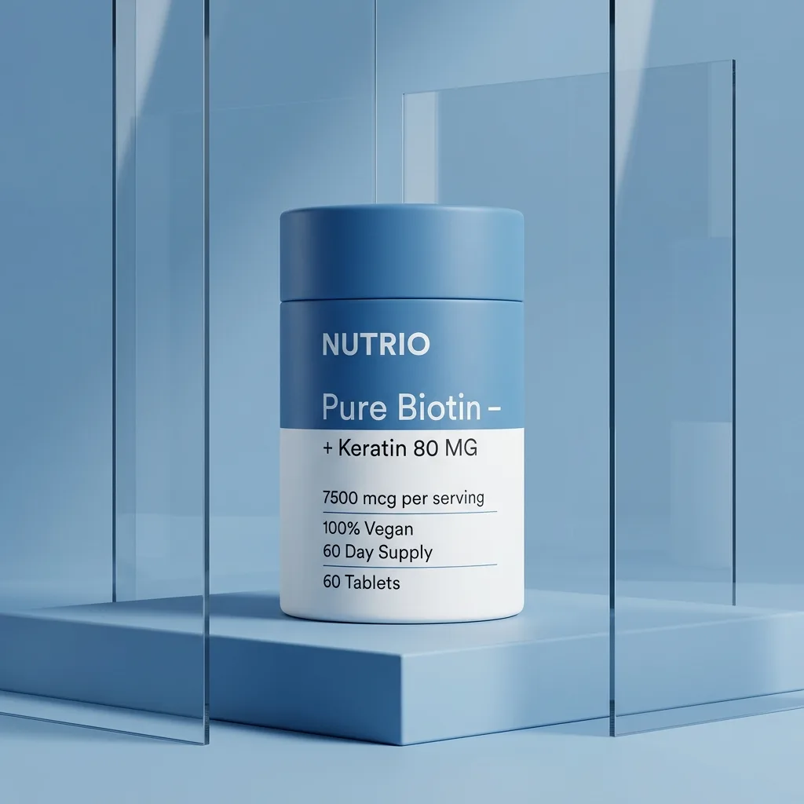

# Refined minimalist product photography featuring a cylindrical supplement container

[← Back to the collection](../../README.md) · Category: [Product & Brand](../../gallery/product-brand.md) · Model: `Vinano Image Pro` · ID: `vn-00263`

<a href="https://vinano.ai?utm_source=github&utm_medium=readme&utm_campaign=awesome-image-video-prompts-updating&utm_content=prompt-page-image"></a>

<sub>Preview generated with <a href="https://vinano.ai?utm_source=github&utm_medium=readme&utm_campaign=awesome-image-video-prompts-updating&utm_content=prompt-page-caption">vinano.ai</a></sub>

## Prompt

```text
Ultra-realistic refined minimalist product photography featuring a cylindrical supplement container labeled “NUTRIO Pure Biotin – + Keratin 80 MG – 7500 mcg per serving – 100% Vegan – 60 Day Supply – 60 Tablets”. The container has a matte blue lid and upper section a clean white lower label. The product is centered in a monochromatic soft blue studio environment, surrounded by thin vertical transparent acrylic glass panels that create subtle reflections and layered depth. The container sits on a smooth geometric platform crisp edges, maintaining a balanced modern composition. Lighting is soft premium studio lighting from the upper left, producing gentle shadows, realistic reflections on the acrylic panels, and smooth gradients across the matte packaging surface. The background remains minimal and monochromatic to emphasize the product. Clean pharmaceutical advertising aesthetic, precise geometry, true-to-life photorealistic textures, shallow depth of field, ultra-detailed 8K commercial product photography Keep edges clean and the overall composition balanced for a polished, gallery-ready result.
```

## Try it on vinano.ai

1. Copy the prompt above.
2. Open **[vinano.ai](https://vinano.ai?utm_source=github&utm_medium=readme&utm_campaign=awesome-image-video-prompts-updating&utm_content=prompt-page-try)**, paste it into the image generator and pick a model.
3. Swap any placeholders (brand, product, city, person…) for your own details, then generate.

More prompts like this: [Product & Brand gallery](../../gallery/product-brand.md) · [all categories](../../README.md#contents)
