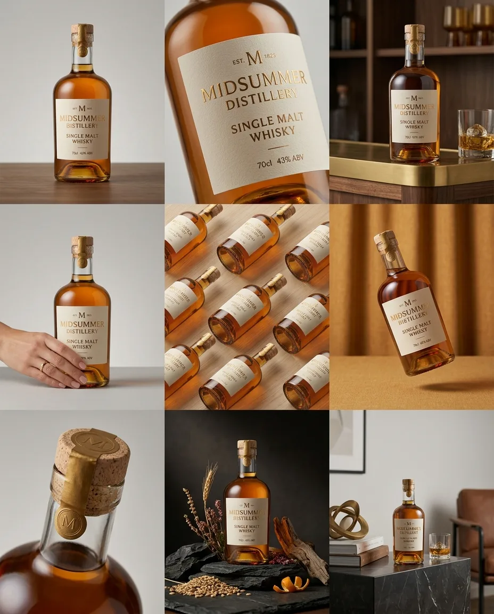

# 创建一张最终图像

[← Back to the collection](../../README.md) · Category: [Product & Brand](../../gallery/product-brand.md) · Model: `Vinano Image Pro` · ID: `vn-00278`

<a href="https://vinano.ai?utm_source=github&utm_medium=readme&utm_campaign=awesome-image-video-prompts-updating&utm_content=prompt-page-image"></a>

<sub>Preview generated with <a href="https://vinano.ai?utm_source=github&utm_medium=readme&utm_campaign=awesome-image-video-prompts-updating&utm_content=prompt-page-caption">vinano.ai</a></sub>

## Prompt

```text
创建一张最终图像。

在4:5总格式内创建清晰的3×3网格故事板，包含九个等比例面板。

使用参考图像作为产品基础。在所有九个面板中保持完全相同的产品、包装设计、品牌、材料、颜色、比例和整体身份。产品在每一帧都应清晰可识别。标签、logo和比例必须完全一致。

这是品牌组合的高端模型展示。重点在形式、构图、材质和视觉节奏，而非现实感或生活方式叙事。结果应感觉精心策划、编辑性强且设计导向。

第1帧:
产品的英雄正面特写，干净的工作室环境。中性背景，均衡构图，平静安全的产品呈现。

第2帧:
特写镜头，焦点聚集在产品中部。突出表面纹理、材料和印刷细节。

第3帧:
参考产品置于与品牌和产品类别自然契合的环境中。工作室场景受产品设计元素和颜色启发。

第4帧:
产品以使用或交互方式展示，中性工作室背景。手和交互元素最少且低调，保持包装风格。

第5帧:
等距构图展示多个产品，从等距俯视角精确几何排列。所有产品采用相同等距角度，均匀间距，干净结构化且图形化。

第6帧:
产品轻微悬浮，倾斜于与参考图像调色板相匹配的中性背景。浮动位置刻意而自然。

第7帧:
极近特写，聚焦标签、边缘、纹理或材料特性的具体细节。

第8帧:
产品置于出人意料但美学强大的环境，大胆编辑视觉冲击力强。意外但高度风格化的场景，工作室基调设计驱动。强势构图提升品牌。

第9帧:
宽幅构图展示产品在精致设计场景中的使用。道具干净，造型受控一致。

摄影与风格:
超高质量工作室图像，呈现真实相机外观。每帧不同角度和构图。受控景深、精确照明、逼真材质和反射。照明逻辑、调色板、氛围和视觉语言在九个面板中保持一致，形成统一系列。

输出:
无边框、无文字、无字幕、无水印的清晰3×3网格。

强调材质质感与自然光影，让画面更具高级真实感。
```

## Try it on vinano.ai

1. Copy the prompt above.
2. Open **[vinano.ai](https://vinano.ai?utm_source=github&utm_medium=readme&utm_campaign=awesome-image-video-prompts-updating&utm_content=prompt-page-try)**, paste it into the image generator and pick a model.
3. Swap any placeholders (brand, product, city, person…) for your own details, then generate.

More prompts like this: [Product & Brand gallery](../../gallery/product-brand.md) · [all categories](../../README.md#contents)
