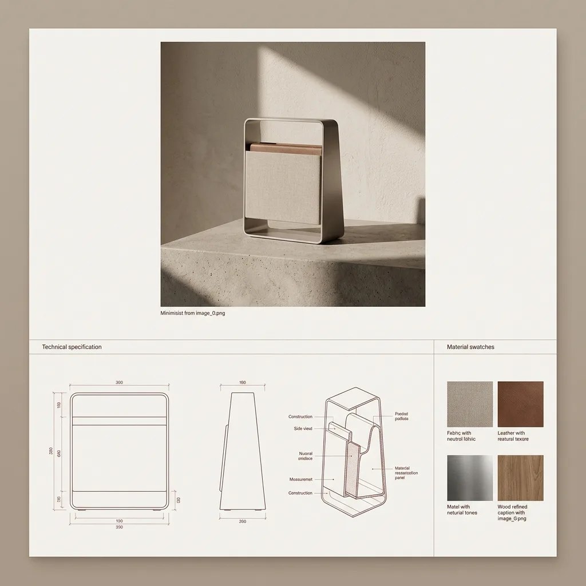

# Use the uploaded image as the exact visual reference

[← Back to the collection](../../README.md) · Category: [Product & Brand](../../gallery/product-brand.md) · Model: `Vinano Image Pro` · ID: `vn-00282`

<a href="https://vinano.ai?utm_source=github&utm_medium=readme&utm_campaign=awesome-image-video-prompts-updating&utm_content=prompt-page-image"></a>

<sub>Preview generated with <a href="https://vinano.ai?utm_source=github&utm_medium=readme&utm_campaign=awesome-image-video-prompts-updating&utm_content=prompt-page-caption">vinano.ai</a></sub>

## Prompt

```text
{
 "reference_images": {
 "product_image": "UPLOADED_IMAGE",
 "usage_rule": "Use the uploaded image as the exact visual reference for the product’s form, proportions, materials, and overall identity. Do not redesign or reinterpret the product."
 },

 "layout": {
 "canvas": {
 "orientation": "vertical",
 "aspect_ratio": "3:4",
 "background": "warm neutral paper-like surface"
 },
 "structure": {
 "top_section": "lifestyle_hero",
 "bottom_section": "technical_specification"
 }
 },

 "top_section": {
 "type": "lifestyle_product_image",
 "composition": {
 "placement": "top_center",
 "scale": "dominant",
 "margin": "generous whitespace around product"
 },
 "environment": {
 "setting": "minimal architectural interior",
 "lighting": {
 "type": "natural sunlight",
 "direction": "angled side light",
 "quality": "soft but high-contrast shadows"
 },
 "floor": "subtle concrete or stone surface",
 "background": "textured plaster wall"
 },
 "rendering": {
 "style": "editorial lifestyle photography",
 "detail": "high realism",
 "color_grading": "warm, muted, premium"
 }
 },

 "bottom_section": {
 "type": "technical_specification_panel",
 "layout": {
 "grid": "modular",
 "alignment": "clean, architectural"
 },

 "technical_drawings": {
 "placement": "bottom_left_and_center",
 "style": "architectural line drawings",
 "views": ["front view",
 "side view",
 "three-quarter cutaway or profile view"],
 "projection": "orthographic",
 "line_style": {
 "color": "muted red or sepia",
 "weight": "fine technical lines"
 },
 "annotations": {
 "type": "measurement and construction callouts",
 "language": "neutral technical labels",
 "density": "minimal, editorial"
 }
 },

 "materials_panel": {
 "placement": "bottom_right",
 "content": {
 "type": "material_swatches",
 "count": "3-4 depending on product",
 "format": "square or rectangular samples"
 },
 "textures": {
 "source": "derived from the product materials",
 "examples": ["fabric",
 "leather",
 "metal",
 "wood",
 "plastic"]
 },
 "labels": {
 "style": "small editorial captions",
 "tone": "technical but refined"
 }
 }
 },

 "typography": {
 "style": "minimal editorial",
 "usage": "subtle captions, no large headlines",
 "color": "soft black or dark brown"
 },

 "overall_style": {
 "mood": "design catalog / product design journal",
 "aesthetic": "architectural, premium, calm",
 "avoid": ["clutter",
 "bold colors",
 "heavy branding",
 "overly decorative graphics"]
 },

 "constraints": {
 "do_not": ["change product design",
 "invent new materials",
 "add logos unless present in reference",
 "use perspective distortion in drawings"]
 }
}

Maintain consistent colour harmony and crisp focus across the whole frame.
```

## Try it on vinano.ai

1. Copy the prompt above.
2. Open **[vinano.ai](https://vinano.ai?utm_source=github&utm_medium=readme&utm_campaign=awesome-image-video-prompts-updating&utm_content=prompt-page-try)**, paste it into the image generator and pick a model.
3. Swap any placeholders (brand, product, city, person…) for your own details, then generate.

More prompts like this: [Product & Brand gallery](../../gallery/product-brand.md) · [all categories](../../README.md#contents)
