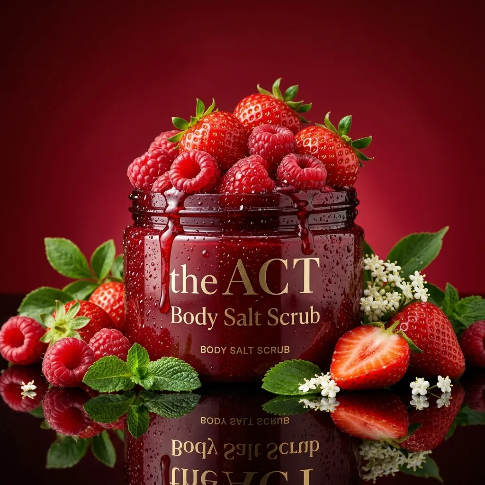

# Luxury cosmetic product photography of a deep red glass

[← Back to the collection](../../README.md) · Category: [Product & Brand](../../gallery/product-brand.md) · Model: `Vinano Image Pro` · ID: `vn-00294`

<a href="https://vinano.ai?utm_source=github&utm_medium=readme&utm_campaign=awesome-image-video-prompts-updating&utm_content=prompt-page-image"></a>

<sub>Preview generated with <a href="https://vinano.ai?utm_source=github&utm_medium=readme&utm_campaign=awesome-image-video-prompts-updating&utm_content=prompt-page-caption">vinano.ai</a></sub>

## Prompt

```text
Ultra-realistic luxury cosmetic product photography of a deep red glass jar labeled “the ACT Body Salt Scrub”, placed on a glossy reflective black surface. The jar is open and overflowing fresh strawberries and raspberries, berry juice dripping over the rim. Water droplets cover the jar creating a fresh, dewy look. Around the jar are scattered raspberries, strawberries, green leaves, and small white flowers. Background is a smooth gradient rich crimson red studio backdrop. Dramatic studio lighting, soft highlights, sharp macro detail, commercial beauty product advertisement style, high contrast, extremely detailed textures, 8k resolution, shallow depth of field, true-to-life photorealistic, luxury skincare branding, centered composition. Keep edges clean and the overall composition balanced for a polished, gallery-ready result.
```

## Try it on vinano.ai

1. Copy the prompt above.
2. Open **[vinano.ai](https://vinano.ai?utm_source=github&utm_medium=readme&utm_campaign=awesome-image-video-prompts-updating&utm_content=prompt-page-try)**, paste it into the image generator and pick a model.
3. Swap any placeholders (brand, product, city, person…) for your own details, then generate.

More prompts like this: [Product & Brand gallery](../../gallery/product-brand.md) · [all categories](../../README.md#contents)
